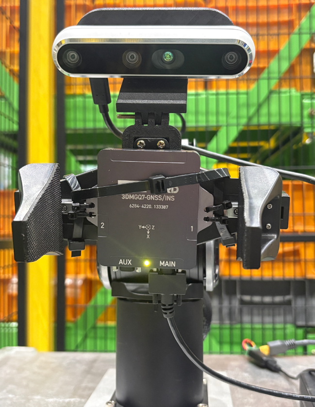
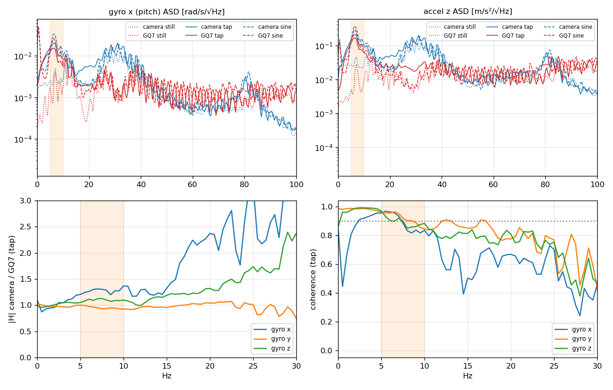
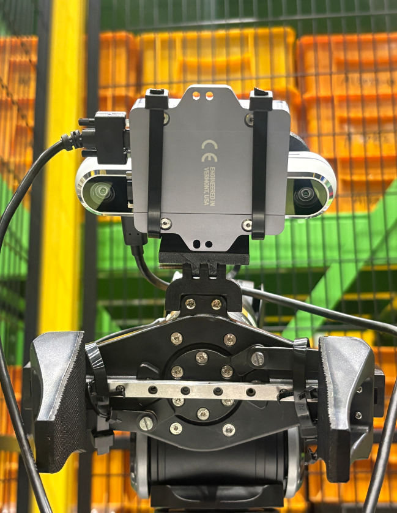

# FW191_B — 측정 체계 점검

펌웨어 S-V1.7-3 · piper_sdk 0.6.2 · 베이스: 거치대에 볼트 고정(11/16 다한)

## 0. 새 시작 조건 (9절 11/16)

2026-11-16 17:30 기준. 젯슨에 팔·손목 카메라·GQ7이 연결되지 않은 상태라 `[젯슨]` 항목은 아직 하지 못했다.

| 항목 | 상태 | 근거 |
|---|---|---|
| `[사람]` 팔·손목 카메라 복귀 | 완료(11/16 다한) | 9절 |
| `[사람]` 거치대 볼트 고정 | 완료(11/16 다한) | 9절 |
| `[사람+젯슨]` 재조립 뒤 기준값(자세 A·B 손 툭 5회씩) | 대기 — 팔·카메라 연결 뒤 | 기존 값은 FW191_A_LOG 0.3절 표(같은 도구) |
| `[사람]` 마이크로스트레인 모델명·연결 방식 | 3DM-GQ7, USB 직렬(코드 기준). 본체 라벨 형식 번호·개수는 다한 확인 필요 | FW191_A_LOG 판단 필요 1 |
| `[젯슨]` 버전 문자열, 피드백 200 Hz, 느린 이동 1회 | 대기 | |
| `[젯슨]` 20 °/s 등속 | 대기 — 판정 규칙은 FW191_A_LOG 판단 필요 2 | |

판단 필요: FW191_A_LOG "판단 필요" 1–6.

다음: 연결되면 위 대기 항목부터.

### 0-1. 2026-11-16 저녁 — 마이크로스트레인 모델 확인(본체 라벨 사진, 다한)

- 모델: **Parker LORD 3DM-GQ7-GNSS/INS, 형식 번호 6284-4220**. 연결은 MAIN 포트의 USB 케이블. 개수는 사진상 1개(다한 확인 대기).
- 라벨 축(라벨을 위로 두었을 때): X = 커넥터 쪽, Z = 본체 안쪽(아래), Y = 오른손 규칙. 11/12 정지 기록의 z = −9.79 m/s²와 맞는다(라벨 위로 두고 잼).
- 부착 제안(젯슨 의견, 9절대로 데스크톱 회신 대기):
  - 끝단(B-4): ~~카메라 브래킷·그리퍼 몸체의 평평한 면에 얇은 강력 양면테이프 + 케이블타이~~ **정정(11/16 다한): 그리퍼 몸통에는 붙일 자리가 없다. 10/29 0.3 kg 때처럼 벌린 손가락 사이 공간에 넣어 플랜지 쪽 끝까지 밀고 테이프로 고정, 손가락은 물지 않게(비접촉).** 고정 상태는 B-4 코히어런스(0.9 이상)로 확인. 방향은 자유(`imu_xcal.py`가 자이로로 축 회전을 찾음). 선은 센서 5 cm 안쪽에서 링크에 묶는다. 재조립 뒤 기준값(손 툭)은 GQ7을 붙이기 전에 잰다(끝단 질량이 늘어 모드가 내려갈 수 있음).
  - 베이스(E): 팔 베이스 볼트 옆, 라벨 위·커넥터 팔 뒤쪽, 날개 구멍 4개 볼트 고정. 이 방향이면 `vib_transmit.py --base-axes -x +y -z`(베이스 x = 센서 −X, y = +Y, z = −Z).
- GNSS 안테나는 쓰지 않는다(가속도·자이로 원시값만).

판단 필요: 위 부착 제안을 그대로 써도 되는지. B-1·B-2 스펙 표는 이 형식 번호로.

### 0-2. 2026-11-16 마감 — GQ7 끝단 부착 방법 확정(다한), 내일 순서

- GQ7은 1개다(다한 확인). 계획대로 끝단(B-4) → 베이스(E) 순서로 옮겨 쓴다.
- 끝단 부착(다한 결정, 0-1의 젯슨 제안을 대체): **손가락을 끝까지 벌리고 그 사이 가로대 위에 센서를 눕힌다.** 실물에서 들어가는 것을 다한이 확인했다. MAIN(USB) 커넥터는 아래쪽으로 두어 그리퍼와 간섭이 없게 한다. 테이프는 센서 위를 넘어 원통 본체 아래로 감고, 케이블은 커넥터 5 cm 안쪽에서 묶는다. 이 배치의 센서 중심은 플랜지에서 약 7 cm(URDF 모델 기준, 그림 `docs/img/gq7_gripper_mount.png`). 고정 상태는 B-4 코히어런스(0.9 이상)로 판정하고, 안 나오면 플랜지 옆 원통 본체에 감는 방법으로 바꾼다.
- 11/16에는 실기를 하지 않았다(팔·카메라·GQ7 미연결).

다음(11/17):
1. 팔·카메라 연결(GQ7은 아직 붙이지 않음) → 새 시작 조건: 버전 문자열, 피드백 200 Hz, 느린 이동 1회(dry-run 먼저), `ramp` 20 °/s × 10° 1회로 등속 확인.
2. 재조립 뒤 기준값: 자세 A·B 손 툭 5회씩 → FW191_A_LOG 0.3절 표와 나란히.
3. GQ7 부착(사진) → B-3(정지 60 s) → B-4(손 툭 10회 + 사인 1회, `imu_xcal.py`) → B-5 → B-6.
4. GQ7을 끝단에서 뗀 뒤 C-1(90시행). 끝단 질량이 달라지므로 C-1은 GQ7 없이 한다.

### 0-3. 2026-11-17 오전 — 연결 확인, 9절 회신 여부, 도구 수정 (실기 전)

펌웨어 S-V1.7-3(기록 기준, 실기 문자열은 CAN을 올린 뒤) · piper_sdk 0.6.2 · 팔은 아직 움직이지 않았다.

- 9절: 11/16 지시 뒤에 추가된 지시가 없다. FW191_A_LOG "판단 필요" 1–6에 대한 답도 없다 → 젯슨 제안대로 진행한다. 20 °/s가 안 나올 때의 처리(판단 필요 2)는 확인 시행 결과를 보고 다한이 정한다(11/17 다한).
- 연결(`lsusb`, `/dev`):

| 장치 | 상태 |
|---|---|
| 손목 카메라 D455 | 연결됨(8086:0b5c). `imu_rec.py` 5 s: 가속도 250 Hz, 자이로 400 Hz |
| GQ7 | 연결됨(`/dev/ttyACM0`, 일련번호 6284.133387). `gq7_rec.py` 5 s: 500.0 Hz, 간격 2.00 ms 일정, 체크섬 오류 0 |
| 팔(USB-CAN) | 어댑터 연결됨, `can_piper`는 DOWN — sudo가 필요해 다한이 올린다. 버전 문자열·피드백 200 Hz는 그 뒤 |

- 두 IMU를 동시에 5 s 기록했다(서로 방해 없음). 정지 표준편차: GQ7 자이로 0.0008–0.0010 rad/s, D455 자이로 0.0011–0.0022 rad/s(전 대역, 팔 전원 상태 미확인이라 B-3 값은 아니다).
- **GQ7이 이미 끝단에 붙어 있는 것으로 보인다.** 정지 가속도 평균이 (−9.57, 0.45, 2.11) m/s²로, 센서 X축(커넥터 쪽)이 아래를 향한다(연직에서 12.7°). 0-2의 부착 방법(커넥터 아래)과 맞고, 책상에 눕힌 값(z = −9.79)과 다르다. 0-2의 순서는 "기준값 손 툭은 GQ7을 붙이기 전"이었다 → 판단 필요.
- 도구 수정(이 커밋):
  - `vib_probe.py`, `vib_stop_report.py`의 `-h`가 도움말의 `%` 때문에 오류로 끝나던 것을 고쳤다(실행에는 영향 없었음).
  - `vib_stop_report.py`가 손 툭 기록(`--stage tap`, qref 고정)을 읽게 했다. 툭 시각은 2–20 Hz 자이로 크기가 가장 큰 시각, 창은 그 0.1 s 뒤부터(손이 닿아 있는 구간 제외). 나머지 정의는 FW191_A_LOG 0.4절과 같다. 10/23 계단 기록(143931)의 값은 수정 전과 같다(7.29 Hz, ζ 0.127 / 6.95 Hz, ζ 0.118).
  - 10/23 손 툭 기록(위아래·앞뒤로 친 9개, `--axis x`)을 이 방법으로 다시 내면 자세 A 6.4–7.1 Hz(4개, 1개는 4.8 Hz로 맞춤 실패), 자세 B 4.8–5.9 Hz, R² 0.63–0.94다. 손 툭은 계단보다 맞춤이 나쁘다(R² 0.8 미만이 5개). 그래서 기준값은 손 툭 5회에 더해 0.3절 표와 같은 가진인 J2 2° 계단을 자세마다 1회 같이 재려 한다.

판단 필요:
1. GQ7이 이미 붙어 있다. (가) 붙인 채로 순서를 바꾼다: 시작 조건 → B-3–B-6 → GQ7 뗌 → 20 °/s 확인·기준값 → C-1. (나) 지금 떼고 원래 순서. 젯슨 의견은 (가)다 — 부착을 한 번만 하고, 등속 확인과 기준값이 C-1과 같은 끝단 질량에서 나온다. 다한 회신 대기.

다음: CAN 올림 → 팔 준비(자세 A) → 버전 문자열·200 Hz → 느린 이동 1회.

### 0-4. 2026-11-17 — GQ7 끝단 부착 사진(다한)

- 벌린 손가락 사이, 그리퍼 앞면에 케이블타이 2줄로 고정(0-2의 테이프 대신). 라벨이 바깥, MAIN 커넥터가 아래. 일련번호 6284-4220.133387(`/dev/ttyACM0`과 일치).
- 라벨 축: X 아래(커넥터 쪽), Y 사진 왼쪽, Z 본체 안쪽(팔 쪽). 0-3의 정지 가속도(x −9.57 m/s²)와 맞는다.
- 사진에서 USB 케이블이 커넥터 아래로 묶이지 않고 늘어져 있다. 0-2는 커넥터 5 cm 안쪽에서 묶기로 했다 → 움직이기 전에 링크에 묶어 달라고 요청함.
- 0-3 판단 필요 1: 다한 회신 전이라 (가)(붙인 채로 B-3–B-6을 먼저)를 기본으로 명령을 준비했다.

### 0-5. 2026-11-17 16:06–16:51 — 새 시작 조건(앞부분, 실기)

펌웨어 S-V1.7-3 · piper_sdk 0.6.2 · 자세 A · GQ7 끝단 부착 상태(0-4) · 실행은 다한

| 항목 | 결과 | 기록 |
|---|---|---|
| 버전 문자열 | **S-V1.7-3**, piper_sdk 0.6.2 | 160629·164943 tap_dry |
| 피드백 | 관절 200 Hz, 고속 200 Hz. enable 6축 1, status (0, 1, 1) | 같은 기록 |
| 위치 모드 느린 이동(dry-run → `--go`) | 정상 종료, 위치 모드 유지. 6축 이탈 최대 0.085°(J5) | 165012 goto_start_slow |
| 두 IMU 동시 기록(`--imu --imu2`) | D455 가속도 1847개·자이로 3644개, GQ7 7003개(14.00 s, 500.0 Hz, 체크섬 오류 0) | 같은 기록 |
| 정지 기울기(끝 1.5 s) | 36.64° — 기존 무리 35.6–36.1°보다 0.5° 크다(GQ7이 붙은 상태) | 같은 기록 |

- 느린 이동은 팔이 이미 자세 A에 있어 실제 변화가 J6 0.1°뿐이었다. 명령 경로(Enable 유지, 위치 모드 송신, 정상 종료)는 확인됐지만 움직임 확인으로는 약하다. B-4 사인 운동(J2 ±5°, 0.25 Hz)의 이탈로 보충한다.
- 기록 루프 간격은 중앙 5.7 ms(약 178 Hz), 99% 10.1 ms다. 10/29 기록(중앙 5.5–5.8 ms)과 같아 GQ7 동시 기록 때문에 느려진 것은 아니다. CAN 피드백 자체는 200 Hz다.
- 20 °/s 등속 확인과 기준값(손 툭)은 GQ7을 뗀 뒤에 한다(0-3 판단 필요 1의 (가)).

다음: B-3(정지 60 s) → B-4(손 툭 10회, 사인 1회).

## 1. B-3–B-6 (2026-11-17 16:55–17:06)

펌웨어 S-V1.7-3 · piper_sdk 0.6.2 · 자세 A, 위치 모드 `--spd 10` · GQ7 끝단 부착(0-4) · 실행은 다한 · 분석 `tools/vib_b_report.py`, `tools/imu_xcal.py`

**요약.** 두 IMU는 동시에 빠짐없이 기록된다. 저주파(사인 0.25 Hz)에서는 두 센서가 엔코더와 4–7% 안에서 맞는다. 그러나 **끄덕임 축(카메라 x)에서 카메라 자이로가 GQ7보다 5–10 Hz에서 1.27배 크고, 이 비가 주파수와 치는 방향에 따라 달라진다**(상수 하나로 보정되지 않는다). 카메라에는 GQ7에 없는 25–37 Hz 성분이 있다. 카메라 장치 시각은 기록 시작 3.5 s 동안 45–65 ms 흔들려서 시각 맞춤 규칙을 고쳤다.

기록: `165529_tap_b3_still`(정지 60 s), `170359_tap_b4_tap10`(손 툭), `170518_slow_j2_b4_sine`(J2 ±5°, 0.25 Hz, 3주기). 모두 정상 종료, GQ7 체크섬 오류 0. 정지 기울기 36.56 / 36.72 / 36.70°.

### 1.1 B-3 정지 잡음 바닥 (61.8 s, 카메라 축 x / y / z, GQ7은 카메라 축으로 돌린 값)

| | 5–10 Hz rms | 2–20 Hz rms | 30–50 Hz rms |
|---|---|---|---|
| 카메라 자이로 [rad/s] | 0.0065 / 0.0036 / 0.0022 | 0.0152 / 0.0071 / 0.0072 | 0.0256 / 0.0053 / 0.0123 |
| GQ7 자이로 [rad/s] | 0.0048 / 0.0033 / 0.0012 | 0.0111 / 0.0067 / 0.0049 | 0.0107 / 0.0042 / 0.0025 |
| 카메라 가속도 [m/s²] | 0.029 / 0.062 / 0.063 | 0.078 / 0.118 / 0.150 | 0.120 / 0.323 / 0.258 |
| GQ7 가속도 [m/s²] | 0.021 / 0.035 / 0.028 | 0.059 / 0.143 / 0.067 | 0.058 / 0.160 / 0.069 |

- 정착 시간용 포락선 바닥(2–20 Hz, x축 중앙값): 카메라 0.0151, GQ7 0.0120 rad/s → `vib_stop_report.py --floor 0.0151`.
- 이 바닥은 센서 잡음이 아니라 전원이 들어간 팔의 실제 떨림이다. GQ7을 책상에 둔 11/12 값(자이로 5–10 Hz 0.0002–0.0016 rad/s)의 3–20배이고, 두 센서가 x·y에서 비슷한 값을 낸다.
- 정지 후 진동 신호(10/23 계단, 5–10 Hz 자이로 x 0.04–0.08 rad/s)는 이 바닥의 6–12배다.

### 1.2 B-4 맞대조 (자이로, 카메라 / GQ7, [진폭 비, 위상°, 코히어런스])

손 툭은 10회 중 8회가 검출됐다(문턱: 최대의 25%). 앞 6회가 위→아래, 뒤가 옆이다.

| 기록 | 축 | 2–5 Hz | 5–10 Hz | 10–20 Hz |
|---|---|---|---|---|
| 손 툭 위→아래 | x(끄덕임) | 1.13, +2, 0.94 | **1.29, +8, 0.94** | 1.44, +18, 0.74 |
| | y | 0.97, +8, 0.98 | 0.97, +15, 0.93 | 0.96, +16, 0.87 |
| | z | 1.06, +2, 0.94 | 1.08, +13, 0.87 | 1.08, +19, 0.77 |
| 손 툭 옆 | x | 1.09, −4, 0.93 | 1.09, −4, 0.91 | 1.22, −1, 0.89 |
| | y | 0.98, −1, 1.00 | 1.00, −5, 1.00 | 1.01, −7, 0.98 |
| | z | 1.04, −1, 1.00 | 1.12, −4, 0.99 | 1.32, −7, 0.97 |
| 사인 | x | 1.21, +5, 0.88 | 1.26, +8, 0.93 | 1.12, +23, 0.76 |
| | y | 0.97, +2, 0.90 | 0.94, +5, 0.91 | 0.89, +12, 0.80 |
| | z | 1.16, +2, 0.72 | 1.32, +9, 0.89 | 1.17, +16, 0.69 |

- 5–10 Hz 코히어런스는 0.87–1.00이다. x·y는 0.9 이상(0-2의 고정 판정 기준 통과), z는 위→아래 툭에서 0.87이다.
- 툭마다 x축 5–10 Hz rms 비(툭 0.1–1.2 s 뒤): 위→아래 1.20 / 1.26 / 1.22 / 1.25 / 1.29 / 1.34, 옆 1.10 / 1.07.
- 저주파 기준: 사인 0.25 Hz에서 엔코더 J2 속도 대비 진폭 비가 GQ7 0.956, 카메라 0.934다. 두 센서의 자이로 배율 자체는 2% 차이로 맞는다.
- 따라서 x축의 1.1–1.4배는 센서 배율이 아니라 **카메라와 GQ7 자리 사이의 상대 회전**이다(같은 강체면 각속도가 같아야 한다). 카메라 브래킷이 휘는 것인지 GQ7 고정(케이블타이, 손가락 가로대)이 덜 따라오는 것인지는 이 측정으로 가릴 수 없다.
- 축 회전(GQ7 → 카메라): 카메라 x = GQ7 y, 카메라 y·z는 GQ7 x·z를 25.7° 돌린 값. 기울기로 보는 카메라 장착각과 방향이 맞다.
- 예전 Z축 위상 지연(19–53°)에 해당하는 것: 자이로 z의 위상 차는 20 Hz까지 19° 이하다. 가속도는 두 센서 위치가 달라 맞대조하지 않았다.

### 1.3 B-5 시각 맞춤

| 짝 | 지연 | 근거 |
|---|---|---|
| 카메라 − GQ7 | +1.5 / −2.3 / −4.6 ms (정지 / 손 툭 / 사인) | 2–20 Hz 자이로 크기 상호상관, 상관 0.82 / 0.96 / 0.93 |
| GQ7 − 엔코더 | +0.8 ms | 사인, J2 속도와 자이로 x, 3 Hz 저역, 상관 0.997 |
| 카메라 − 엔코더 | −0.7 ms | 같은 방법, 상관 0.995 |

- **카메라 장치 시각은 기록 시작 0.6–3.5 s 사이에 45–65 ms 흔들린다**(수신 − 장치 시각이 그만큼 작게 나오는 표본이 700여 개). 기존 규칙(전체 표본의 1 백분위)은 이 구간에 끌려가, 고치기 전에는 카메라 − GQ7 지연이 기록에 따라 −2 / −43 / −59 ms로 나왔다.
- 수정: `vib_stop_report.py`(`load_imu`)와 `imu_xcal.py`가 기록 시작 4 s 뒤 표본만으로 시각을 맞춘다. 수정 뒤 위 표의 값이다. 시작 구간 뒤에도 5 s 구간 중앙값이 ±5 ms쯤 움직이므로 카메라 시각의 불확도는 ±5 ms로 본다. `--imu-lag`는 0으로 둔다.
- 10/23 계단 기록을 수정 뒤 도구로 다시 내면 주파수·감쇠비는 그대로이고(143931: 7.28 Hz·0.131 / 6.97 Hz·0.117, 145755: 6.30 Hz·0.042 / 6.22 Hz·0.046) 첫 봉우리 시각만 5 ms 달라진다. FW191_A_LOG 0.3절 표는 그대로 쓴다.
- GQ7은 장치 시각 간격이 2.00 ms로 일정하고, 수신 시각 오프셋의 아래쪽 끝이 네 기록 모두 같다(−24.7 ms). 시작 구간 문제가 없다.

### 1.4 B-6 0–100 Hz 스펙트럼

- 위 왼쪽(자이로 x): 5–10 Hz 봉우리(약 7 Hz)는 두 센서에 같이 있다. **25–37 Hz에는 카메라에만 큰 성분이 있다**(카메라 약 1 × 10⁻² rad/s/√Hz, GQ7 약 2 × 10⁻³). 정지·손 툭·사인 모두에서 같다. 80 Hz 근처의 작은 봉우리는 두 센서에 같이 있다.
- 그래서 "분석 대역 밖에 성분이 없다"는 그림은 되지 않는다. 카메라 자이로 x는 정지 중 30–50 Hz rms(0.0256)가 5–10 Hz rms(0.0065)의 4배다. 5–10 Hz 대역 지표는 대역통과 뒤 값이라 영향이 없지만, 첫 봉우리는 20 Hz 저역이 필요하다(지금 정의 그대로).
- VIB_E1의 "정지 중 30–50 Hz 서보 떨림"은 카메라 가속도로 본 값이다. GQ7에서는 같은 대역이 2–4배 작으므로, 그 값의 상당 부분이 팔 전체가 아니라 카메라 쪽 국부 떨림일 수 있다.

### 판단 필요

1. **카메라 IMU 보정.** 끄덕임 축 비가 2–5 Hz 1.13, 5–10 Hz 1.26–1.29, 10–20 Hz 1.44이고 옆으로 치면 1.09다. 상수 하나로 보정하면 가진 방향에 따라 ±10% 틀린다. 젯슨 제안: 보정하지 않고 "카메라 자리의 각속도"라고 측정점을 명시해 쓴다(C-1은 조건 간 상대 비교라 영향이 없다). E의 전달률 절댓값에는 "끝단 = 카메라 자리, 그리퍼 몸통 기준으로는 5–10 Hz에서 약 0.78배"를 주석으로 단다.
2. **1.1–1.4배의 원인**(카메라 브래킷 대 GQ7 고정). 가르려면 GQ7을 카메라 브래킷에 직접 붙여 한 번 더 재야 한다. KROS 전에 할지.
3. **25–37 Hz 카메라 국부 성분.** 기존 "30–50 Hz 서보 떨림" 서술(VIB_E1, 발표 자료)을 고칠지. GQ7 기준 값은 1.1절 표에 있다.
4. 0-3 판단 필요 1(순서)은 (가)로 진행했다. FW191_A_LOG 판단 필요 1–6은 그대로 열려 있다.

다음: GQ7을 끝단에서 뗌 → `ramp` 20 °/s × 10° 등속 확인 → 자세 A·B 기준값(손 툭 5회 + J2 2° 계단 1회) → C-1.

### 1.5 2026-11-17 저녁 — 박사님 의견(다한 전달)과 GQ7 필터 설정

- **방향(박사님):** AMR은 12월을 넘겨야 온다. 이동시키기 전에 고정 베이스(STATIC)에서 우리 제어 알고리즘이 진동을 잡는지 먼저 검증하고, 그 뒤에 이동형 베이스로 간다. → E(거치대·AMR)보다 C-1 → D(8절)가 먼저다. 9절 11/16 순서 3번("KROS에는 B, C-1, E")과 달라지므로 데스크톱 확인 필요.
- **좌표계(박사님):** 손목 카메라 IMU와 GQ7의 좌표계를 맞춰야 하고, GQ7은 필터링이 많아 변환만으로는 값이 같아지지 않는다는 의견.
  - 좌표계는 1.2절에서 자이로로 구한 회전 행렬로 맞춘 뒤 비교했다(옆 툭 y축 비 1.00, 코히어런스 1.00).
  - 기록하는 값은 센서 데이터 묶음(0x80)의 스케일 가속도·자이로다. 항법 필터(EKF, 0x82) 출력이 아니다(`gq7_rec.py` 18–19행).
  - 저역통과 필터 설정을 장치에서 읽었다(명령 0x0C/0x54, 읽기만): 가속도·자이로 모두 켜짐, 자동 모드(수동 주파수 미지정). 자동 모드의 차단 주파수 값은 문서로 확인하지 못했다. 데이터로는 y축 비가 20 Hz까지 0.96–1.01, 두 센서 시각 차 5 ms 이내라 2–20 Hz에서 필터 영향은 보이지 않는다.
  - 확인 방법: GQ7을 카메라 브래킷에 축을 나란히 붙여 손 툭을 한 번 더 잰다. 비가 1.0 근처면 1.27배는 브래킷과 그리퍼 사이의 실제 차이, 그대로면 센서·필터 쪽이다(판단 필요 2와 같은 측정).

판단 필요:
5. 고정 베이스 우선에 따른 KROS(11/26) 범위와 순서: C-1 → D-1로 가고 E는 미루는 것으로 젯슨은 이해했다. D-1에는 `mit_probe`의 등속 후 정지 궤적(미구현)과 MIT 순간 튐 정리(9절)가 먼저 필요하다.

### 1.6 2026-11-17 19:50 — GQ7을 카메라에 축을 맞춰 붙이고 다시 잰 맞대조 (박사님 지적 확인)

펌웨어 S-V1.7-3 · piper_sdk 0.6.2 · 자세 A · 기록 `195009_tap_b4_tap10_cam`(손 툭 10회 모두 검출, 정상 종료, 체크섬 오류 0)

- 부착(다한): GQ7 라벨 면을 카메라 앞면에 대고 케이블타이 2줄. 바닥이 앞, 커넥터가 카메라 오른쪽 → GQ7 X·Y·Z = 카메라 x·y·z. 정지 중력: GQ7 (0.89, −7.34, −6.44), 카메라 (0.84, −6.91, −6.98) m/s², 축 차이 약 4°. 자이로로 구한 회전각은 10.9°(주로 x축 둘레 6°).

| 자이로, 카메라 / GQ7 [비, 위상°, 코히어런스] | 2–5 Hz | 5–10 Hz | 10–20 Hz |
|---|---|---|---|
| x(끄덕임) — 그리퍼 부착(1.2절) | 1.13, +2, 0.94 | 1.27, +7, 0.93 | 1.34, +12, 0.74 |
| x — **카메라 부착** | 0.97, +4, 0.99 | **0.96, +6, 0.98** | 0.91, +17, 0.87 |
| y — 카메라 부착 | 1.02, +5, 0.99 | 0.99, +11, 0.98 | 0.92, +19, 0.91 |
| z — 카메라 부착 | 0.92, +6, 0.97 | 0.97, +9, 0.92 | 0.90, +19, 0.83 |
| 가속도 x / y / z — 카메라 부착(5–10 Hz) | | 0.98 / 0.89 / 1.01, 위상 +18–22°, 코히어런스 0.93–0.97 | |

- 툭마다 x축 5–10 Hz rms 비: 0.96 0.98 0.97 0.97 0.97 0.98 0.90 1.00 1.00 0.94(그리퍼 부착 때는 1.07–1.34).
- **같은 자리에 붙이면 두 센서의 자이로는 5–10 Hz에서 1–4% 안, 10–20 Hz에서 10% 안으로 같다.** GQ7 필터나 좌표계 변환 때문에 값이 달라지는 것이 아니다. 1.2절의 1.27배는 카메라 자리와 그리퍼 가로대 자리 사이의 실제 움직임 차이다(판단 필요 2 해결).
- 지연: 카메라 − GQ7 = −3.8 ms(상관 0.99). 자이로 위상이 주파수에 비례해 늘어나는 것(15 Hz에서 +17–19°, 약 3 ms)과 맞다. 카메라 시각 불확도(±5 ms) 안이라 GQ7 필터 지연인지 카메라 시각인지는 가릴 수 없다. 가속도는 약 8 ms(5–10 Hz +22°, 10–20 Hz +44°)로 자이로보다 크다.
- **카메라에만 있던 25–37 Hz 성분이 사라졌다.** 30–50 Hz 자이로 x rms: 그리퍼 부착 때 카메라 0.0331 / GQ7 0.0106 → 카메라 부착 때 0.0042 / 0.0049 rad/s. GQ7(약 80 g)을 카메라에 얹자 없어졌으므로 이 성분은 카메라 브래킷의 국부 공진으로 본다(판단 필요 3의 근거).
- 정지 기울기 33.48°(그리퍼 부착 때 36.6–36.7°). 카메라에 질량이 얹힌 상태의 값이라 기존 무리와 비교하지 않는다.
- 팔 전원을 끈 상태의 센서 잡음(8 s, 전 대역 표준편차): 가속도 카메라 0.010–0.011 / GQ7 0.003–0.004 m/s², 자이로 카메라 0.0010–0.0015 / GQ7 0.0008–0.0011 rad/s.

결론(판단 필요 1 갱신): 카메라 IMU는 카메라 자리의 움직임을 GQ7과 같게 잰다. 보정 계수는 필요 없다. 다만 카메라 자리는 그리퍼 몸통보다 끄덕임이 5–10 Hz에서 1.27배 크고 25–37 Hz 국부 공진이 있으므로, 측정점을 "카메라 자리"로 명시한다.

다음: GQ7을 뗌 → `ramp` 20 °/s 확인 → 기준값 → C-1.
