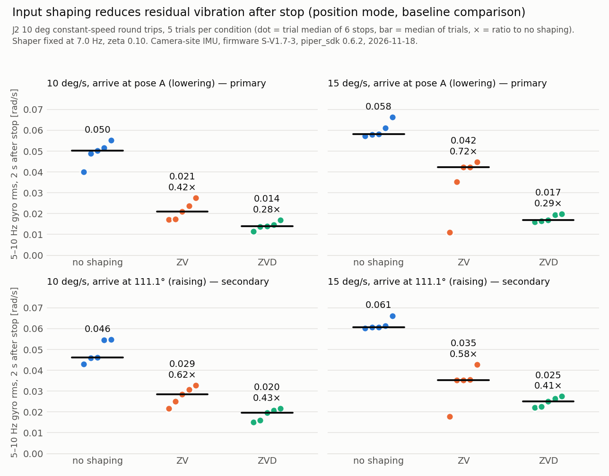
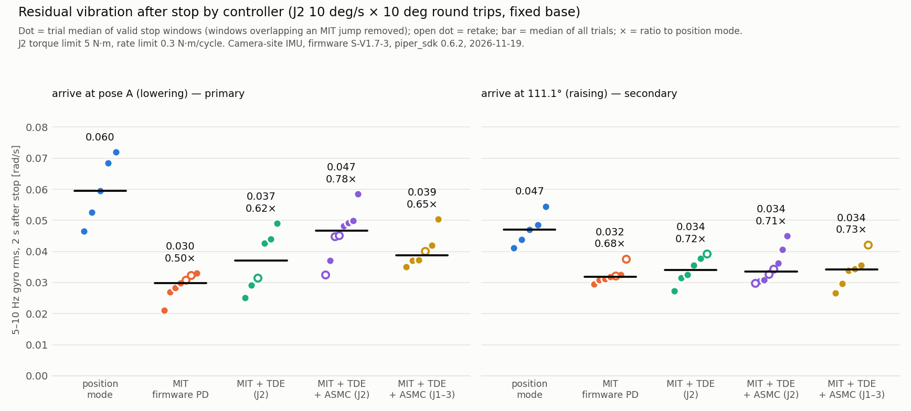
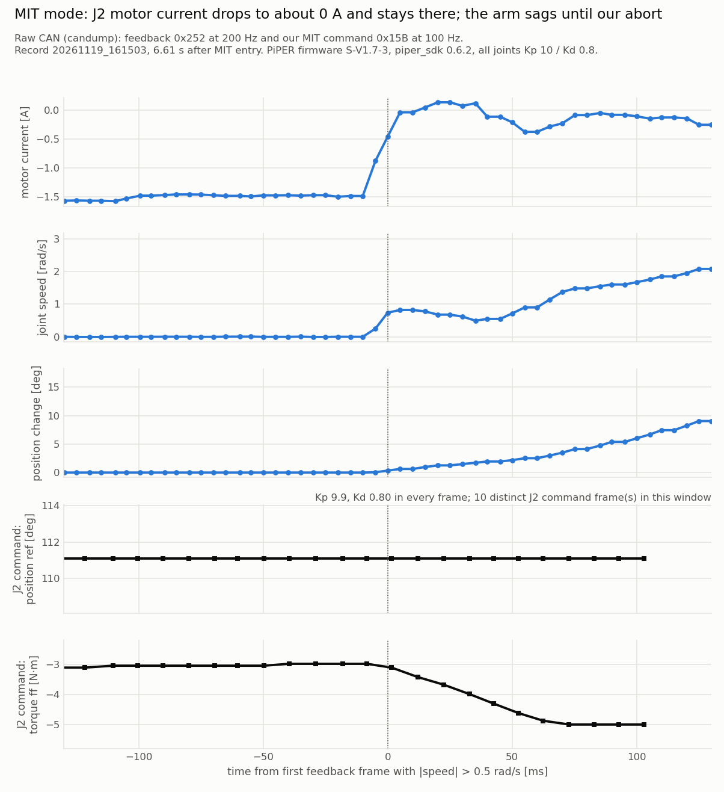

# FW191_D — 계층별 비교 준비와 실험

펌웨어 S-V1.7-3 · piper_sdk 0.6.2 · 고정 베이스 · 문제 정의는 [FW191_SUMMARY_1117.md](FW191_SUMMARY_1117.md) 1절

## 0. 준비: 추종층을 J1–3에 동시에 (2026-11-17 21:20, 실기 없음)

**요약.** 다한 결정(11/17): J2에만 들어가 있던 추종층을 J1–3으로 먼저 넓힌다. `mit_probe.py`가 추종층(TDC/TDE + ASMC16, `joint_ctrl.py`)을 한 번에 한 관절에만 걸 수 있던 것을 여러 관절에 동시에 걸 수 있게 고쳤고, 가짜 팔로 확인했다. 실기는 아직 하지 않았다.

### 0.1 지금까지의 상태(기록 대조)

| 관절 | 추종층 실기 이력 | 근거 |
|---|---|---|
| J2 | 하이브리드(펌웨어 PD 유지 + TDE 보정) M̄ 0.01, ASMC16 ε 0.08 — D3 ②·④-off에서 사용 | HANDOFF_VIB_JETSON 327행 |
| J1 | 하이브리드 단독, 사인 ±5° 0.25 Hz·±10° 0.5 Hz, M̄ 0.01(10/20). 추종 오차 rms 0.056°(고정 PD 최선 0.128°) | MIT_E5_LOG 6절 |
| J3 | 순수 토크 TDC만 해 봄(10/20, 정지마찰 헌팅 ±0.3–0.4°). **하이브리드는 해 본 적 없다** | MIT_E4_LOG 31–33행, MIT_E5_LOG 7절 "다음" |
| J1+J2+J3 동시 | 없음. 11/01–02의 3축 시나리오는 J2만 추종층, J1·J3는 펌웨어 PD | HANDOFF_VIB_JETSON 348행 |

### 0.2 고친 것

- `mit_probe.py --tdc-joints 1 2 3`: 적은 관절마다 `JointCtrl`을 하나씩 만들어 같은 주기에 계산한다. `--joint`는 그 안에 들어 있어야 하고(처프·τ_vib 경로와 `.tdc.csv` 기록은 `--joint`), 나머지 관절의 기록은 `.tdc1.csv`·`.tdc3.csv`.
- `--mbars`: `--tdc-joints` 순서대로 관절별 M̄(없으면 모두 `--mbar`). 나머지 게인(Ks, Kg, ASMC16 φ·α·ε, K̂ 상한)은 공통.
- 제한: `--hybrid` 필수, J1–J3만. 순수 토크 TDC는 J1·J3에서 헌팅했고(MIT_E4) 손목은 토크 한 칸이 유지 토크 수준이라 뺐다.
- 기준 가속도를 관절별로 넘긴다(사인·계획 구간에서 움직이는 관절마다). 한 관절일 때의 계산은 그대로다.
- 감쇠층(τ_vib)은 넓히지 않았다. 끄덕임 평면 기준 설계라 J1에는 그대로 못 쓴다(9절 11/16).

### 0.3 가짜 팔 확인 (`--fake --fake-friction`, 3축 사인 ±5° 0.25 Hz 2주기, 모델이 아니고 도구 확인용)

| 실행 | 추종 오차 rms J1 / J2 / J3 [°] | 최대 [°] |
|---|---|---|
| 고치기 전 코드, 추종층 J2만 | 0.732 / 0.076 / 0.737 | 1.34 / 0.53 / 1.34 |
| 고친 코드, 추종층 J2만 | 0.727 / 0.074 / 0.732 | 1.32 / 0.47 / 1.32 |
| 고친 코드, `--tdc-joints 1 2 3` | **0.065 / 0.075 / 0.071** | 0.21 / 0.54 / 0.27 |

- 한 관절일 때 결과가 고치기 전과 같다(가짜 팔이 실시간으로 돌아 값이 조금씩 다르다).
- 세 관절 동시: 정상 종료, 순간 튐 0회, 관절별 기록 3개 생성, K̂ 최대 0.8–1.8.
- 인자 검사(하이브리드 없음, J4 포함, `--mbars` 개수 불일치)는 실행 전에 막힌다.

### 0.4 실기 순서(제안, 아직 안 함)

모두 자세 A, MIT라 시행이 끝나면 비상 정지로 팔이 내려앉는다(받침 필요, 시행마다 복구). 각 단계는 dry-run 먼저.

1. J3 단독 하이브리드 정지 5 s — 처음 하는 조합
2. J3 단독 사인 ±5° 0.25 Hz 3주기
3. J1+J2+J3 동시 정지 5 s — 처음 하는 조합
4. J1+J2+J3 동시 3축 사인 ±5° 0.25 Hz 6주기
5. 같은 3축 사인을 추종층 J2만으로(기존 ④-off 명령) — 4번과 짝 비교

판정: 이탈·속도 한계에 걸리지 않고 끝나는지, 관절별 추종 오차 rms, 순간 튐 횟수, 5–10 Hz IMU rms(4번 대 5번).

### 판단 필요

1. J1·J3의 M̄. J1은 0.01(10/20 하이브리드 실기), J3는 하이브리드 실기 값이 없어 0.01로 시작하려 한다(순수 토크 때의 잠정값).
2. MIT 순간 튐. 세 관절에 TDE가 걸리면 한 관절의 튐에 다른 관절의 보정이 같이 반응할 수 있다. 기존 기록의 튐 정리(9절 11/16)를 실기 전에 할지, 3번 결과를 보고 할지.
3. D-1의 "등속 후 정지" 궤적은 `mit_probe`에 아직 없다. 위 1–5번은 기존 사인 궤적으로 확장이 동작하는지만 본다.

다음: 다한 실기(위 1–5번) → `mit_probe` 등속 후 정지 궤적.

## 1. 추종층 J1–3 확장 실기 (2026-11-17 21:37–)

자세 A · MIT 100 Hz · 하이브리드(펌웨어 PD Kp 10·Kd 0.8 유지) + TDE M̄ 0.01 + ASMC16(ε 0.08) · `--dev-limit 6 --speed-consec 10` · 실행은 다한 · 시행 뒤 비상 정지 → 복구

### 1.1 J3 단독, 정지 5 s (`213749_hold`) — 통과

| 항목 | 값 |
|---|---|
| 결과 | 정상 종료(5.0 s), 루프 멈춤 0회 |
| J3(추종층) 이탈 | rms 0.028°, 최대 0.107°(아래 튐 순간). 튐을 빼면 최대 0.051° |
| J3 보낸 토크 | 진입 −1.04 → 1 s 안에 −1.56 N·m로 수렴(이탈 +0.036° → 0.000°) |
| ASMC16 | K̂ 최대 0.41, 스위칭 토크 최대 0.002 N·m — 거의 안 켜짐 |
| 헌팅 | 없음(10/20 순수 토크 TDC는 ±0.3–0.4°) |
| 추종층 없는 관절(펌웨어 PD만) | J2 이탈 0.71–0.78°(일정한 처짐), J4 0.17°, J6 0.49° |
| 순간 튐 | 1회 — 3.88 s에 **J5**가 −2.38 rad/s, 이탈 최대 2.22°, 0.25 s에 복귀(기존 MIT 순간 튐과 같은 모양) |
| 튐 때 J3 | 이탈 0.107° → 0.15 s 뒤 0.047°, 0.3 s 뒤 0에 가깝게 복귀. 튐 뒤 J2가 0.07° 더 처져(0.71 → 0.78°) J3 토크가 −1.55 → −1.31 N·m로 다시 맞춰짐 |
| 정지 기울기 | 정지 확인 34.34°, MIT 시작 34.94°, 끝 34.90° |

- J3 하이브리드는 정지에서 헌팅 없이 동작한다. 손목 튐이 와도 J3 추종층이 발산하지 않는다.

### 1.2 J3 단독, 사인 ±5° 0.25 Hz 3주기 (`214257_sine`) — 완주, 순간 튐 4건

| 항목 | 값 |
|---|---|
| 결과 | 정상 종료(16.0 s), 루프 멈춤 0회 |
| J3(추종층) 이탈, 운동 구간 | rms 0.130°, 최대 1.657°(튐). 튐 창(−0.1–+0.5 s)을 빼면 rms 0.078°, 최대 0.28°(구간의 79%) |
| ASMC16 | K̂ 평균 0.10, 튐 때 최대 10.7(스위칭 토크 최대 0.10 N·m) |
| J3 보낸 토크 | −4.00–−0.65 N·m — 튐 직후 1주기씩 명령 상한(4 N·m)에 닿음 |
| 추종층 없는 관절 | J2 이탈 rms 0.72°(최대 0.93°), J4 0.11°, J6 0.23° |
| 정지 기울기 | 정지 확인 34.69°, MIT 시작 35.40°, 끝 35.52° |

순간 튐(|q̇ − q̇_ref| > 0.5 rad/s)은 도구 집계로 7회, 사건으로는 4건이다.

| 시각 | 관절 | 내용 |
|---|---|---|
| 4.67 s | **J3** → J5 | J3가 한 주기(10 ms)에 0° 쪽으로 +1.66°(2.3 rad/s). 직전 5주기의 J3 보낸 토크는 −1.54–−1.69 N·m로 매끄러웠다. 다음 주기부터 추종층이 −2.9, −4.0(상한) N·m로 되밀어 0.1 s 뒤 이탈 0.1°. J5는 10 ms 뒤 −1.3 rad/s로 튀고 0.05 s에 복귀 |
| 7.29 s | J5 | −2.58 rad/s, 이탈 최대 4.53°, 0.1 s 뒤 복귀 시작. J3 이탈은 0.23° 이내 |
| 11.42 s | J2 | −0.68 rad/s 한 주기 |
| 12.80 s | **J3** → J5 | effort가 먼저 +2.51 N·m로 뛰고(직전 −0.94) 다음 주기에 J3 +1.12°(3.0 rad/s). 추종층이 −3.7, −4.0 N·m로 되밀어 0.07 s 뒤 0.14°. J5는 20 ms 뒤 −2.2 rad/s |

- J3 튐 2건은 모두 사인의 아래쪽 끝 근처(J3 기준각 −77.6°, −78.0°)에서 났고, 방향은 0° 쪽이다. 우리 명령이 변하기 전에 모터 전류·위치가 먼저 뛴다. MIT_E3의 "0° 쪽 순간 튐(팔 내부)"과 같은 모양이다.
- 하이브리드는 펌웨어 PD를 켜 두므로 J3도 이 튐을 받는다. 추종층은 발산하지 않고 0.1 s 안에 되돌리지만, 그 과정에서 토크 명령이 상한에 닿는다.
- 튐을 뺀 추종 오차 0.078°는 J1 하이브리드의 10/20 값(0.056°)과 같은 수준이다.

판단 필요:

4. 16 s에 튐 4건(정지 5 s에서는 1건)이다. 세 관절 동시(0.4절 3번) 전에 기존 기록의 튐 정리를 먼저 한다는 9절 11/17 지시에 동의한다. 이번 두 기록을 그 정리에 넣겠다.
5. 튐 직후 추종층 토크가 상한에 닿는 것을 줄일지(예: 한 주기 이탈이 문턱을 넘으면 그 주기의 TDE 갱신을 건너뜀). 세 관절이면 한 관절의 튐에 세 관절이 같이 크게 반응할 수 있다. 구현은 회신 뒤에 한다.

### 1.3 J3 단독 사인 반복 (`214857_sine`) — 큰 튐 없음

1.2와 같은 명령을 한 번 더 했다(J3 튐이 −78° 근처에서 다시 나는지).

| | 1.2 (`214257`) | 1.3 (`214857`) |
|---|---|---|
| 결과 | 정상 종료 16.0 s | 정상 종료 16.0 s |
| J3 이탈 rms, 운동 구간(튐 창 제외) | 0.130° (0.077°) | 0.085° (0.073°) |
| J3 이탈 최대 | 1.66° | 0.30° |
| J3 보낸 토크 | −4.00–−0.65 N·m | −1.81–−0.63 N·m |
| K̂ 최대 | 10.7 | 1.7 |
| \|q̇ − q̇_ref\| > 0.5 rad/s 사건 | 4건(J3 위치 튐 2, J5 위치 튐 1, J2 속도만 1) | 7건 — 모두 위치 변화 0.3° 이하(J2·J3 속도 표본만 튐) |
| J2(펌웨어 PD만) 이탈 rms | 0.72° | 0.86° |
| 정지 기울기(정지 확인 / MIT 시작 / 끝) | 34.69 / 35.40 / 35.52° | 34.99 / 35.71 / 35.89° |

- J3가 −78° 근처를 지나간 것은 두 기록 합쳐 6번이고, 그중 위치 튐은 1.2의 2번뿐이다. 같은 각도에서 매번 나는 것은 아니다.
- 튐이 없을 때 J3 추종 오차는 두 기록에서 같다(0.073–0.077°). 토크도 상한에 닿지 않는다.
- 1.3의 7건은 엔코더 속도 값만 한두 표본 튄 것이고 위치는 0.3° 안이다. 사건 집계는 위치 튐과 속도 표본 튐을 나눠야 한다(2절 튐 정리에서 구분).

### 1.4 J1 단독, 사인 ±5° 0.25 Hz 3주기 (`215422_sine`) — 통과

오늘 설정(하이브리드 M̄ 0.01 + ASMC16 ε 0.08, 자세 A)으로 J1을 한 번 확인했다. 10/20의 J1 하이브리드는 MIT_E5_LOG 6절.

| 항목 | 값 |
|---|---|
| 결과 | 정상 종료(16.0 s), 루프 멈춤 0회 |
| J1(추종층) 이탈, 운동 구간 | rms 0.079°, 최대 0.34°. 튐 창을 빼면 rms 0.065°, 최대 0.26°(구간의 85%) |
| J1 보낸 토크 | −0.45–+1.23 N·m |
| ASMC16 | K̂ 평균 0.03, 최대 2.2(스위칭 토크 최대 0.022 N·m) |
| 추종층 없는 관절 | J2 이탈 rms 0.78°, J3 0.29°, J5 0.32°, J6 0.18° |
| 사건 | 3건 — 2.85 s J5 위치 튐(이탈 2.87°), 6.05 s·6.64 s는 J1 속도 표본만 튐(이탈 0.24°, 0.34°) |
| 정지 기울기 | 정지 확인 36.24°, MIT 시작 37.06°, 끝 36.72° |

- 관절별 단독 추종 오차(튐 창 제외): J1 0.065°, J3 0.073–0.077°. J2는 기존 D3 값.
- 추종층이 없는 J3는 같은 시행에서 0.29° 이탈한 채로 있다(1.2·1.3에서 추종층을 건 J3는 0.07–0.08°).
- 정지 기울기가 36.2°로, 저녁 내내 34.3–35.0°였던 것에서 1.3° 올랐다(복구 뒤의 처짐 상태가 달라짐).

### 1.5 정정 — 1.2–1.4절의 사건 집계 (2절 도구로 다시 셈)

1.2–1.4절에서 "속도 표본만 튄 것"이라고 적은 사건은 틀렸다. 기준 속도를 qref의 한두 표본 차분으로 구해 생긴 거짓 사건이 섞였고, 추종층 없는 J2의 위치 튐을 일정한 처짐(0.7–0.9°)에 가려 놓쳤다. `tools/mit_jump_report.py`(±4표본 차분, 이탈 변화 기준)로 다시 센 값이 맞다.

| 기록 | 1.2–1.4절에 적은 것 | 다시 센 것 |
|---|---|---|
| 1.1 `213749_hold` | J5 위치 튐 1건 | 같음(J5 2.13°) |
| 1.2 `214257_sine` | J3 위치 튐 2, J5 위치 튐 1, J2 속도만 1 | 4건 모두 위치 튐: J3 1.67°·1.12°, J5 4.32°, **J2 0.96°** |
| 1.3 `214857_sine` | 7건, 모두 속도 표본만 | **2건, 모두 J2 위치 튐**(0.74°, 0.66°, 0° 쪽). J3는 튐 없음 |
| 1.4 `215422_sine` | J5 위치 튐 1, J1 속도만 2 | 2건: J5 2.84°, **J1 0.33°**(6.64 s, 추종층 관절) |

- 속도만 튀고 위치가 안 움직인 사건은 오늘 기록에 없다. 122개 기록 전체에서도 0건이다(2.1절).
- 1.3절의 결론 가운데 "J3가 −78° 근처에서 매번 튀는 것은 아니다"와 추종 오차 값은 그대로다.


## 2. MIT 순간 튐 정리 (기존 기록, 2026-11-17)

펌웨어 S-V1.7-3 · piper_sdk 0.6.2 · 실기 없음(기존 기록만 읽음) · 도구 `tools/mit_jump_report.py` · 사건 표 `docs/data/mit_jumps.csv` · 그림 `docs/img/p_fw191_d_jumps.png`

**요약.** `logs/mit`의 실기 기록 122개(10/06–11/17, MIT 누적 3071 s = 51.2분)를 한 가지 기준으로 다시 셌다. 조용한 상태에서 한 번에 끝난 튐이 395건, 평균 7.8 s에 1건(7.7건/분)이다. 30 s 넘는 기록 18개 가운데 튐이 없는 것은 없다. J2·J3·J5·J6가 비슷한 빈도(1.7–2.3건/분)로 튀고 0° 근처에 있는 J1·J4는 거의 튀지 않는다. 방향은 95%가 0° 쪽이다. 엔코더만 튀는 것이 아니라 끝단이 실제로 맞는다(카메라 자이로 변화 중앙 3.4 rad/s, 정지 후 진동 첫 봉우리의 약 10배). 우리 토크(추종층)는 튐의 빈도와 크기를 바꾸지 않지만 튐 직후 토크 명령이 1.9 N·m(중앙)만큼 흔들린다. 위치 모드(C-1 90시행, 733 s)에서는 같은 검출로 0건이다. 2 s 정지 창 하나에 튐이 들어갈 확률은 23%라, D-1의 MIT 묶음에는 창 제외 규칙이 반드시 필요하다.

### 2.1 검출과 분류

- 대상: `logs/mit/*.csv` 중 파일명에 fake·dry가 없는 122개의 mit 구간. 날짜별 10/06 4개, 10/20 35개, 10/23 5개, 10/26 26개, 10/27 14개, 10/29 34개, 11/17 4개(`213749_hold`, `214257_sine`, `214857_sine`, `215422_sine`).
- 사건: |q̇ − q̇_ref| > 0.5 rad/s인 표본을 0.3 s 안이면 하나로 묶는다. q̇_ref는 qref의 ±4표본 차분이다(한 표본 차분은 기록 시각과 기준 계산 시각이 어긋나 60 °/s까지 튀어 거짓 사건을 만든다).
- 유형: **튐(jump)** = 직전 0.12 s가 조용하고(|q̇ − q̇_ref| < 0.25 rad/s) 0.2 s 안에 끝난 위치 튐. **그 밖(osc)** = 연속 튐, 헌팅, 발산. 처음 튄 관절 = 사건 첫 표본에서 가장 크게 넘은 관절.
- 502건 = 튐 395 + 그 밖 107. 속도만 튄(이탈 변화 0.1° 미만) 사건은 0건이다.
- 그 밖 107건 중 41건은 10/20의 순수 토크 TDC·SMC 실험이다(J1 25건, 우리 토크 관절 30건, 중단으로 끝난 기록 안 18건 — MIT_E4·E5의 헌팅·발산). 나머지 66건 가운데 47건은 0° 쪽 + effort 이상을 갖춘 튐 모양이다(직전에 작은 움직임이 있었거나 0.2 s 넘게 이어진 연속 튐). 이것까지 넣으면 8.6건/분이다. 아래 수치는 395건 기준이다.
- 펌웨어 PD 유무는 `.candump`의 첫 MIT 프레임(0x15A–0x15F)에서 Kp·Kd를 읽었다(Kp 10 → 9.9로 읽힘). 중단 여부는 기록에 종료 사유가 없어 추정이다(mit 끝 0.15 s의 이탈·속도·모드).

### 2.2 빈도

| 묶음 | 기록 수 | MIT [s] | 튐 | 건/분 |
|---|---|---|---|---|
| 전체 | 122 | 3071 | 395 | 7.72 |
| 10/06 | 4 | 8 | 3 | 21.6 |
| 10/20 | 35 | 315 | 39 | 7.42 |
| 10/23 | 5 | 106 | 7 | 3.96 |
| 10/26 | 26 | 559 | 73 | 7.83 |
| 10/27 | 14 | 608 | 76 | 7.50 |
| 10/29 | 34 | 1421 | 191 | 8.07 |
| 11/17 | 4 | 53 | 6 | 6.80 |
| hold | 60 | 1178 | 142 | 7.23 |
| sine | 56 | 1162 | 186 | 9.60 |
| plan | 6 | 731 | 67 | 5.50 |
| 기준이 움직이는 중 | | 1137 | 175 | 9.23 |
| 기준이 정지 중 | | 1933 | 220 | 6.83 |
| J2 하이브리드 사인·계획(a′, D3와 같은 구성) | 38 | 1627 | 220 | 8.11 |

- 10/26 이후 7.5–8.1건/분으로 날짜에 따른 변화가 없다. 늘지도 줄지도 않았다.
- 튐이 한 번도 없는 기록은 21개이고 모두 짧다(MIT 중앙 10.0 s, 최장 24.0 s). 30 s 이상 기록 18개는 전부 튐이 있다. 기록별 15 s당 튐 수의 사분위는 0 / 1.1 / 2.0 / 2.7 / 4.7이다.
- 움직이는 중이 정지 중의 1.35배다. 관절별로 보면 J2(하이브리드) 정지 1.40 → 운동 2.46건/분, J3(펌웨어 PD만) 정지 1.70 → 운동 2.26건/분.
- 튐 사이 간격(같은 기록 안, n 294): 중앙 4.37 s, 평균 6.12 s, 변동계수 0.97. 칸별 개수 29 / 26 / 22 / 35 / 45 / 83 / 54(0.3–0.8 / 0.8–1.4 / 1.4–2 / 2–3 / 3–5 / 5–10 / 10 s 이상)는 지수 분포 기대 24 / 26 / 24 / 35 / 54 / 76 / 56과 같다. 무작위로 일어나는 사건의 모양이다.
- MIT 진입 뒤 시각에 따른 변화도 없다(진입 2 s 안 32건, 기대 31건). 진입 0.5 s 안은 12건(3.0%, 노출 비율 2.0%)으로 조금 많다. 종료 0.5 s 전 15건 중 10건은 중단으로 끝난 기록의 마지막 사건이다(튐이 중단을 만든 경우).

### 2.3 관절별 크기와 방향 (처음 튄 관절 기준)

| 관절 | 자세 A 각 | 튐(건/분) | 이탈 변화 중앙 / 90% / 최대 [°] | 최고 속도 중앙 / 최대 [rad/s] | 0° 쪽 | 복귀 중앙 [s] | 카메라 자이로 변화 중앙 [rad/s] (n) | 따라 튄 관절 |
|---|---|---|---|---|---|---|---|---|
| J1 | −0.3° | 6 (0.12) | 0.53 / 1.03 / 1.13 | 0.74 / 1.71 | 4 / 6 | 0.12 | 0.49 (2) | — |
| J2 | 121.1° | 87 (1.70) | 0.94 / 1.22 / 1.73 | 1.77 / 2.11 | 76 / 87 | 0.23 | 1.39 (81) | J5 57건 |
| J3 | −73.2° | 95 (1.86) | 1.41 / 1.69 / 2.50 | 2.72 / 3.10 | 93 / 95 | 0.23 | 5.20 (88) | J5 87건 |
| J4 | 1.6° | 2 (0.04) | 0.31 / 0.35 / 0.36 | 0.53 / 0.54 | — | 0.07 | — | — |
| J5 | 52.0° | 116 (2.27) | 2.47 / 3.14 / 6.83 | 2.55 / 5.41 | 112 / 116 | 0.32 | 3.94 (101) | J3 8건 |
| J6 | 13.7° | 89 (1.74) | 1.10 / 1.35 / 2.45 | 1.96 / 2.28 | 89 / 89 | 0.25 | 3.36 (81) | J5 1건 |

- 0° 쪽 비율: 판정 가능한 394건 중 374건(95%)이다. J1·J4는 0° 근처라 대부분 판정하지 않았다.
- **0° 근처 관절은 튀지 않는다.** J1은 정지 중(펌웨어 PD만) 2423 s 동안 0건이고, J1이 ±5–10°로 움직일 때만 2건(336 s)이다. J4는 3011 s에 2건(0.31°)이다.
- **끝단이 실제로 움직인다.** `.imu.csv`가 있는 353건에서 사건 창(−0.06–+0.2 s)의 카메라 자이로 변화가 중앙 3.43 rad/s(사분위 1.58–4.40)다. C-1의 정지 후 첫 봉우리(0.15–0.5 rad/s)의 약 10배다. 오늘 J3 튐 2건은 6.3·6.5 rad/s였다.
- 튐 뒤 5–10 Hz 울림(처프·τ_vib 없는 정지 기록 19건, 자이로 x 포락선): 봉우리 중앙 0.43 rad/s(직전 바닥의 16배), 바닥 2배 아래로 가라앉는 시간 중앙 0.41 s, 90% 1.23 s. J6 튐은 끄덕임 모드를 거의 흔들지 않는다(봉우리 0.019 rad/s, 5건).
- 전체 이탈 변화(관절 최대): 중앙 1.30°, 90% 2.64°, 3° 초과 15건, 6° 초과 1건(J5 6.83°). 기본 이탈 한계 3°에서는 15건이 중단을 만든다.
- effort: 처음 튄 관절의 effort 이상이 속도보다 한 표본 이상 먼저 92건, 같은 표본 265건, 뒤 26건, 없음 12건이다.

### 2.4 우리 토크와의 관계

| 관절 | 펌웨어 PD만 | 하이브리드(PD + 우리 토크) | 우리 토크만(펌웨어 Kp 0) |
|---|---|---|---|
| J1 | 2 / 2759 s = 0.04건/분 | 1 / 92 s | 3 / 179 s = 1.01 |
| J2 | 12 / 493 s = 1.46 | 75 / 2516 s = 1.79 | 0 / 21 s |
| J3 | 90 / 2944 s = 1.83 | 2 / 37 s | 1 / 49 s |
| J5 | 103 / 2939 s = 2.10 | 8 / 72 s | 4 / 19 s |
| J6 | 87 / 3011 s = 1.73 | — | 0 / 19 s |

- J2는 정지 중만 비교하면 펌웨어 PD만 1.46(12 / 493 s), 하이브리드 1.40(37 / 1590 s)건/분으로 같다. 튐 크기도 같다(이탈 변화 중앙 0.95° 대 0.94°, 카메라 자이로 1.38 대 1.39 rad/s). **추종층은 튐을 만들지도 줄이지도 않는다.**
- 우리 토크가 걸린 관절의 튐 96건 중 75건은 직전 50 ms의 토크 명령 변화폭이 0.13 N·m(두 칸) 미만이다(중앙 0.077 N·m). 명령이 변하지 않았는데 튄다.
- 펌웨어 Kp 0인 관절에서도 8건이 있다(J1 3, J3 1, J5 4, 노출 합 306 s). 펌웨어 PD를 꺼도 남는다.
- **튐 직후 추종층의 반응:** J2 하이브리드 75건에서 튐 뒤 0.15 s 안의 토크 명령 변화가 중앙 1.89 N·m, 90% 2.49, 최대 3.58 N·m이고 명령 상한(4 N·m)에 닿은 것이 1건이다. 오늘 J3 하이브리드는 2건 모두 상한에 닿았다(변화 2.4 N·m). 같은 기록들에서 튐이 없는 구간의 주기당 토크 변화는 중앙 0.015, 99.9% 0.098, 최대 0.183 N·m다(26413주기). 튐 반응은 주기당 1 N·m를 넘는다.
- 복귀 시간은 J2 펌웨어 PD만 0.15 s(12건), 하이브리드 0.24 s(75건)다. 추종층이 복귀를 빠르게 하지는 않는다.

### 2.5 관절각·속도 의존 (그 관절이 사인으로 움직이는 중)

| | −11–−4° | −4–−2° | −2–0° | 0–2° | 2–4° | 4–11° |
|---|---|---|---|---|---|---|
| J2 (기준각 − 유지각) 건/분 | 2.6 | 2.3 | 1.4 | 2.0 | 4.5 | 1.6 |
| J3 | 3.3 | 3.4 | 2.4 | 2.0 | 1.4 | 1.5 |

| \|기준 속도\| | 0.3–2 °/s | 2–4 | 4–6 | 6–8 | 8–30 |
|---|---|---|---|---|---|
| J2 건/분 | 3.1 | 1.7 | 2.5 | 2.3 | 4.2 |
| J3 | 1.7 | 2.5 | 3.2 | 1.7 | 4.4 |

- 칸마다 3–14건이라 차이를 말하기 어렵다. J3는 0° 쪽에서 먼 각(더 접힌 쪽, −78° 근처)에서 조금 많지만(3.3–3.4 대 1.4–1.5건/분) 칸당 3–8건이다. 오늘 J3 튐 2건이 −77.6°·−78.0°에서 난 것을 특정 각에 몰린다고 볼 근거는 없다.
- 속도가 빠른 칸(8 °/s 이상, 0.5 Hz 사인)이 4.2–4.4건/분으로 가장 높지만 각 4건이다.

### 2.6 기존 문서와 대조

| 기존 서술 | 이번 집계 | 판정 |
|---|---|---|
| HANDOFF_VIB_JETSON 259행 "0° 쪽, 15 s에 0–3회, J2·J3·J5·J6" | 15 s당 사분위 0 / 1.1 / 2.0 / 2.7, 최대 4.7. 관절·방향 일치 | 맞다 |
| MIT_E3 "우리 명령은 안 바뀌고 모터 전류만 뛴다, 펌웨어 Kp·Kd 0이어도 남는다" | 96건 중 75건이 직전 명령 변화 두 칸 미만. effort가 먼저거나 같은 표본 357건. Kp 0 관절 8건 | 맞다 |
| MIT_E3 3절 "약 1.1 s 간격" | 문턱 0.3 rad/s로 `20261020_140839_hold`의 7건(0.21–6.71 s)이 그대로 다시 나온다. 그러나 1.1 s 안팎 간격이 3번 이상 이어진 기록은 122개 중 이 하나뿐이고, 전체 간격 분포는 지수 분포다 | 그 기록에서만 맞다. 일반적인 주기는 아니다 |
| VIB_PLAN_1105 444·455행 "q가 한 주기 0° 쪽으로 점프, 자이로 무반응(엔코더만 튐)" | 자이로 변화 중앙 3.4 rad/s, 속도만 튄 사건 0건 | **다르다.** 끝단이 실제로 움직인다 |
| VIB_E4 312행 "순간 튐은 실제 토크 충격" | 위와 같음 | 맞다 |
| VIB_E4 670·779·892행 "튐 제외 비율 5–64%" | 8.1건/분 × ±0.5 s = 평균 14% | 맞다 |
| FW191_PLAN 4절 A-5 "0이면 창 제외 규칙을 지운다" | 30 s 이상 기록에서 0인 적이 없다 | 규칙을 유지한다 |
| `vib_d3_report.py`의 제외 문턱 0.7 rad/s | 튐 395건 중 27건이 0.7 미만 | 문턱을 0.5로 낮춰야 빠지지 않는다 |

### 2.7 D-1에 주는 영향

- 2 s 정지 창 하나에 튐이 1건 이상 들어갈 확률: 7.72건/분이면 23%, a′ 구성(8.11건/분)이면 24%. 왕복 6회 = 정지 창 12개면 그중 약 3개가 튐을 포함한다.
- 튐 하나가 만드는 5–10 Hz 울림(포락선 봉우리 중앙 0.43 rad/s)이 C-1의 정지 후 rms(0.03–0.10 rad/s)보다 크다. 제외하지 않으면 MIT 묶음의 지표는 제어기가 아니라 튐이 정한다.
- 위치 모드에는 튐이 없다(C-1 90시행 733 s, 움직이지 않는 관절의 |q̇| 최대 0.39 rad/s, 0.5 초과 0표본). 그래서 ① 대 MIT 계층 비교에서 튐은 MIT 쪽에만 불리하게 들어간다.

### 2.8 완화 방법 후보 (구현하지 않음)

1. **분석 창 제외(필수).** 튐 시각 −0.1 s부터 +1.2 s까지를 5–10 Hz 지표에서 뺀다. 근거: 가라앉는 시간 중앙 0.41 s, 90% 1.23 s(2.3절). 지금 규칙(±0.5 s, 문턱 0.7 rad/s)은 울림의 절반쯤만 덮고 27건(7%)을 놓친다. 정지 창 단위로는 "튐이 든 창은 버리고 남은 창의 중앙값"으로 하고 버린 창 수를 적는다. 검출은 `mit_jump_report.py`의 `events()`를 그대로 쓴다.
2. **튐 주기에 TDE 갱신 건너뛰기.** 한 주기 |Δq̇|가 문턱(0.5 rad/s)을 넘으면 그 주기와 다음 몇 주기는 q̈ 추정을 직전 값으로 둔다. 근거: 튐 한 번의 속도 변화 2–3 rad/s가 10 ms에 들어오면 M̄·q̈ = 0.01 × 200–300 = 2–3 N·m로, 관측된 명령 변화(중앙 1.89, 오늘 J3 2.4 N·m, 상한 닿음)와 같은 크기다. 정상 구간의 주기당 변화는 0.1 N·m 미만이다. 세 관절 동시에서는 J3 → J5(87 / 95건), J2 → J5(57 / 87건)처럼 따라 튀므로 한 사건에 두 관절이 같이 반응한다. 걸리는 점: 손 툭 같은 실제 외란에도 반응이 늦어진다(`vib_damp`의 엔코더 튐 거부와 같은 문제).
3. **토크 변화율 제한.** 추종층 출력의 주기당 변화를 0.3 N·m쯤으로 묶는다. 근거: 정상 추종의 주기당 변화 최대 0.183 N·m(99.9% 0.098)라 정상 동작은 건드리지 않고, 튐 반응(주기당 1 N·m 이상)만 깎는다. 2번보다 단순하고 외란 종류를 가리지 않는다.
4. **이탈 한계.** MIT 시행은 `--dev-limit 6 --speed-consec 10`을 유지한다. 근거: 3° 초과 15건, 6° 초과 1건.
5. **자세로 피하기.** 0° 근처 관절(J1, J4)은 튀지 않으므로 J5·J6를 0°에 가깝게 두면 손목 튐(전체의 52%)이 줄 수 있다. 그러나 자세 A를 바꾸면 고유 진동수와 기존 값과의 비교가 깨지고, 한 관절 안에서 각도에 따른 크기 변화는 확인하지 못했다(2.5절). 지금은 쓰지 않는다.
6. 특정 관절각이나 속도를 피하는 것은 근거가 없다(2.5절).

### 판단 필요

6. 창 제외 규칙을 −0.1–+1.2 s, 문턱 0.5 rad/s로 바꿀지. 기존 D3 값(−37%·−43%)은 ±0.5 s·0.7 rad/s 규칙으로 낸 값이라 새 규칙으로 다시 내면 달라질 수 있다.
7. 세 관절 동시(0.4절 3번) 전에 2번(TDE 갱신 건너뛰기)이나 3번(변화율 제한)을 넣을지. 젯슨 의견은 3번을 먼저 넣는 것이다(정상 구간 최대 0.183 N·m와 튐 반응 1 N·m 이상 사이에 여유가 크다). 넣지 않고 가면 한 번의 J3 → J5 튐에 세 관절의 TDE가 같이 반응하고, 오늘 J3처럼 상한에 닿는다.
8. MIT 묶음의 시행 길이. 튐이 7.8 s에 1건이라 왕복 6회(약 50 s) 시행에는 평균 6–7건이 든다. 정지 창 12개 중 약 3개를 버리게 되므로 조건당 5회로 충분한지.
9. "엔코더만 튐"이라는 표현(VIB_PLAN_1105 444·455행, `vib_tap_report.py`·`vib_damp.py`의 이름)을 고칠지. 끝단이 실제로 맞는 충격이다.

확인하지 못한 것: 튐의 원인(팔 내부라는 MIT_E3의 결론을 넘는 것은 없다), 관절각이 0°에서 멀수록 커지는지(한 관절 안에서의 범위가 ±5–10°뿐), 10/06·10/20 기록의 `--dev-limit`·`--speed-consec` 설정(기록에 인자가 없어 중단은 추정), 손 툭 시행의 툭과 튐의 구분(effort 이상과 0° 쪽 방향으로만 갈랐다 — 튐 395건 중 effort 이상이 없는 것은 12건).

## 3. 위치 모드 입력 성형 옵션과 왕복 동작 (2026-11-17, 실기 없음)

**요약.** 9절 11/17 회신 4번·6번 (가)·7번 ①대로 `vib_probe.py --stage ramp`에 입력 성형(`--shape zv|zvd`)을 넣고, `vib_trials.py`가 성형과 왕복을 조건으로 다루게 했다. 왕복 6회(`--round --reps 6`)는 원래 코드로 되는 것을 확인했다(한 기록에 hold 6 + bhold 6). 가짜 팔에서 정지 창 5–10 Hz rms가 성형 없음 0.011 → ZV 0.0010 → ZVD 0.0005 rad/s로 줄었다. 가짜 팔은 1차 지연 + 1자유도 모드라 성형이 이론대로 듣는 것이 당연하고, 도구가 맞게 도는지만 본 것이다. 실기에서 펌웨어 서보가 성형한 명령 모양을 그대로 내는지는 모른다.

### 3.1 고친 것

| 파일 | 내용 |
|---|---|
| `tools/vib_probe.py` | `--shape none\|zv\|zvd`, `--shape-f`(기본 7.0 Hz), `--shape-zeta`(기본 0.10). 등속 구간(`ramp`)과 왕복의 돌아가는 구간(`back`)의 기준 궤적을 임펄스열과 합성한다. 예비 동작(`pre`)과 마지막 복귀(`post`)는 그대로 |
| | `ramp` → `hold`(명령 정지) 전환은 성형된 기준이 멈춘 시각이다. 등속 구간이 성형기 길이만큼 길어진다 |
| | 실행할 때 임펄스 값, 늘어나는 시간, 구간별 명령 속도를 출력하고 `.meta.json`의 `shape`에 종류·f·ζ·임펄스·늘어난 시간을 남긴다. 파일 이름에 `_zv`·`_zvd`, 왕복이면 `_r6`이 붙는다(성형 없음·편도는 이름이 그대로) |
| `tools/vib_trials.py` | `make --shapes none zv zvd [--shape-f --shape-zeta] --round [--round-reps 6]`. 목록에 `shape`, `shape_f`, `shape_zeta`, `round_reps` 열이 생기고 `run`이 `vib_probe`에 넘긴다. `--round`는 `--dirs +` 또는 `-`를 요구한다 |
| | 성형·왕복을 쓰지 않는 목록은 열과 조건 이름이 그대로다. `trials_c1.csv`는 그대로 읽히고, 같은 인자로 다시 만들면 조건 순서가 같다 |

- 성형기 식: K = exp(−ζπ / √(1 − ζ²)), 임펄스 간격 = 감쇠 주기의 절반. ZV는 [1, K] / (1 + K), ZVD는 [1, 2K, K²] / (1 + K)².
- 7.0 Hz·ζ 0.10에서 계산값: ZV 0.5783 / 0.4217 @ 0 / 71.8 ms, ZVD 0.3344 / 0.4877 / 0.1778 @ 0 / 71.8 / 143.6 ms. 9절 11/17의 값(0.578 / 0.422 @ 0 / 0.072 s, 0.334 / 0.488 / 0.178 @ 0 / 0.072 / 0.144 s)과 같다. 기본값으로 실행하면 "9절 11/17 값과 같음"이 출력된다.
- 성형 없음일 때 기준 궤적(구간 이름, 각도, 속도)은 고치기 전 코드와 한 표본도 다르지 않다(편도 1회·3회, 왕복 6회, 15 °/s × 2.5°를 1.3 ms 간격으로 비교, 차 0).
- 안전 한계(거리 15°, 속도 20 °/s, 이탈 3°, |q̇ − q̇_ref| 0.5 rad/s)는 건드리지 않았다. 성형한 명령 속도는 등속 값을 넘지 않는다(임펄스가 모두 양수이고 합이 1).

### 3.2 가짜 팔 확인 (`--fake`, 가짜 팔은 목표를 1차 지연 50 ms로 따르고 합성 IMU는 7.0 Hz·ζ 0.05 모드를 관절 가속으로 흔든다. 모델이 아니고 도구 확인용)

정지 창 5–10 Hz 자이로 rms [rad/s], `vib_stop_report.py --all`(엔코더 정지 정의 (나)).

| 조건 | 성형 없음 | ZV | ZVD |
|---|---|---|---|
| 편도 10 °/s × 10°, 성형기 7.0 Hz·ζ 0.10 (2회) | 0.0111 (0.0110–0.0112) | 0.0010 (0.0008–0.0012) | 0.0005 (0.0005–0.0005) |
| 편도 15 °/s × 10°, 같은 성형기 (1회) | 0.0216 | 0.0020 | 0.0023 |
| 편도 10 °/s × 10°, 성형기 6.2 Hz (1회) | | 0.0012 | 0.0008 |
| 편도 10 °/s × 10°, 성형기 7.5 Hz (1회) | | 0.0015 | 0.0008 |
| 편도 10 °/s × 10°, 성형기 ζ 0.05 (1회) | | 0.0012 | 0.0026 |
| 왕복 6회 10 °/s × 10°, hold 6개 중앙(범위) | 0.0111 (0.0109–0.0114) | 0.0009 (0.0006–0.0010) | 0.0006 (0.0003–0.0008) |
| 왕복 6회, bhold 6개 중앙(범위) | 0.0109 (0.0106–0.0114) | 0.0010 (0.0006–0.0012) | 0.0005 (0.0004–0.0006) |

- 왕복 기록 하나에 정지 12개(hold 6, bhold 6)가 phase로 나뉘고 `vib_stop_report.py --all`이 12개를 모두 낸다. 구간은 lead → pre → wait → (ramp → hold → back → bhold) × 6 → post, 10 °/s × 10°에서 59.3 s(ZV 60.1 s, ZVD 61.0 s).
- 성형한 값 0.0005–0.0026은 합성 IMU 잡음(5–10 Hz에서 약 0.0003–0.0005)에 가깝고 1회씩이라, 성형기 주파수가 틀렸을 때의 ZV 대 ZVD 차이는 이 표로는 가려지지 않는다. 그래서 잡음 없는 계산을 따로 했다(아래).
- 엔코더 정지 지연(명령 정지 뒤): 성형 없음 145 ms, ZV 115 ms, ZVD 88 ms. 명령은 72·144 ms 길어지지만 끝이 완만해져 엔코더 정지는 그만큼 늦어지지 않는다(가짜 팔 기준).
- `vib_trials.py`로 성형·왕복 목록의 dry-run과 가짜 팔 2시행을 돌렸다. 목록에 결과·기록 파일이 적히고 이어 하기가 된다.

성형기가 틀렸을 때(잡음 없는 계산, 성형기는 7.0 Hz·ζ 0.10 고정, 1차 지연 50 ms + 모드 ζ 0.10, 성형 없음 대비 정지 창 rms 비. 실기 모델이 아니다):

| 실제 모드 | ZV | ZVD |
|---|---|---|
| 6.2 Hz | 0.15 | 0.03 |
| 6.6 Hz | 0.07 | 0.01 |
| 7.0 Hz | 0.02 | 0.01 |
| 7.5 Hz | 0.08 | 0.01 |

10 °/s와 15 °/s에서 같은 값이다. C-1에서 고유 진동수가 진폭에 따라 6.2–7.5 Hz로 움직였으므로, 이 계산대로라면 ZV는 최악에 15%가 남고 ZVD는 3% 이하다. ZVD를 같이 재라는 9절 지시의 근거와 맞는다.

### 3.3 실기에서 미리 알 수 없는 것

- **펌웨어 서보가 성형한 명령을 그대로 내는지.** C-1에서 명령 궤적으로 한 예측은 상관 0.39였고, 실제 엔코더 속도는 등속 구간에서도 ±2–3 °/s 오르내렸다. 서보가 0.072 s 간격의 두 계단을 그대로 따르지 않으면 상쇄가 깨진다. 확인 방법: 성형한 편도 1회에서 엔코더 속도가 두 계단(ZV) 모양으로 나오는지 본다.
- **명령 속도 계단과 속도 상한.** 성형한 명령은 등속 값을 넘지 않는다. 10 °/s ZV는 5.8 → 10.0 → 4.2 °/s, ZVD는 3.3 → 8.2 → 10.0 → 6.7 → 1.8 °/s, 15 °/s ZV는 8.7 → 15.0 → 6.3 °/s, ZVD는 5.0 → 12.3 → 15.0 → 10.0 → 2.7 °/s다. `--spd 10`의 상한(약 17 °/s) 아래이고, 한 번에 바뀌는 속도는 성형 없음(10·15 °/s)보다 작다(최대 5.8·8.7 °/s). 이탈은 성형 없음과 같거나 작을 것으로 본다(15 °/s 실측 0.77°, 한계 3°).
- **임펄스 시각의 정밀도.** 기준은 실제 시각으로 계산하지만 `JointCtrl` 송신이 약 11 ms 간격(기록 루프 5.6 ms의 두 번에 한 번)이라 계단 시각이 최대 11 ms 어긋난다. 7 Hz에서 28°에 해당한다.
- **서보 지연이 성형기 간격과 비슷하다.** 추종 지연 43 ms(15 °/s)와 명령 정지 뒤 155–230 ms의 자체 감속이 임펄스 간격 72 ms와 같은 크기다. 지연이 일정하면 성형에 영향이 없지만, 속도에 따라 달라지면(20 °/s에서 본 포화) 달라진다.
- **성형기 값.** 7.0 Hz·ζ 0.10은 C-1 90시행의 중앙값(6.99 Hz, ζ 0.103)과 같다. 올림·내림 정지에서 모드가 다르면(왕복의 반대쪽 정지는 자세가 10° 다르다) 한 성형기로 양쪽을 다 맞추지 못할 수 있다.

### 3.4 실기 순서 제안 (아직 안 함, 모두 위치 모드라 팔이 내려앉지 않는다)

자세 A에서 시작. 왕복은 `--dist +10`(= `--dirs +`)을 제안한다: 자세 A(121.1°)와 111.1° 사이를 오가고 **자세 A보다 아래로 내려가지 않는다.** 내림이 자세 A에 도착(hold), 올림이 111.1°에 도착(bhold)한다.

1. 성형한 편도 1회씩(서보가 계단을 따르는지 확인). dry-run 먼저.

```bash
python3 tools/vib_probe.py --stage ramp --joint 2 --speed 10 --dist 10 --shape zv --expect -0.3 121.1 -73.2 1.6 52.0 13.7 --expect-tol 1.0 --imu --note chk_zv
python3 tools/vib_probe.py --stage ramp --joint 2 --speed 10 --dist 10 --shape zv --expect -0.3 121.1 -73.2 1.6 52.0 13.7 --expect-tol 1.0 --imu --note chk_zv --go
python3 tools/vib_probe.py --stage ramp --joint 2 --speed 10 --dist 10 --shape zvd --expect -0.3 121.1 -73.2 1.6 52.0 13.7 --expect-tol 1.0 --imu --note chk_zvd --go
```

2. 왕복 6회 1시행(성형 없음, 실기에서 왕복은 처음. 약 65 s).

```bash
python3 tools/vib_probe.py --stage ramp --joint 2 --speed 10 --dist 10 --round --reps 6 --expect -0.3 121.1 -73.2 1.6 52.0 13.7 --expect-tol 1.0 --imu --note chk_round
python3 tools/vib_probe.py --stage ramp --joint 2 --speed 10 --dist 10 --round --reps 6 --expect -0.3 121.1 -73.2 1.6 52.0 13.7 --expect-tol 1.0 --imu --note chk_round --go
```

3. (가) 묶음 주 조건: 10 °/s × 10°, ① / ① + ZV / ① + ZVD, 5블록 = 15시행(약 17분).

```bash
python3 tools/vib_trials.py make docs/data/trials_d1a_v10.csv --joint 2 --speeds 10 --dists 10 --dirs + --shapes none zv zvd --round --round-reps 6 --reps 5
python3 tools/vib_trials.py run docs/data/trials_d1a_v10.csv --imu --n 3
python3 tools/vib_trials.py run docs/data/trials_d1a_v10.csv --imu --go
```

4. (가) 묶음 보조 조건: 15 °/s × 10°, 같은 구성 15시행(약 16분).

```bash
python3 tools/vib_trials.py make docs/data/trials_d1a_v15.csv --joint 2 --speeds 15 --dists 10 --dirs + --shapes none zv zvd --round --round-reps 6 --reps 5
python3 tools/vib_trials.py run docs/data/trials_d1a_v15.csv --imu --n 3
python3 tools/vib_trials.py run docs/data/trials_d1a_v15.csv --imu --go
```

분석: `python3 tools/vib_stop_report.py logs/vib/<기록들> --all --out docs/data/d1a_stops.csv` 뒤 시행별로 hold 6개·bhold 6개의 중앙값을 내고(통계 단위는 시행 5개), ① 대비 비를 올림·내림 따로 판정한다.

### 판단 필요

10. 왕복의 방향. 위 제안(`--dirs +`)은 내림이 자세 A에서 멈추고 올림은 111.1°에서 멈춘다. 8절의 "올림 → 3 s → 내림"과는 첫 동작만 다르다(내림이 먼저). `--dirs -`로 하면 올림이 자세 A에서 멈추지만 내림이 131.1°(11/17에 천천히 내려 간격만 확인한 자세)에 10–15 °/s로 도착한다. 어느 쪽이든 올림과 내림 중 하나는 자세 A가 아닌 곳에서 멈춘다. C-1 값과 나란히 놓을 수 있는 것은 자세 A에 도착하는 쪽뿐이다.
11. 성형기 값을 7.0 Hz·ζ 0.10 하나로 둘지(9절 그대로). 반대쪽 정지(111.1° 또는 131.1°)의 모드 주파수는 재 본 적이 없다. 2번(왕복 1시행)의 bhold에서 나온 주파수를 보고 정하려 한다.
12. `vib_stop_report.py`에 필요한 것(이번 작업에서 고치지 않음): 지표 표에 `shape` 열(`.meta.json`의 `shape.kind`)과 왕복 회차 열, bhold 행의 방향 표기(지금은 hold와 같은 `dist_deg`가 적힌다), 시행별 중앙값을 내는 집계, "명령 정지부터 정착까지" 열(= 엔코더 정지 지연 + 정착 시간).

### 2.9 추가(11/17 밤, 다한 질문) — 추종층을 안 건 J5가 왜 튀는가, J5의 튐이 J2·J3에 잡힌 것은 아닌가

**요약.** 튐은 추종층이 아니라 MIT 모드에서 생기므로 펌웨어 PD만 쓰는 J5도 튄다. J2·J3의 튐은 J5의 영향이 아니라 그 관절 자신의 튐이다. 영향은 반대로 J3 → J5로 간다.

**1) J5는 펌웨어가 제어하는데 왜 튀는가**

- MIT 시행에서는 6축 전체가 MIT 모드로 들어간다. 추종층은 고른 관절의 τ_ff에 보정을 더할 뿐이고, 나머지 관절도 MIT 프레임(기준 위치, Kp 10, Kd 0.8, τ_ff)으로 펌웨어 PD가 돈다. "펌웨어가 제어한다"는 것은 위치 모드가 아니라 MIT 모드의 펌웨어 PD다.
- 튐이 MIT 모드에서 나온다는 근거:

| 근거 | 값 | 출처 |
|---|---|---|
| 위치 모드에는 없다 | C-1 90시행 733 s에서 0건 | 2.7절 |
| 추종층 유무와 무관 | J2 정지 중 펌웨어 PD만 1.46, 하이브리드 1.40건/분. 크기 0.95° 대 0.94° | 2.4절 |
| 추종층을 건 적 없는 관절이 가장 많이 튄다 | J5 116건(2.27건/분), J6 89건(1.74건/분). 이 205건 중 192건은 그 관절에 우리 토크가 없었다 | 2.3절, `mit_jumps.csv` |
| 명령은 그대로인데 모터 전류가 먼저 뛴다 | CAN 원본(10/20), 오늘 J3 12.80 s(effort +2.51 N·m가 위치보다 한 주기 먼저) | MIT_E3_LOG 4절, 1.2절 |

- 원인은 확인되지 않았다(팔 내부, MIT_E3). 95%가 0° 쪽이고 0° 근처인 J1·J4가 거의 안 튀는 것은 "기준 위치가 순간 0으로 처리된다"는 가정과 맞지만, 펌웨어 Kp 0인 관절에서도 8건이 있어 그 가정만으로는 설명되지 않는다.

**2) J5의 튐이 J2·J3에 잡힌 것은 아닌가**

튐 395건을 처음 튄 관절별로 나눠, 사건 창(−0.02–+0.2 s)에서 각 관절의 이탈이 직전 값에서 얼마나 변했는지 다시 냈다(중앙값 / 90% 값, 단위 °).

| 처음 튄 관절 | 건수 | J2 변화 | J3 변화 | J5 변화 | J6 변화 |
|---|---|---|---|---|---|
| J2 | 87 | **0.94 / 1.16** | 0.12 / 0.24 | 0.30 / 0.61 | 0.00 / 0.06 |
| J3 | 95 | 0.19 / 0.57 | **1.41 / 1.67** | 1.25 / 1.62 | 0.07 / 0.11 |
| J5 | 115 | 0.12 / 0.38 | 0.17 / 1.19 | **2.46 / 3.14** | 0.06 / 0.12 |
| J6 | 89 | 0.05 / 0.21 | 0.00 / 0.26 | 0.04 / 0.21 | **1.10 / 1.35** |

- **J5가 튀어도 J2·J3는 거의 안 움직인다.** J5가 처음 튄 115건에서 J3 변화 중앙 0.17°, J2 0.12°다. J5가 3° 넘게 튄 12건에서도 J3 중앙 0.26°, J2 중앙 0.08°(최대 0.29°)다. J5 튐의 크기와 J3 변화의 상관은 −0.17로, J5가 크게 튄다고 J3가 더 움직이지 않는다. J3 자신의 튐(중앙 1.41°)은 이것으로 설명되지 않는다.
- J5가 처음 튄 사건 가운데 J3가 0.5° 넘게 변한 것은 16건(14%), J2는 9건이다. 같은 10 ms 주기 안에 두 관절이 함께 튄 경우로 보이며 선후는 기록 간격으로 가릴 수 없다.
- **J3가 튀면 J5가 따라 움직인다.** J3가 처음 튄 95건 중 94건에서 J5가 0.5° 넘게 변했고, 크기 비(J5 / J3)의 중앙은 0.93이다. 오늘 기록의 순서: 4.67 s에 J3가 한 주기에 1.66° 튀는 동안 J5 이탈은 0.08°로 그대로였고 10 ms 뒤에 −1.24°가 됐다. 12.80 s는 J3 effort → J3 위치 → 20 ms 뒤 J5 순이다. 팔뚝이 통째로 움직일 때 끝의 손목이 반동으로 따라가는 모양이다.
- **J2는 J5 없이도 튄다.** J2가 처음 튄 87건 중 45건은 J5 변화가 0.3° 미만이다. 오늘 `214857_sine`의 J2 튐 2건(0.74°, 0.66°)에서 J5 변화는 0.45–0.55° 안이었다.
- J6의 튐은 다른 관절을 움직이지 않는다.

**남는 한계.** 기록 간격이 10 ms라 그 안의 선후는 알 수 없다. 처음 튄 관절은 사건 첫 표본에서 문턱을 가장 크게 넘은 관절로 정했다. 위의 크기 비교는 간격과 무관하다.

### 2.10 추가(11/17 밤, 다한 질문 이어서) — CAN 원본으로 본 튐의 선후와 구동 방향

2.9절은 10 ms 기록으로 냈다. 같은 질문("J5가 튀어서 J1–3에 영향을 준 것은 아닌가", "J5는 왜 튀는가")을 `.candump`의 고속 피드백 프레임(0x251–0x256, 관절마다 200 Hz, 속도·전류·위치, CAN 수신 시각)으로 다시 봤다. 오늘 기록의 사건 4건이다.

| 사건 | 처음 변한 것 | 그 관절의 전류와 움직임 | 다른 관절 |
|---|---|---|---|
| `214257` 4.67 s, J3 튐 | **J3 전류**: −0.84 → +2.03 A(−7 ms), 같은 프레임에 속도 +2.05 rad/s | 전류가 움직이는 방향(0° 쪽)으로 뛰었다 — J3 모터가 민 것 | J5는 10 ms 뒤(+3 ms)에 움직이기 시작. J5는 −1.3° 밀리는 동안 전류가 +1.6–+2.8 A로 **반대 방향** — 끌려가며 버틴 것. J2는 14 ms 뒤, 0.17° |
| `214257` 12.80 s, J3 튐 | **J3 전류**: −0.80 → +2.13 A(−8 ms) | 위와 같음(속도 +3.03 rad/s, +1.1°) | J5는 10 ms 뒤, 전류 +0.8–+2.8 A로 반대 방향. J2는 15 ms 뒤, 0.11° |
| `214257` 7.29 s, J5 튐 | **J5 전류**: +0.16 → −2.67 → −6.23 A(−17 ms부터) | 전류가 움직이는 방향(0° 쪽, −)으로 뛰었다 — J5 모터가 민 것. 위치 −4.4° | J3는 10 ms 뒤 전류 −0.62 → −1.67–−2.69 A, 위치 변화 0.2° 안. J2는 40 ms 뒤 0.11° |
| `215422` 2.85 s, J5 튐 | **J5 전류**: +0.15 → −3.46 → −5.72 A | 위와 같음(위치 −2.5°) | J3는 10 ms 뒤 전류 −0.48 → −1.80 A, 0.2°. **J1(추종층 관절)은 전류·속도 변화 없음** |

- **튄 관절은 자기 모터가 0° 쪽으로 민다.** 전류가 평소 유지 값의 수 배–40배로 5–10 ms 동안 움직이는 방향으로 뛴다. 따라 움직인 관절은 전류가 움직임과 반대 방향이다(끌려가며 PD가 버팀). 그래서 J3의 튐은 J5가 흔들어서 생긴 것이 아니고, J5의 튐도 J3가 만든 것이 아니다. 각 사건은 그 관절의 모터에서 시작한다.
- **우리 명령은 그대로다.** J5의 MIT 명령 프레임(0x15E)은 두 사건의 전후 100 ms 동안 한 비트도 바뀌지 않았다(`894B7FF051947810`, `…7820`). J3 명령(0x15C)은 사인과 TDE로 매끄럽게 변하다가 튐 뒤에야 크게 변한다. MIT_E3의 CAN 관찰과 같다.
- J5가 튈 때 J1에는 아무 변화가 없고, J2·J3는 10–40 ms 뒤에 0.1–0.2° 움직인다. 2.9절의 크기 비교와 맞는다.
- **J5가 왜 튀는가:** 명령이 그대로인데 J5 모터에 0° 쪽으로 −6 A의 전류가 5–10 ms 들어간다. 그 전류를 만든 것이 메인 컨트롤러인지 모터 드라이버인지는 이 버스에서 보이지 않는다. 원인은 여전히 모른다.

확인해 볼 수 있는 것(제안, 아직 안 함): MIT 정지 60 s를 자세 A와 "J5·J6만 0°로 바꾼 자세"에서 한 번씩. 자세 A에서 J5·J6 튐은 합쳐 약 4건/분이다. 0° 자세에서 60 s 동안 0건이면(우연일 확률 약 2%) "0°에서 멀수록 튄다"가 확인되고, 손목 튐(전체의 52%)을 자세로 피할 수 있는지도 알게 된다. 자세가 달라지므로 진동 비교용이 아니라 원인 확인용이다.

## 4. 11/18 실기 전 준비 — 9절 22:04 회신 검증, 토크 변화율 제한, 분석 도구 (2026-11-18 오후, 실기 없음)

펌웨어 S-V1.7-3 · piper_sdk 0.6.2 · 고정 베이스 · 오늘 순서는 다한 확정: (가) 위치 모드 입력 성형 묶음 → 변화율 제한을 넣은 세 관절 동시

**요약.** 9절 11/17 22:04 회신이 기대는 수치를 기록과 코드로 다시 계산했고 모두 맞았다. 추종층 토크 변화율 제한(`mit_probe.py --tau-rate 0.3`)을 넣어 가짜 팔로 확인했다. 정상 구간에서는 한 주기도 걸리지 않고, 튐 흉내 뒤에만 걸린다. `vib_stop_report.py`에 성형·왕복 회차·도착 방향·IMU 빈틈 열과 시행별 집계·판정 표를 넣었고, `vib_d3_report.py`의 튐 제외를 새 규칙으로 바꿨다(옛 규칙은 `--old`). 달라진 것 하나: 어제 J3 단독 사인의 "튐 창 제외 추종 오차 0.073–0.077°"는 같은 도구로 다시 내면 0.077–0.084°(옛 창), 0.087–0.088°(새 규칙)다.

### 4.1 9절 22:04 회신이 기대는 사실 — 검증

| 회신의 근거 | 다시 낸 값 | 판정 |
|---|---|---|
| 튐 395건, 0° 쪽 374 / 394, 자이로 변화 중앙 3.43 rad/s, 3° 초과 15건, 0.7 rad/s 미만 27건 | `mit_jumps.csv`에서 같은 값 | 맞다 |
| J2 정지 중 튐 빈도 1.46 대 1.40건/분, 크기 0.95° 대 0.94° | 펌웨어 PD만 12건(모두 정지 중)·하이브리드 정지 중 37건, 이탈 변화 중앙 0.946° 대 0.943° | 맞다 |
| 튐 뒤 복귀 0.15 s(펌웨어 PD만) 대 0.24 s(하이브리드) | 0.15 s(12건) 대 0.24 s(75건). 정지 중인 것만 보면 하이브리드 0.275 s(37건)라 차이가 더 크다 | 맞다 |
| 정상 구간 주기당 토크 변화가 0.3 N·m보다 작다 | 튐 창(−0.1–+1.2 s) 밖 주기당 변화: 어제 J3 정지 최대 0.017, J3 사인 2회 최대 0.101·0.112, J1 사인 최대 0.093 N·m. J2 하이브리드 41개 기록(처프·τ_vib 없는 것, 74210주기) 중앙 0.013, 99.9% 0.104, 최대 0.326 N·m(0.3 초과 1주기) | 맞다. 0.3 N·m는 정상 추종을 건드리지 않는다 |
| 15 °/s 속도 계단이면 TDE 항이 주기당 0.26 N·m | M̄ × Δq̇ / h = 0.01 × 0.2618 / 0.01 = 0.262 N·m | 맞다(등속 후 정지 궤적을 넣을 때 가짜 팔로 다시 본다) |
| "직전 토크"는 제한을 거친 송신값이어야 한다 | `JointCtrl.commit(tau_sent)`가 포화 뒤 값을 받는 구조였다. 제한을 포화 다음, `commit` 앞에 넣었다 | 구현 조건 충족 |
| 창 하나가 버려질 확률 약 35%(노출 3.3 s), 방향별 유효 창 3개 미만 약 12% | 1 − exp(−7.72 / 60 × 3.3) = 0.346, 이항(6, 0.65)에서 2개 이하 0.117 | 맞다 |
| 왕복 `--dirs +`는 자세 A와 111.1° 사이이고 내림이 자세 A에 도착 | `vib_probe.ramp_plan`: 출발점 S = A − dist, pre(A → S) → ramp(S → A) → hold → back(A → S) → bhold. `--dist +10`이면 J2가 121.1°를 넘지 않는다 | 맞다 |
| 성형기 값 ZV 0.578 / 0.422 @ 0 / 0.072 s, ZVD 0.334 / 0.488 / 0.178 @ 0 / 0.072 / 0.144 s | 0.5783 / 0.4217 @ 71.8 ms, 0.3344 / 0.4877 / 0.1778 @ 71.8 / 143.6 ms | 맞다 |
| 진폭이 절반이면 정착은 약 0.15 s 준다 | ln 2 / (0.10 × 2π × 7) = 0.158 s | 맞다 |

### 4.2 토크 변화율 제한 (`mit_probe.py --tau-rate`)

- 추종층 관절마다 보내는 토크의 주기당 변화를 ±`--tau-rate` N·m로 묶는다. 순서는 계산 → 명령 상한(±4 N·m) 포화 → 변화율 제한 → 송신 → `commit`(TDE의 직전 토크). 기준은 직전 송신값이고 첫 주기는 유지 토크다.
- 기본값 0(끔)이라 기존 명령의 동작은 그대로다. 오늘 실기 명령에는 `--tau-rate 0.3`을 넣는다.
- 기록: `.tdc*.csv`에 `tau_raw`(제한 전)와 `lim`(걸린 주기 1) 열. 끝날 때 관절별로 걸린 주기 수를 출력한다. 창 안팎을 나눠 세는 것은 `tools/mit_track_report.py`.
- 처프·τ_vib와는 같이 쓰지 못하게 막았다. 지금 구현은 관절의 합 토크를 깎아 그 토크까지 깎기 때문이다. ④-on을 같은 제한으로 재려면 제한을 추종층 몫에만 걸도록 고쳐야 한다(D-1 MIT 묶음 전).

가짜 팔 확인(`--fake`, 모델이 아니고 도구 확인용):

| 실행 | 결과 | 제한에 걸린 주기 |
|---|---|---|
| J3 단독 사인 3주기(마찰) | 정상 종료 | 0 / 1574 |
| J1–3 동시 사인 2주기(마찰), 제한 있음 | 정상 종료, 추종 오차 rms 0.075 / 0.074 / 0.074° | 0 / 1185 |
| 같은 것, 제한 없음 | 정상 종료 | — |
| J1–3 동시 정지 5 s(마찰) | 정상 종료 | 0 / 495 |
| J1–3 동시 사인 + J3 튐 흉내(`--fake-refzero`), 제한 없음 | 완주. 튐마다 J3 이탈 2.1°(한 번 5.1°), J3 토크 −4.0–+1.9 N·m(상한에 닿음), 1 s 안 부호 바뀜 13–15회 | — |
| 같은 것, 제한 있음 | **4번째 튐에서 이탈 6.11°로 중단**(한계 6°). 그 전 3건은 이탈 2.8–3.0°, J3 토크 −2.8–+0.4 N·m(상한에 안 닿음), 부호 바뀜 6–9회, 튐마다 34–39주기 동안 제한 | J3 111, J2 3, J1 0 / 490 |

- 제한을 넣으면 튐 뒤 토크가 상한에 닿지 않고 흔들림도 줄지만, 추종층이 튐을 바로 되밀지 못해 **튐의 이탈이 커진다**(가짜 팔 2.1 → 2.9°). 가짜 팔의 튐은 12 ms 넘게 이어져 추종층이 되미는 효과가 크게 나오는 것이고, 실기 기록에서는 추종층 유무로 튐 크기가 같았다(J2 0.946° 대 0.943°). 그래서 실기에서 커질 것으로 보지는 않지만, J3 단독 1회에서 튐의 이탈 크기를 같이 본다.
- 제한은 튐마다 0.34–0.39 s 동안 걸렸다. 새 제외 창(+1.2 s) 안이다.

### 4.3 분석 도구

| 파일 | 내용 |
|---|---|
| `tools/vib_stop_report.py` | 열 추가: `shape`, `rep`(왕복 회차), `arrive`(도착 방향, +가 J2 내림), `stop_deg`(멈춘 각 — bhold는 111.1°·올림으로 적힌다), `gap_n`·`gap_frac`·`gap_max_ms`(창 안 자이로 빈틈 수·시간 비율·최대 간격, 빈틈 = 간격이 중앙값의 1.5배 초과). `--trial-out`(시행별 hold·bhold 중앙값), `--judge`(성형 없음 대비 비와 판정 표). 기존 열의 값은 그대로다(C-1 4시행 대조, 차 0) |
| `tools/vib_d3_report.py` | 튐 제외를 `mit_jump_report.events()` 사건의 −0.1–+1.2 s로(문턱 0.5 rad/s). 옛 규칙(±0.5 s, 0.7 rad/s)은 `--old`. 튐을 포함한 값도 같이 출력 |
| `tools/mit_track_report.py`(새로) | MIT 시행마다 튐 목록, 관절별 추종 오차(전체 / 옛 창 −0.1–+0.5 s 제외 / 새 규칙 제외), 보낸 토크 범위, 상한에 닿은 주기, 제한에 걸린 주기(전체 / 창 밖) |

어제 J3 단독 사인을 `mit_track_report.py`로 다시 낸 값(오늘 비교의 기준):

| 기록 | 튐 | J3 추종 오차 rms 전체 / 옛 창 제외 / 새 규칙 제외 [°] | 상한에 닿은 주기 | 창 밖 주기당 토크 변화 최대 [N·m] |
|---|---|---|---|---|
| `214257_sine` | 4건 | 0.130 / 0.077 / 0.088 | 2 | 0.101 |
| `214857_sine` | 2건 | 0.085 / 0.084 / 0.087 | 0 | 0.112 |

- 1.3절의 `214857` "튐 창 제외 0.073°"는 1.5절에서 정정한 거짓 사건 7건의 창으로 낸 값이다. 실제 사건 2건(J2 튐)의 창으로 내면 0.084°다. 오늘 J3 단독 1회의 비교 기준은 0.073–0.077°가 아니라 **0.077–0.084°(옛 창), 0.087–0.088°(새 규칙)**로 둔다.
- 새 규칙으로 `214257`의 운동 구간 43%가 빠진다(옛 창 20%).

### 4.4 만들어 둔 것·남은 것

- 시행 목록 `docs/data/trials_d1a_v10.csv`, `trials_d1a_v15.csv`(각 15시행, `--dirs +`, 왕복 6회, seed 1)를 만들어 두었다. 3.4절의 `make` 줄은 다시 실행하지 않는다.
- 오늘 실기에 쓰지 않아 남긴 것: 기존 −37%·−43%의 새 규칙 재계산(VIB_PLAN_1105 17-1 병기), `mit_probe` 등속 후 정지 궤적, C-1 빈틈 민감도, `vib_d0_report.py` 250 Hz 가정, 정정 주석들.

### 4.5 IMU 빈틈 원인 확인 (9절 22:04 C_LOG 3번, 팔은 움직이지 않음)

`imu_rec.py`만 60 s 돌린 기록(`logs/vib/20261118_imu_alone_60s.imu.csv`)과 `vib_probe`와 같이 돌린 어제 기록을 같은 기준(간격이 중앙값의 1.5배 초과, 시작 4 s 제외)으로 비교했다.

| 기록 | 자이로 빈틈 | 빠진 시간 | 최대 간격 | 평균 표본율(자이로 / 가속도) |
|---|---|---|---|---|
| `imu_rec.py` 단독 60 s(11/18) | 87개(1.56개/s) | 3.6% | 67 ms | 386 / 195 Hz |
| `165529_tap_b3_still`(`vib_probe`와 같이, 62 s) | 90개(1.55개/s) | 4.1% | 73 ms | 384 / 193 Hz |
| `c1_001`(같이, 13.6 s) | 15개(1.43개/s) | 4.0% | 55 ms | 384 / 194 Hz |
| `c1_090`(같이, 10.7 s) | 14개(1.94개/s) | 4.0% | 42 ms | 384 / 194 Hz |

- 단독으로 돌려도 빈틈이 같은 빈도로 생긴다. `vib_probe`와 같이 돌려서 생기는 것이 아니다. 가속도와 자이로가 같은 비율(3.6%)로 빠지므로 카메라 → USB → librealsense(RSUSB 빌드) 쪽에서 묶음째 빠지는 것으로 본다.
- 한계: 단독 기록 60 s 가운데 앞 10 s쯤은 같은 젯슨에서 가짜 팔 dry-run을 돌리고 있었다(부하 평균 2.5). 부하가 전혀 없는 상태의 값은 아니다.
- 지금 할 수 있는 것은 창별 빈틈 열(4.3절)로 영향을 감시하는 것이다. 원인을 없애려면 수신 쪽(프레임 큐 크기, 콜백 방식)을 봐야 하고 오늘은 하지 않는다.

### 판단 필요

13. ④-on(τ_vib)을 같은 변화율 제한으로 재려면 제한을 추종층 몫(τ_vib를 뺀 값)에만 걸어야 한다. 지금 구현은 같이 쓰지 못하게 막아 두었다. ④-on을 D-1에 넣을지 정해지면 고친다.
14. J3 단독 사인의 비교 기준을 0.077–0.084°(옛 창)·0.087–0.088°(새 규칙)로 바꿔 쓰겠다(4.3절).

### 4.6 9절 11/18 14:10 회신(J5·J6 0° 자세 시험 등) — 검증과 실기 계획

회신의 글자(B = 입력 성형 묶음, C = 세 관절 MIT)는 인수인계 문서의 C·D에 해당한다. 그래서 자세 시험은 입력 성형 묶음 뒤, 변화율 제한 J3 단독 사인 앞이다. 넣을지는 다한이 정한다.

| 회신의 근거 | 다시 낸 값 | 판정 |
|---|---|---|
| 정지 중 손목(J5·J6) 튐 129건 / 1933 s = 4.0건/분 | 손목 튐 205건 중 기준 정지 중 129건 | 맞다 |
| 손목 튐 빈도가 날마다 다르다(10/23·11/17 2.3, 10/20 4.0, 10/26 3.9, 10/27 4.7, 10/29 3.9건/분) | 같은 값(10/06은 8 s에 2건이라 뺀다) | 맞다 |
| 60 s에 0건이 우연일 확률: 4.0건/분이면 2%, 2.3건/분이면 10%, 120 s면 1% | exp(−4.0) = 1.8%, exp(−2.3) = 10.0%, exp(−4.6) = 1.0% | 맞다 |
| 펌웨어 Kp 0 관절의 튐 8건 중 7건이 0° 쪽, 최대 J5 6.83°(`20261020_143411_hold`), 다음 3.25°(`143016_hold`) | 같은 값(effort 변화 4.82, 4.27 N·m) | 맞다 |
| J5가 3° 넘게 튄 것 `disp_deg` 기준 13건, 처음 튄 J5 116건 | 13건, 116건 | 맞다. 2.9절의 12건·115건과의 차이는 아직 못 풀었다(진입 0.02 s의 J5 사건 `20261029_201255_sine`은 사건 전 표본이 없어 2.9절 계산에서 빠졌을 가능성) |

자세 시험 준비:

- 0° 자세 `[-0.3, 121.1, -73.2, 1.6, 0, 0]°`. J5 변화가 52°라 `goto`의 관절당 한도(40°)를 넘으므로 중간 자세 `[…, 26, 6.85]`를 거쳐 두 번에 간다(5 °/s, 한 번에 약 8 s).
- 기구학으로 본 끝단(link6) 위치: 자세 A x 37.0·z 10.0 cm → 0° 자세 x 44.4·z 12.8 cm. 책상 쪽으로 내려가지 않고 7 cm 더 앞으로 나간다. 비상 정지로 내려앉을 때도 끝단이 자세 A 때보다 약 8 cm 앞에 닿는다(J2 150° 기준 x 31 → 39 cm). 받침을 그만큼 앞에 둔다.
- MIT 실행은 `mit_probe.py --stage hold --hold 60 --dev-limit 6 --speed-consec 10 --imu`(6축 펌웨어 PD Kp 10·Kd 0.8 + 유지 토크, 추종층 없음). 유지 토크 τ_ff는 실행마다 그 자세에서 0.5 s 측정한 값이라 새 자세 값으로 계산된다(`mit_probe.run` 2단계).
- 0° 자세의 MIT는 처음이다.

## 5. D-1 (가) 위치 모드 입력 성형 묶음 — 실기 (2026-11-18 14:21–15:01)

펌웨어 S-V1.7-3 · piper_sdk 0.6.2 · 위치 모드 `--spd 10` · 자세 A · 고정 베이스 · 측정점 카메라 자리(손목 카메라 IMU) · 실행은 다한 · 표 `docs/data/d1a_stops.csv`(정지 창 360개), `d1a_trials.csv`(시행별 중앙값), 목록 `trials_d1a_v10.csv`·`trials_d1a_v15.csv`

**요약.** J2를 자세 A(121.1°)와 111.1° 사이에서 등속 왕복 6회 시키고 정지마다 2 s 창의 5–10 Hz rms를 쟀다. 성형 없음 / ZV / ZVD를 5블록씩, 10 °/s와 15 °/s에서 30시행 모두 정상 종료했다. **입력 성형은 정지 후 진동을 줄인다.** 자세 A에 도착하는 쪽(내림, 주 판정)에서 성형 없음 대비 자이로 rms 비가 ZVD 0.28(10 °/s)·0.29(15 °/s), ZV 0.42·0.72다. 가속도 비도 같은 수준이고 시행 범위가 겹치는 조건이 없어 여덟 비교 모두 "감소"다. 펌웨어 서보는 성형한 명령의 계단을 따라간다(엔코더 속도에 계단이 보인다). 다만 이상적인 계산(명령 궤적 기준 0.01–0.03)만큼 줄지는 않는다. 오늘 자세 A 쪽 모드는 6.0–6.6 Hz로 성형기 값 7.0 Hz보다 낮았고, ZV가 ZVD보다 덜 듣는 것과 맞는다.

### 5.1 실행

- 1번 성형한 편도 1회씩(`142143_…chk_zv`, `142208_…chk_zvd`), 2번 왕복 6회 1시행(`142243_…chk_round`), 3번 10 °/s 15시행(14:24–14:43), 4번 15 °/s 15시행(14:45–15:01). 중단 0건.
- 시작 전 정지 확인이 J5 서보 움찔(0.23 rad/s)로 5번 걸렸다(시행 v10 002에서 2번, v10 009, v15 007, v15 012). 팔은 움직이기 전이고 기록은 버렸다. 처음 한 번은 목록의 중단 표시를 지우고 다시 했고, 그 뒤로는 `vib_trials.py`가 3번까지 다시 시도하게 고쳤다. 분석은 목록의 `file` 열에 적힌 30개만 썼다.
- 시행 직전 기울기 32.3–32.6°. 어제 C-1·MIT 시행(34–36°)보다 낮은 처짐 상태다.

### 5.2 결과 (통계 단위는 시행 5개, 시행 값 = 왕복 6회의 중앙값, 값은 중앙(최소–최대))

| 속도 [°/s] | 정지 | 성형 | 5–10 Hz 자이로 rms [rad/s] | 비 | 가속도 rms [m/s²] | 비 | 창 최대 [rad/s] | 정착 [s] | f [Hz] | 판정 |
|---|---|---|---|---|---|---|---|---|---|---|
| 10 | **자세 A 도착(내림, 121.1°)** | 없음 | 0.0503 (0.0400–0.0553) | 1.00 | 0.401 (0.304–0.409) | 1.00 | 0.211 (0.159–0.222) | 0.69 (0.54–0.81) | 6.46 | 기준 |
| 10 | 자세 A 도착 | ZV | 0.0209 (0.0172–0.0276) | **0.42** | 0.170 (0.129–0.220) | 0.42 | 0.104 (0.079–0.142) | 0.56 (0.48–0.73) | 6.31 | 감소 |
| 10 | 자세 A 도착 | ZVD | 0.0139 (0.0116–0.0168) | **0.28** | 0.108 (0.093–0.137) | 0.27 | 0.085 (0.084–0.088) | 0.41 (0.34–0.46) | 6.05 | 감소 |
| 15 | 자세 A 도착 | 없음 | 0.0583 (0.0573–0.0664) | 1.00 | 0.446 (0.425–0.483) | 1.00 | 0.260 (0.245–0.286) | 0.64 (0.55–0.69) | 6.50 | 기준 |
| 15 | 자세 A 도착 | ZV | 0.0422 (0.0110–0.0447) | **0.72** | 0.312 (0.080–0.343) | 0.70 | 0.171 (0.067–0.184) | 0.55 (0.22–0.73) | 6.18 | 감소 |
| 15 | 자세 A 도착 | ZVD | 0.0169 (0.0161–0.0199) | **0.29** | 0.137 (0.132–0.171) | 0.31 | 0.094 (0.083–0.122) | 0.46 (0.44–0.55) | 6.08 | 감소 |
| 10 | 111.1° 도착(올림, 보조) | 없음 | 0.0462 (0.0429–0.0547) | 1.00 | 0.502 (0.473–0.591) | 1.00 | 0.268 (0.236–0.282) | 1.27 (0.95–1.48) | 7.06 | 기준 |
| 10 | 111.1° 도착 | ZV | 0.0285 (0.0217–0.0328) | 0.62 | 0.324 (0.251–0.369) | 0.64 | 0.121 (0.094–0.153) | 1.01 (0.75–1.19) | 7.21 | 감소 |
| 10 | 111.1° 도착 | ZVD | 0.0197 (0.0151–0.0216) | 0.43 | 0.230 (0.155–0.264) | 0.46 | 0.090 (0.076–0.112) | 0.78 (0.55–1.33) | 7.21 | 감소 |
| 15 | 111.1° 도착 | 없음 | 0.0607 (0.0602–0.0662) | 1.00 | 0.622 (0.601–0.681) | 1.00 | 0.326 (0.302–0.382) | 1.35 (1.19–1.50) | 6.97 | 기준 |
| 15 | 111.1° 도착 | ZV | 0.0354 (0.0178–0.0427) | 0.58 | 0.420 (0.218–0.460) | 0.68 | 0.172 (0.096–0.203) | 1.14 (0.68–1.32) | 7.13 | 감소 |
| 15 | 111.1° 도착 | ZVD | 0.0250 (0.0220–0.0275) | 0.41 | 0.284 (0.256–0.311) | 0.46 | 0.117 (0.091–0.128) | 0.98 (0.90–1.16) | 7.21 | 감소 |

- 판정 규칙(9절 11/17 6번): 자이로·가속도 비가 둘 다 0.83 이하면 감소. 여덟 비교 모두 해당하고, 자이로 rms의 시행 범위가 성형 없음과 겹치는 조건은 없다.
- 시행별 값(자세 A 도착, 블록 순): 10 °/s 없음 0.040 0.052 0.049 0.050 0.055 / ZV 0.024 0.028 0.017 0.021 0.018 / ZVD 0.017 0.012 0.014 0.015 0.014. 15 °/s 없음 0.058 0.058 0.061 0.066 0.057 / ZV 0.042 0.035 0.042 **0.011** 0.045 / ZVD 0.020 0.016 0.017 0.017 0.019. 15 °/s ZV의 4블록 한 시행만 0.011로 낮다(111.1° 쪽도 같은 시행이 0.018). 이유는 확인하지 못했다.
- 왕복 회차(1–6회)에 따른 경향은 없다(성형 없음 10 °/s 회차별 중앙 0.045 0.054 0.050 0.052 0.046 0.053).
- **정착 시간:** 자세 A 도착 10 °/s에서 ZVD 0.41 s(0.34–0.46)는 성형 없음 0.69 s(0.54–0.81)와 범위가 겹치지 않는다. 이 조건 하나만 "지속 시간이 줄었다"고 쓸 수 있다(9절 22:04 C_LOG 2번 규칙). 나머지는 범위가 겹친다. 줄어든 이유는 감쇠가 늘어서가 아니라 진폭이 줄어 바닥에 먼저 닿기 때문이다(ζ는 그대로).
- 성형하면 명령이 72 ms(ZV)·144 ms(ZVD) 길어진다. 성형 전 명령이 끝났을 시각부터 정착까지로 환산해도 10 °/s 자세 A 도착에서 없음 0.77 s, ZV 0.59 + 0.07 = 0.66 s, ZVD 0.44 + 0.14 = 0.58 s로 성형한 쪽이 짧다.
- 엔코더 정지 지연(명령 정지 뒤): 없음 70 ms, ZV 45 ms, ZVD 25 ms(10 °/s). 엔코더 몫은 0.19 / 0.22 / 0.31로, 진동이 줄수록 엔코더에 보이는 비율이 커진다.

### 5.3 서보가 성형한 명령을 따르는가 (9절 22:04 11번의 확인 두 가지)

10 °/s, 첫 정지 직전의 속도[°/s] 중앙값(명령 정지 기준 시각):

| 시각 [ms] | −150 | −125 | −100 | −75 | −50 | −25 | 0 | +25 | +50 |
|---|---|---|---|---|---|---|---|---|---|
| 없음 명령 | 10.1 | 10.0 | 10.0 | 9.9 | 9.8 | 10.2 | 1.5 | 0 | 0 |
| 없음 엔코더 | 9.7 | 9.9 | 9.5 | 10.2 | 10.1 | 10.3 | 9.1 | 8.0 | 1.9 |
| ZV 명령 | 9.9 | 9.9 | 10.0 | 8.0 | 4.2 | 4.3 | 1.4 | 0 | 0 |
| ZV 엔코더 | 9.4 | 10.4 | 9.4 | 10.2 | 8.2 | 6.4 | 5.6 | 2.7 | 0 |
| ZVD 명령 | 8.5 | 6.6 | 6.9 | 3.7 | 1.8 | 1.8 | 0.3 | 0 | 0 |
| ZVD 엔코더 | 9.5 | 9.3 | 7.5 | 6.4 | 5.2 | 2.2 | 2.5 | 0.5 | 0 |

- **엔코더 속도에 계단이 나온다.** 성형 없음은 10 → 0 °/s로 한 번에 떨어지고, ZV는 5.6–6.4 °/s 단을 거쳐 멈추며, ZVD는 세 단으로 줄어든다. 서보가 성형을 지우지 않는다. 명령보다 약 40–50 ms 늦고 단의 모서리는 뭉개진다.
- `vib_c1_predict.py` 방식 계산(엔코더로 잰 운동을 7.0 Hz·ζ 0.11 모드에 넣은 정지 창 rms, 첫 정지 30시행)의 성형 없음 대비 비:

| | 측정 | 엔코더 운동으로 계산 | 명령 궤적으로 계산 |
|---|---|---|---|
| 10 °/s ZV / ZVD | 0.46 / 0.27 | 0.34 / 0.18 | 0.03 / 0.02 |
| 15 °/s ZV / ZVD | 0.74 / 0.35 | 0.55 / 0.52 | 0.03 / 0.01 |

- 계산값도 줄어든다(9절 기준으로 "서보가 성형을 지우지 않았다"). 측정과 엔코더 운동 계산의 시행 상관은 0.81(30시행)이다.
- 명령 궤적대로면 0.01–0.03까지 줄어야 하는데 실제는 0.27–0.74다. 서보의 지연과 뭉개짐, 그리고 아래 5.4절의 주파수 차이가 남는 몫이다.

### 5.4 모드 주파수와 성형기 값

| 정지 | 성형 없음의 f [Hz] (R² ≥ 0.8) | ζ | 성형기 |
|---|---|---|---|
| 자세 A 도착(내림) | 10 °/s 6.59(26개), 15 °/s 6.52(30개). 왕복 1시행(`chk_round`)은 5.99–6.40 | 0.11–0.12 | 7.0 Hz, ζ 0.10 |
| 111.1° 도착(올림) | 10 °/s 7.07(30개), 15 °/s 6.96(30개) | 0.07–0.08 | 같음 |

- 111.1° 쪽은 6.2–7.8 Hz 안이라 "성형기 불일치 조건"이 아니다(9절 22:04 11번). 판정 표에 그대로 둔다.
- **자세 A 쪽이 6.0–6.6 Hz로 성형기 값보다 0.4–1.0 Hz 낮다.** C-1(어제, 편도)의 중앙값은 6.99 Hz였다. 오늘은 기울기가 32.4°로 낮은 처짐 상태이고 궤적도 왕복이라, 어느 쪽 때문인지는 가리지 못했다.
- 3.2절의 잡음 없는 계산에서 실제 모드가 6.2–6.6 Hz면 ZV는 0.07–0.15, ZVD는 0.01–0.03이 남는다. 주파수가 틀릴 때 ZV가 더 덜 듣는다는 방향은 측정과 같다(ZV 0.42·0.72, ZVD 0.28·0.29).
- 주파수가 맞는 111.1° 쪽이 오히려 덜 줄었다(ZV 0.58–0.62, ZVD 0.41–0.43). 그쪽은 감쇠비가 0.07–0.08로 성형기의 0.10보다 낮다는 것까지만 확인했고 이유는 모른다.

### 5.5 C-1(편도)과 나란히 — 자세 A 도착(내림), 성형 없음, 10° 이동

| | C-1 편도(11/17, 기울기 34–36°) | 왕복(11/18, 기울기 32.4°) |
|---|---|---|
| 10 °/s 자이로 rms [rad/s] | 0.080 (0.048–0.081) | 0.050 (0.040–0.055) |
| 15 °/s | 0.074 (0.065–0.085) | 0.058 (0.057–0.066) |

왕복 쪽이 22–37% 작다. 궤적(예비 동작 뒤 편도 대 연속 왕복)과 처짐 상태가 둘 다 다르므로 성형 효과는 같은 묶음 안의 성형 없음과만 비교한다.

### 5.6 IMU 빈틈

- 정지 창 360개에서 자이로 빈틈은 창당 중앙 3개(1–7개), 시간 비율 중앙 4.4%, 최대 간격 중앙 45 ms(최대 82.5 ms). 최대 간격이 50 ms를 넘는 창이 115개다.
- 그 115개를 빼고 다시 내면 조건 12개 중 4개의 중앙값이 5–10% 달라진다(10 °/s 자세 A ZV 0.0209 → 0.0195, ZVD 0.0139 → 0.0129, 10 °/s 111.1° ZVD 0.0197 → 0.0176, 15 °/s 자세 A ZVD 0.0169 → 0.0184). 모두 진동이 작은 성형 조건이고, 비와 판정은 바뀌지 않는다.

### 판단 필요

15. 자세 A 쪽 모드가 오늘 6.0–6.6 Hz였다. 성형기는 정한 대로 7.0 Hz로 쟀고 그 결과가 위 표다. 6.5 Hz 성형기를 추가 조건으로 재서 "성형기를 맞추면 ZV가 얼마나 더 듣는가"를 볼지. 젯슨 의견: KROS에는 지금 표로 충분하고, 추가는 "값을 미리 정해 두고 한 번 더" 형태여야 결과를 보고 맞춘 것이 되지 않는다.
16. 빈틈이 큰 창을 빼면 작은 값이 5–10% 움직인다(5.6절). 판정은 그대로라 표는 전체 창으로 두었다. 빼는 규칙을 둘지.
17. 자세 A의 모드 주파수가 날(처짐 상태)에 따라 6.0–7.3 Hz로 움직이는 것으로 보인다. D-1 MIT 묶음도 같은 날 안에서 짝을 지어 비교해야 한다.

## 6. J5·J6 0° 자세 시험 — MIT 정지 60 s × 4 (2026-11-18 15:03–15:25, 9절 11/18 14:10 1번)

펌웨어 S-V1.7-3 · piper_sdk 0.6.2 · MIT 100 Hz, 6축 펌웨어 PD(Kp 10, Kd 0.8) + 유지 토크, 추종층 없음 · `--dev-limit 6 --speed-consec 10` · 실행은 다한 · 원인 확인용(D-1의 자세는 바꾸지 않는다)

**요약.** 자세 A와 "J5·J6만 0°"인 자세를 번갈아 60 s씩 네 번 쟀다(자세마다 120 s). 모두 완주했다. **손목을 0°에 두면 손목의 튐이 거의 사라지고, J2·J3의 튐은 그대로다.** J6는 0° 자세에서 위치 튐도 전류 튐도 0건이다. J5는 큰 튐(전류 4–6 A, 이탈 2.2–2.6°)이 5건에서 0건이 됐고, 작은 사건 3건(전류 0.5–0.7 A, 0.3°)만 남았는데 세 번 모두 J5가 −0.34°에서 0° 쪽으로 움직였다. 9절의 읽는 법으로는 첫째 줄(크기가 0°에서 잰 각에 달려 있다)에 해당하고, J5의 작은 사건 3건은 "0°에서도 사건은 생기지만 밀 거리가 없다" 쪽의 단서다.

### 6.1 실행

| 기록 | 자세 | J5 / J6 [°] | 유지 토크 J5 [N·m] | 결과 | 기울기(MIT 시작) |
|---|---|---|---|---|---|
| `150350_hold` | 자세 A | 52.0 / 13.6 | +0.04 | 60 s 완주 | 33.53° |
| `151634_hold` | 손목 0° | 0.0 / 0.0 | −1.13 | 60 s 완주 | — |
| `152044_hold` | 자세 A | 52.0 / 13.6 | | 60 s 완주 | |
| `152343_hold` | 손목 0° | 0.0 / 0.0 | | 60 s 완주 | |

- 0° 자세로는 위치 모드 `goto` 두 번(중간 자세 J5 26°·J6 6.85°를 거침, 5 °/s)으로 갔다. 유지 토크는 실행마다 그 자세에서 잰 값이다(J5 +0.04 → −1.13 N·m, J2 −2.05 → −2.44, J3 −0.78 → −1.15).
- 이탈 최대는 네 기록 모두 한계(6°) 안이다(0° 자세 최대 J3 1.91°).

### 6.2 위치 튐 — 처음 튄 관절 (`mit_jump_report.events()`, 문턱 0.5 rad/s, 자세마다 120 s)

| 자세 | J2 | J3 | J4 | J5 | J6 | 손목(J5 + J6) | J2 + J3 |
|---|---|---|---|---|---|---|---|
| 자세 A | 5 | 5 | 0 | 4 | 4 | **8** | 10 |
| 손목 0° | 6 | 6 | 1 | 3 | 0 | **3** | 12 |

- 0° 자세의 J5 3건은 이탈 변화 0.86°, 0.44°, 0.38°로 작다(자세 A의 J5는 2.2–2.4°). 0.86° 한 건(`151634` 54.6 s)은 같은 시각에 J2가 튀었다(J2 전류 −2.7 A). J4 한 건은 0.39°다.
- 자세 A의 손목 8건 / 120 s = 4.0건/분으로 기존 빈도(정지 중 4.0건/분)와 같다. 오늘이 빈도가 낮은 날이 아니다.

### 6.3 전류 튐 (CAN 고속 피드백 200 Hz, 0.4 s 이동 중앙값 대비 변화)

문턱: 평소 변화는 중앙 0.00–0.01 A, 99% 값이 J2·J3·J5 0.15–0.32 A, J6 0.04–0.09 A다. 사건은 1 A 초과(J6는 0.15 A 초과도 같이)로 셌다. 0.3 s 안은 하나로 묶었다.

| | 자세 A (120 s) | 손목 0° (120 s) |
|---|---|---|
| J2 전류 튐(1 A 초과) | 6건, −2.4–−2.9 A | 8건, −2.1–−2.8 A |
| J3 자기 튐(0° 쪽, +) | 5건, +1.9–+2.9 A | 7건, +2.4–+3.1 A |
| **J5 자기 튐(0° 쪽, −)** | **5건, −3.9–−6.3 A**, 위치 51.9 → 49.6°(2.2–2.6°) | **1 A 초과 0건.** 작은 사건 3건: +0.51, +0.69, +0.72 A, 위치 −0.34 → 0.00·−0.06·−0.06° |
| J5가 J3 튐에 끌려간 반응(+) | 5건, +2.2–+2.7 A(J3 튐과 같은 시각) | 7건, +2.3–+3.0 A(J3 튐 7건과 같은 시각) |
| **J6 자기 튐** | **6건, 0.8–1.1 A**, 위치 13.7 → 12.4–12.8°(약 1°) | **0건**(0.15 A 문턱으로도 0건) |

- J5가 자세 A에서 스스로 튄 5건은 전류가 0° 쪽(−)으로 4–6 A 뛴다(2.10절과 같은 모양). 0° 자세에서는 이 크기의 사건이 없다. 자세와 무관하게 같은 빈도(120 s에 J5·J6 합 11건)로 생긴다면 0건이 나올 확률은 exp(−11)이다.
- 0° 자세의 J5 작은 사건 3건은 모두 `152343` 기록이고, J2·J3 튐과 겹치지 않는다. J5는 처짐으로 −0.34°에 서 있다가 세 번 모두 0° 쪽으로 0.3° 움직였다(한 번은 정확히 0.00°까지). 전류는 움직이는 방향(+)이다. 건수가 3이고 한 기록에만 있어 단정하지 않는다.
- J3가 튈 때 J5가 반대 방향 전류로 끌려가는 것(2.10절)은 두 자세에서 똑같이 보인다(J3 튐 12건 모두).
- J2·J3의 튐은 자세와 무관하다(위치 튐 10 대 12건, 전류 튐 11 대 15건).

### 6.4 읽기 (9절 11/18 14:10의 표 기준)

- 해당하는 줄: "손목 튐 0건, 손목 전류 튐 0건, J2·J3 튐은 같은 빈도 → 튐의 크기가 0°에서 잰 각에 달려 있다. 손목 튐은 자세로 피할 수 있다." J6는 그대로이고, J5는 큰 튐이 0건이다.
- 그 표가 "이 시험으로 갈리지 않는다"고 한 두 가지(0°에서는 사건이 안 생긴다 / 생기지만 밀 거리가 없다) 가운데, J5의 작은 사건 3건은 뒤쪽의 단서다. J6는 0° 자세에서 정확히 0.00°에 서 있었고(J5는 −0.34°) 사건이 0건이다.
- 관절이 0°에서 멀수록 튐이 크다는 것과 맞는 값: J5 52° → 이탈 2.2–2.6°·전류 4–6 A, J6 13.7° → 약 1°·0.8–1.1 A, J5 −0.34° → 0.3°·0.5–0.7 A.
- 쓰는 범위는 9절대로 원인 확인과 위고 문의 근거까지다. D-1은 자세 A로 잰다.

### 판단 필요

18. 위고 문의에 이 결과를 넣을지: "같은 조건에서 J5·J6를 0°에 두면 J6의 튐은 0건(자세 A 6건 / 120 s), J5의 큰 튐도 0건(자세 A 5건)이고, 각도가 같은 J2·J3는 그대로 튄다. 튐은 관절각이 0°에서 먼 만큼 크다."
19. 0° 자세의 J5 작은 사건(−0.34° → 0°)을 더 볼지. 예: J5를 +5°, +15°에 두고 60 s씩 재면 각도와 크기의 관계가 나온다(원인 확인용, 급하지 않다).

## 7. 변화율 제한을 넣은 추종층 실기 (2026-11-18 15:31–)

자세 A · MIT 100 Hz · 하이브리드(펌웨어 PD Kp 10·Kd 0.8) + TDE M̄ 0.01 + ASMC16(ε 0.08) · **`--tau-rate 0.3`** · `--dev-limit 6 --speed-consec 10` · 실행은 다한 · 분석 `tools/mit_track_report.py`

### 7.1 J3 단독 사인 ±5° 0.25 Hz 3주기, 제한 0.3 N·m (`153122_sine`) — 통과, 다만 J3 튐이 없어 제한은 한 번도 걸리지 않음

| 항목 | 오늘(제한 있음) | 어제(제한 없음, 4.3절) |
|---|---|---|
| 결과 | 정상 종료 16.0 s | 정상 종료 |
| 튐 | 1건 — 9.65 s J6(1.07°). J3 튐 없음 | `214257` 4건(J3 2건), `214857` 2건(J2) |
| J3 추종 오차 rms 전체 / 옛 창 제외 / 새 규칙 제외 [°] | 0.078 / 0.080 / 0.082 | 0.130 / 0.077 / 0.088, 0.085 / 0.084 / 0.087 |
| J3 이탈 최대 | 0.27° | 1.66°, 0.30° |
| J3 보낸 토크 | −1.81–−0.78 N·m, 상한에 닿은 주기 0 | −4.00–−0.65(상한 2주기), −1.81–−0.63 |
| 주기당 토크 변화 최대 | 0.102 N·m | 창 밖 0.101, 0.112 |
| 제한에 걸린 주기 | **0 / 1560** | — |
| K̂ 최대 | 0.9 | 10.7, 1.7 |

- 추종 오차가 어제와 같다(0.080° 대 0.077–0.084°). 제한은 정상 추종을 건드리지 않는다. 튐 창 밖에서 걸린 주기 0이므로 0.5 N·m로 올릴 필요가 없다.
- **확인하지 못한 것:** 이 시행에 J3 튐이 없어서, 튐 뒤에 제한이 토크를 상한 아래로 묶는지는 실기에서 아직 보지 못했다. 세 관절 동시 시행(7.2절 이후)에서 추종층 관절이 튈 때 같이 본다.

### 7.2 J1+J2+J3 동시 정지 5 s (`153423_hold`) — 통과. 처음 하는 조합

| 항목 | J1 | J2 | J3 |
|---|---|---|---|
| 이탈 rms, 새 규칙 제외 [°] | 0.000 | 0.015 | 0.012 |
| 이탈 최대, 튐 창 밖 [°] | 0.00 | 0.06 | 0.06 |
| 보낸 토크 [N·m] | +0.06–+0.20 | −3.62–−1.95 | −1.69–−0.91 |
| 주기당 토크 변화 최대(창 밖) [N·m] | 0.013 (0.012) | 0.300 (0.035) | 0.085 (0.015) |
| 제한에 걸린 주기 전체 / 창 밖 | 0 / 0 | **4 / 0** | 0 / 0 |
| K̂ 최대 | 0.03 | 11.2 | 0.6 |

- 정상 종료(5.0 s). 헌팅 없음 — 튐 창 밖 이탈이 세 관절 모두 0.06° 이하다(중단 기준 ±0.3°).
- J2 토크는 진입 −1.95에서 −3.22 N·m로 옮겨 갔다. 펌웨어 PD만일 때의 처짐(0.7–0.9°)을 TDE가 없애는 데 드는 몫이다. 이탈은 0.00°로 수렴했다.
- **튐 1건: 1.21 s에 J2가 1.18°(2.00 rad/s), J5가 따라 움직임.** 여기서 제한이 처음 실기에서 걸렸다 — J2에서 4주기, 모두 튐 창 안. J2 토크는 −3.62 N·m까지 갔고 상한(4 N·m)에는 닿지 않았다. 복귀 0.26 s(기존 J2 하이브리드 중앙 0.24 s). J3는 같은 튐에 이탈 0.20°, 토크 변화 주기당 0.085 N·m 이하로 제한에 걸리지 않았다. J1은 반응하지 않았다.
- J2 튐의 크기 1.18°는 기존 J2 튐 분포(중앙 0.94°, 90% 1.22°, 최대 1.73°) 안이다. 한 건이라 제한이 튐을 키우는지는 말할 수 없다.
- 추종층 없는 관절: J4 0.05°, J5 0.28°(튐 때), J6 0.05°.

### 7.3 3축 사인 ±5° 0.25 Hz 6주기 — 추종층 J1+J2+J3 동시(`153724_sine`) 대 J2만(`153928_sine`), 둘 다 제한 0.3 N·m

두 시행 모두 정상 종료(28.0 s). 세 관절이 추종층을 건 채 같이 움직인 것은 처음이다. 시작 기울기 32.42° / 32.78°.

추종 오차 rms [°] (운동 구간, 새 규칙으로 튐 창 제외. 괄호는 전체):

| 관절 | 추종층 J1+J2+J3 | 추종층 J2만 | 비 |
|---|---|---|---|
| J1 | **0.064** (0.068) | 0.280 (0.274) | 0.23 |
| J2 | 0.079 (0.080) | 0.073 (0.075) | 1.08 |
| J3 | **0.066** (0.107) | 0.371 (0.370) | 0.18 |

- 추종층을 건 관절은 0.064–0.079°로 따라가고, 걸지 않은 J1·J3는 0.28–0.37°다. 단독 시행 값(J1 0.065°, J3 0.080–0.084°)과 같은 수준이라, 세 관절에 같이 걸어도 서로의 추종을 해치지 않는다.
- 보낸 토크: J1 −0.47–+0.47, J2 −3.87–−2.20, J3 −1.89–−0.74 N·m. 상한(4 N·m)에 닿은 주기 0. J2가 −3.87 N·m까지 가서 여유는 0.13 N·m다.
- 튐: 세 관절 시행 2건(3.12 s J6 1.04°, 13.51 s J3 1.61° → J5), J2만 시행 1건(10.11 s J3 1.35° → J5).
- **변화율 제한이 J3 튐에서 동작했다.** 13.51 s에 추종층이 원한 토크는 −3.22 N·m였고(직전 −1.03), 제한이 2주기 동안 묶어 실제로 보낸 것은 −1.89 N·m까지다. 어제 제한 없는 J3 단독(`214257`)은 같은 종류의 튐에서 두 번 모두 상한 −4.00 N·m에 닿았다. 복귀 0.27 s. 같은 튐에서 J1·J2의 주기당 토크 변화는 0.09·0.19 N·m로 제한에 걸리지 않았다.
- 제한에 걸린 주기: 세 관절 시행 J3 2주기(창 안), 그 밖 0. 튐 창 밖에서 걸린 주기는 오늘 네 시행 모두 0이다.

끝단 5–10 Hz rms (`vib_d3_report.py`, 사인 램프 뒤 22 s 창, 카메라 자리):

| 지표 | 추종층 J1+J2+J3 | 추종층 J2만 | 비(세 관절 / J2만) |
|---|---|---|---|
| 가속도 z [m/s²], 튐 제외 | 0.541 | 0.485 | 1.12 |
| 자이로 x [rad/s], 튐 제외 | 0.0527 | 0.0454 | 1.16 |
| 각가속도 [rad/s²], 튐 제외 | 2.43 | 2.05 | 1.19 |
| 3축 자이로 크기 [rad/s] | 0.0681 | 0.0555 | 1.23 |
| base 요 각속도(자이로 z) [rad/s] | 0.0319 | 0.0211 | 1.51 |
| 가속도 z, 튐 포함 | 0.645 | 0.613 | 1.05 |
| 자이로 x, 튐 포함 | 0.0695 | 0.0638 | 1.09 |
| 튐 제외 비율 | 7% (2건) | 6% (1건) | |

- **세 관절에 추종층을 걸면 추종 오차는 J1·J3에서 1/4–1/5로 줄지만, 끝단 5–10 Hz 진동은 J2만일 때보다 12–16% 크게 나왔다**(주축 가속도·자이로). 판정 문턱 1.2에는 못 미친다. 요 방향(J1이 만드는 방향)은 1.51배다.
- 한 번씩 잰 값이다. 같은 조건을 되풀이했을 때의 흩어짐을 모르므로 "키운다"고 단정하지 않는다. 10/29에 xy에서 이득이 사라졌던 것과 같은 방향이기는 하다.
- 위치 모드(①)로 같은 3축 사인을 잰 값은 오늘 없다. 그래서 "추종층이 위치 모드보다 줄이는가"는 이 표로 말할 수 없다.

### 7.4 오늘 변화율 제한 실기 정리

| 시행 | 추종층 | 튐 | 제한에 걸린 주기(전체 / 창 밖) | 토크 상한에 닿은 주기 |
|---|---|---|---|---|
| 7.1 J3 사인 | J3 | 1 (J6) | 0 / 0 | 0 |
| 7.2 세 관절 정지 | J1·J2·J3 | 1 (J2) | J2 4 / 0 | 0 |
| 7.3 세 관절 사인 | J1·J2·J3 | 2 (J6, J3) | J3 2 / 0 | 0 |
| 7.3 J2만 사인 | J2 | 1 (J3) | 0 / 0 | 0 |

- 0.3 N·m 제한은 정상 추종에서 한 주기도 걸리지 않았고(창 밖 0), 추종층 관절이 튄 두 번(J2, J3) 모두 토크를 상한 아래로 묶었다. 0.5 N·m로 올릴 이유가 없다.
- 세 관절 동시는 정지와 사인 모두 완주했다. 한 관절의 튐에 다른 추종층 관절이 크게 반응하지 않았다.

### 판단 필요

20. D-1 MIT 묶음을 J2 동작으로 낼지 J1–3 동작으로 낼지(9절 11/17 "세 관절 추종층이 J2만일 때보다 5–10 Hz rms를 키우면 J2 동작으로"). 오늘 값은 1.12–1.16배(1회씩)로 문턱 1.2 아래다. 젯슨 의견: 이 한 쌍으로는 정하기 어렵다. 같은 쌍을 순서를 바꿔 두 번 더 재면(약 10분) 흩어짐이 나온다. KROS는 어느 쪽이든 J2 동작의 등속 후 정지로 내는 것이 안전하다(9절 11/17 2·3번 그대로).
21. 요 방향 5–10 Hz가 1.51배인 것을 따로 볼지. J1 추종층만 건 3축 사인을 한 번 재면 J1 몫인지 갈린다.
22. J2 토크가 −3.87 N·m까지 간다(상한 4). 등속 후 정지 궤적에서 더 큰 토크가 필요하면 상한에 닿는다. 상한을 올릴지는 안전 한계 변경이라 9절 답을 받고 한다.

### 5.7 추가(11/18 저녁) — 5절 그림



`docs/img/p_fw191_d1a_shaping.png`(`tools/vib_d1a_fig.py docs/data/d1a_trials.csv …`). 점 = 시행(왕복 6회의 중앙값), 굵은 선 = 시행 5개의 중앙값, 숫자 = 중앙값과 성형 없음 대비 비. 위 줄이 자세 A 도착(주 판정), 아래 줄이 111.1° 도착(보조). 15 °/s ZV에서 한 시행(4블록)만 낮은 것이 그림에 그대로 보인다.

### 7.5 3축 사인 반복 — 세 관절 추종층 대 J2만 세 쌍 + 위치 모드 1회 (2026-11-18 15:46–15:54, 판단 필요 20)

7.3절의 한 쌍(세 관절 → J2만)에 이어 순서를 바꿔 두 쌍을 더 쟀다(J2만 → 세 관절 → 세 관절 → J2만). 맨 앞에 같은 3축 사인을 위치 모드로 1회 쟀다(`154657_slow_j123_ref3`). 모두 정상 종료, 모두 `--tau-rate 0.3`. 시작 기울기 32.3–33.2°. 표 `docs/data/d_3j_vs_j2_1118.csv`.

끝단 5–10 Hz rms(사인 램프 뒤 22 s 창, 카메라 자리, MIT는 새 규칙으로 튐 제외):

| 기록 | 구성 | 튐(제외 비율) | 가속도 z [m/s²] | 자이로 x [rad/s] | 각가속도 [rad/s²] | 3축 자이로 | 요(자이로 z) | 튐 포함 가속도 z / 자이로 x |
|---|---|---|---|---|---|---|---|---|
| `154657` | 위치 모드 ① | 0 | 0.787 | 0.0797 | 3.29 | 0.0863 | 0.0157 | 같음 |
| `153724` | 세 관절 | 2 (7%) | 0.541 | 0.0527 | 2.43 | 0.0681 | 0.0319 | 0.645 / 0.0695 |
| `154956` | 세 관절 | 5 (25%) | 0.586 | 0.0578 | 2.58 | 0.0683 | 0.0236 | 1.162 / 0.1045 |
| `155202` | 세 관절 | 5 (29%) | 0.523 | 0.0527 | 2.46 | 0.0639 | 0.0219 | 0.641 / 0.0602 |
| `153928` | J2만 | 1 (6%) | 0.485 | 0.0454 | 2.05 | 0.0555 | 0.0211 | 0.613 / 0.0638 |
| `154739` | J2만 | 5 (29%) | 0.482 | 0.0497 | 2.16 | 0.0559 | 0.0154 | 0.689 / 0.0843 |
| `155343` | J2만 | 3 (18%) | 0.483 | 0.0509 | 2.17 | 0.0594 | 0.0207 | 0.791 / 0.1056 |

중앙(최소–최대)과 비:

| 지표(튐 제외) | 세 관절 | J2만 | 세 관절 / J2만 | 범위 겹침 | 세 관절 / 위치 모드 | J2만 / 위치 모드 |
|---|---|---|---|---|---|---|
| 가속도 z | 0.541 (0.523–0.586) | 0.483 (0.482–0.485) | **1.12** | 없음 | 0.69 | 0.61 |
| 자이로 x | 0.0527 (0.0527–0.0578) | 0.0497 (0.0454–0.0509) | **1.06** | 없음 | 0.66 | 0.62 |
| 각가속도 | 2.46 (2.43–2.58) | 2.16 (2.05–2.17) | 1.14 | 없음 | 0.75 | 0.66 |
| 3축 자이로 크기 | 0.0681 (0.0639–0.0683) | 0.0559 (0.0555–0.0594) | 1.22 | 없음 | 0.79 | 0.65 |
| 요(자이로 z) | 0.0236 (0.0219–0.0319) | 0.0207 (0.0154–0.0211) | 1.14 | 없음 | 1.50 | 1.32 |
| 가속도 z, 튐 포함 | 0.645 (0.641–1.162) | 0.689 (0.613–0.791) | 0.94 | 있음 | 0.82 | 0.88 |
| 자이로 x, 튐 포함 | 0.0695 (0.0602–0.1045) | 0.0843 (0.0638–0.1056) | 0.83 | 있음 | 0.87 | 1.06 |

추종 오차 rms [°] (튐 창 제외, 세 시행 범위): 세 관절 J1 0.058–0.068·J2 0.071–0.079·J3 0.061–0.073, J2만 J1 0.228–0.280·J2 0.063–0.073·J3 0.327–0.438, 위치 모드 J1 0.178·J2 0.182·J3 0.187.

- **세 관절 추종층은 J2만일 때보다 끝단 5–10 Hz가 조금 크다.** 주 지표에서 1.06–1.12배이고 세 쌍의 범위가 겹치지 않는다. 판정 문턱(1.2)에는 못 미친다. 한 쌍만 봤을 때의 1.12–1.16배가 흩어짐이 아니라 되풀이되는 차이라는 것까지 확인됐다.
- **두 구성 모두 위치 모드보다 작다(튐 제외).** J2만 0.61–0.62배, 세 관절 0.66–0.69배. 10–11월의 −37%·−43%(옛 제외 규칙)와 같은 크기이고, 새 제외 규칙·변화율 제한을 넣은 오늘 설정에서도 다시 나왔다. 위치 모드는 1회다.
- **튐을 포함하면 차이가 거의 사라진다.** 자이로 x는 J2만 1.06배, 세 관절 0.87배(위치 모드 대비)이고 시행마다 0.060–0.106으로 흩어진다. MIT 모드에서 끝단이 실제로 겪는 5–10 Hz는 튐이 좌우한다(2.7절과 같은 결론).
- 요 방향은 MIT 구성이 위치 모드보다 1.3–1.5배 크다.
- 추종 오차는 세 관절 추종층이 위치 모드의 약 1/3, J2만일 때의 J1·J3는 위치 모드보다 나쁘다(0.23–0.44° 대 0.18°).
- 이 값들은 움직이는 동안의 진동이다. 정지 후 진동이 아니다.

변화율 제한(추가 네 시행): 걸린 주기는 모두 튐 창 안이다(J2만 `154739` J2 4주기, 세 관절 `154956` J2 4·J3 4주기, `155202` J1 2·J3 5주기, J2만 `155343` J2 7주기). 창 밖 0.

- `154739`(J2만)에서 J2 토크가 **상한 −4.00 N·m에 4주기 닿았다.** J2는 평소 −2.1–−3.8 N·m로 상한 가까이에서 돌기 때문에, 제한이 있어도 튐 뒤 반응 1.2 N·m(0.3 × 4주기)이면 닿는다. J3는 제한 덕에 오늘 한 번도 닿지 않았다(최대 −1.97).
- `154956` 3.29 s에 J1의 주기당 토크 변화가 0.285 N·m였다(창 밖 값으로 잡힘). J1이 2.43° → 2.27°로 0° 쪽으로 0.16° 움직인 작은 튐이고(전류 −0.50 N·m 한 주기), 속도가 0.40 rad/s라 사건 문턱(0.5) 아래였다. 제한에는 걸리지 않았다. 각도가 0°에 가까운 J1의 튐이 작다는 6절의 관찰과 맞는다.

판단 필요 20 갱신: 세 쌍 결과로는 "세 관절 추종층이 J2만일 때보다 5–10 Hz를 6–12% 키운다(되풀이됨, 문턱 1.2 아래)"다. 9절 11/17의 문장("키우면 J2 동작으로 낸다")을 그대로 적용하면 J2 동작이다. 젯슨 의견: D-1 MIT 묶음은 J2 동작으로 내고, 세 관절 동시는 "추종 오차는 1/3–1/5, 끝단 진동은 비슷하거나 조금 큼"으로 국방로봇학회 재료에 둔다.

## 8. 위고 문의 첨부 준비 (2026-11-18 저녁, 9절 11/18 14:10 2번, 실기 없음)

- 도구 `tools/mit_jump_fig.py`: 튐 한 건의 전후 100 ms를 CAN 원본으로 그린다 — 고속 피드백(0x251–0x256)의 전류·속도·위치와, 우리 MIT 명령 프레임(0x15A–0x15F)을 푼 기준 위치·τ_ff(Kp·Kd는 글로). 같은 구간의 `candump` 발췌(모든 ID)를 글 파일로 같이 낸다.
- 만든 것(`WeGo문의/첨부_20261118/`, git 제외 폴더라 젯슨에만 있다): `fig1_J5_jump.png`(+ 발췌), `fig2_J3_jump_J5_dragged.png`(+ 발췌).
- 9절은 `214257`의 사건(7.29 s, 4.67 s)을 짚었지만 **오늘의 6축 펌웨어 PD 정지 기록 `20261118_152044_hold`의 사건(35.23 s J5, 31.45 s J3)으로 바꿨다.** `214257`은 J3에 추종층이 걸려 있어 J3 명령 토크가 튐 뒤에 변하고, 제조사가 보기에 "우리 명령이 그대로"가 한눈에 안 들어온다. 오늘 기록은 6축 모두 명령 프레임이 전후 100 ms 동안 한 종류뿐이다.

| 그림 | 사건 | 튄 관절의 전류 | 위치 변화 | 그 관절 명령 프레임 |
|---|---|---|---|---|
| 1 | `152044` 35.23 s, J5(52°) | +0.07 → −6.27 A(0° 쪽), 속도보다 한 프레임(5 ms) 먼저 | −2.58° | 1종류(기준 52.0°, Kp 9.9, Kd 0.80, τ_ff +0.09) |
| 2 | `152044` 31.45 s, J3(−73°) → J5 | J3 −0.76 → +1.99 A(0° 쪽). J5는 5–10 ms 뒤 +1.9–+2.6 A(끌려가는 반대 방향) | J3 +1.43°, J5 −1.5° | 1종류(기준 −73.3°, τ_ff −0.59) |

- 2.10절의 네 건(J3 2, J5 2)과 같은 모양이다. CAN 원본으로 본 사건은 이제 J3 3건, J5 3건이다.
- 명령 프레임 간격(9절이 물은 "우리 송신 지연이 방아쇠인가")을 이 두 건에서만 봤다: 기록 전체의 간격은 중앙 10.1 ms, 99% 14–15 ms, 최대 34–49 ms. J3 사건은 직전 60 ms의 간격이 9.2–10.7 ms로 고르다. J5 사건은 50–60 ms 전에 18.6 ms 간격이 한 번 있다. 두 건으로는 말할 수 없고, 122개 기록 통계(9절 요청)는 아직 하지 않았다.
- 문의 초안(조건, 통계, CAN 관찰, 11/18 자세 시험, 질문 네 가지)은 다한에게 전달했다. 보내는 시점과 문구는 다한이 정한다.

### 7.6 추가(11/18 저녁) — 9절 15:56·15:57 회신에 대한 답 (7.5절 추종 오차 범위와 표 파일의 차이)

- 7.5절 본문의 추종 오차 범위는 `mit_track_report.py` 값이다: 기준이 움직인 구간 전체(사인 진폭 램프 2 s 포함, 약 23.8 s), 새 규칙으로 튐 창 제외.
- 표 파일 `d_3j_vs_j2_1118.csv`의 `e1`–`e3`는 `vib_d3_report.py` 값이다: 램프 2 s 뒤의 22 s 창(IMU 지표와 같은 창), 새 규칙으로 튐 창 제외.
- 두 값의 차이는 창 차이다(램프 구간을 넣느냐). IMU 지표와 나란히 놓을 때는 표 파일의 `e1`–`e3`를 쓴다: 세 관절 J1 0.057–0.058°·J2 0.067–0.073°·J3 0.060–0.062°, J2만 J1 0.219–0.285°·J2 0.062–0.068°·J3 0.335–0.435°, 위치 모드 0.178·0.182·0.187°.
- 9절 15:56의 나머지(13–22번)는 읽었고 그대로 따른다. 대조한 것: 18번의 세 점(J5 52° 4–6 A, J6 13.7° 0.8–1.1 A, J5 −0.34° 0.5–0.7 A → 0.1·0.07·1.8 A/°), 21번의 요 비(J2만 / 위치 모드 0.0207 / 0.0157 = 1.32)는 6.3·7.5절 값과 맞다. 위고 문의 초안에서 "0°에서 먼 정도에 달려 있다"는 문장은 빼고 세 점을 표로 넣는다.

### 판단 필요 (11/18 저녁 추가)

23. D-1 MIT 묶음에 "ASMC16, 추종층 J1+J2+J3" 조건을 하나 더 넣을지(다한 의견: 나중에 쓸 구성은 J1–3인데 왜 J2에만 넣는가). 동작은 J2 왕복 그대로다. 7.5절의 6–12%는 세 관절이 다 움직이는 사인의 값이고, J2만 움직이고 J1·J3가 서 있는 정지 동작에서는 재 본 적이 없다. 조건 하나에 속도당 15–20분이 더 든다. 결정은 다한이 한다(SUMMARY 11.5절).

## 9. D-1 MIT 묶음 준비 — 등속 후 정지 궤적, 분석, 시행 실행기 (2026-11-18 저녁, 실기 없음)

9절 11/18 15:56 "다음 순서 1번"의 준비다. 가짜 팔로만 확인했다(모델이 아니고 도구 확인용).

### 9.1 고친 것·새로 만든 것

| 파일 | 내용 |
|---|---|
| `tools/mit_probe.py` | `--stage ramp`: `--joint`(1–3)를 등속 후 정지 왕복. 구간과 이름은 `vib_probe --stage ramp --round`와 같다(lead → pre → wait → (ramp → hold → back → bhold) × `--reps` → post → end). `--speed`(15 °/s 이하), `--dist`(15° 이하, 부호 뜻 같음), `--stop-hold`(기본 3 s), `--note`, `--expect`. 등속 구간의 기준 가속도는 0이다(양 끝의 속도 계단은 TDE가 받는다). `--speed-err` 필수 |
| | 기록: 본 CSV에 `seg` 열(구간 이름, phase는 `mit` 그대로라 기존 도구가 그대로 읽는다), `.meta.json`(조건 `ctrl`: pd / tde / asmc16 / asmc16_j123, 변화율 제한 값과 걸린 주기 수, 인자) |
| `tools/vib_stop_report.py` | MIT 왕복 기록을 위치 모드 기록과 같은 표로 읽는다. `ctrl` 열, `jump` 열(정지 창이 튐의 제외 구간 −0.1–+1.2 s와 겹치면 1). 시행 집계는 튐이 겹친 창을 버린 중앙값(`n_win` = 남은 창 수)과 버리지 않은 값(`_inc`)을 같이 낸다. `--judge`는 조건(`pos`, `pos+zv`, `pd`, `tde`, …)별로 위치 모드 대비 비·판정·튐 포함 비·버린 창 수·유효 창 3개 미만 시행 수를 낸다. 오늘 입력 성형 기록은 값이 그대로다 |
| `tools/mit_trials.py`(새로) | 조건(pos / pd / tde / asmc / asmc3) × 블록, 블록마다 순서를 섞은 목록. `run`은 **한 번에 한 시행만** 한다(MIT 시행은 내려앉으므로 복구 뒤 같은 명령을 다시 실행). 정상 종료가 아니면 그 시행을 다음에 다시 하고 시도 수를 적는다. MIT 추종층 조건은 모두 `--tau-rate 0.3` |
| `tools/mit_track_report.py` | 상한에 닿은 주기를 전체 / 튐 창 밖으로 나눠 내고, 정지 구간에서 토크가 수렴한 값과 상한까지의 여유를 낸다(9절 11/18 22번) |

### 9.2 가짜 팔 확인

| 실행 | 결과 | 출발·정지 순간의 주기당 토크 변화(제한 전) | 제한에 걸린 주기 |
|---|---|---|---|
| pd, 10 °/s × 10° 왕복 2회 | 정상 종료, 구간 이름 9종 기록 | — | — |
| tde, 10 °/s | 정상 종료, J2 이탈 rms 0.059° | 0.13–0.16 N·m | 0 / 2802 |
| asmc16, 15 °/s | 정상 종료, 0.072° | 0.18–0.25 N·m | 1 / 2668(MIT 진입 0.01 s, 정지 창 아님) |
| asmc16 J1+J2+J3, 15 °/s | 정상 종료, 0.071° | 0.18–0.25 N·m | 0 / 2667 |
| `mit_trials.py` 다섯 조건 1블록 | 다섯 시행 차례로 실행, 목록에 기록 | | |

- **출발·정지 순간에 변화율 제한은 걸리지 않는다.** 15 °/s에서 주기당 0.25 N·m로 9절의 계산(0.26)과 같고 제한 0.3 N·m까지 여유가 0.05 N·m다. 실기에서는 확인 시행에서 다시 본다. 걸리면 9절 22:04대로 0.5 N·m로 올리고 다시 본다.
- 가짜 팔의 진동 값(pd·tde가 위치 모드보다 큼)은 뜻이 없다. 가짜 팔은 위치 모드를 1차 지연으로, MIT를 2차 동역학으로 흉내 내고 합성 IMU는 관절 가속만 본다.

### 9.3 실기 순서 (아직 안 함)

1. 확인 시행: pd 1회, tde 1회(10 °/s × 10° 왕복 6회, 약 60 s씩). MIT에서 J2를 10 °/s 등속으로 움직이는 것은 처음이다(사인의 최고는 7.85 °/s). 볼 것: 등속이 나오는지, 출발·정지 순간에 제한이 걸리는지, J2 토크가 튐 창 밖에서 상한에 닿는지(닿으면 J2만 5 N·m, 다한 승인), 정지 구간에서 수렴한 토크.
2. 본 묶음: `mit_trials.py make docs/data/trials_d1b_v10.csv --speed 10 --conds …` → `run … --imu --go`를 시행마다. 조건은 다한 결정(판단 필요 23).
3. 분석: `vib_stop_report.py <목록의 file 열> --all --judge --out docs/data/d1b_stops.csv --trial-out docs/data/d1b_trials.csv`.

## 10. D-1 MIT 묶음 — 추종층의 정지 후 진동 (2026-11-19)

펌웨어 S-V1.7-3 · piper_sdk 0.6.2 · 자세 A · 고정 베이스 · 측정점 카메라 자리(손목 카메라 IMU) · 실행은 다한

### 10.0 시작 전 확인 (10:30–10:45, 실기 없음)

**연결**

| 항목 | 결과 |
|---|---|
| CAN `can_piper` | UP, ERROR-ACTIVE, 버스 오류 0. 수신 약 3160 프레임/s |
| 팔(`vib_probe --stage tap`, 읽기만) | 펌웨어 S-V1.7-3, piper_sdk 0.6.2, 피드백 관절 200 Hz·고속 203 Hz. **내려앉은 상태**(q −0.2 / −3.0 / 1.1 / 1.0 / 19.6 / −9.1°, Enable 0) → 다한이 자세 A로 복구한 뒤 시작 |
| 손목 카메라 | D455(8086:0b5c, USB 3 버스). `imu_rec.py` 6 s: 가속도 202 Hz(간격 4.95 ms), 자이로 400 Hz(2.50 ms) |
| 드라이버·카메라 노드 | 떠 있지 않음 |

**9절 11/18 16:47·15:56 회신이 기대는 사실 — 코드·기록 대조**

| 회신 내용 | 확인 | 결과 |
|---|---|---|
| 다섯 조건(pos / pd / tde / asmc / asmc3), 동작은 J2 왕복 | `mit_trials.py`의 `MIT` 표: asmc3 = asmc + `--tdc-joints 1 2 3`, 추종층 조건은 모두 `--tau-rate 0.3`. seed 1의 다섯 조건 5블록 순서를 미리 뽑아 봄(25시행, MIT 20회) | 맞음 |
| 다섯째 조건에서 J1·J3 보낸 토크 범위와 제한에 걸린 주기(창 안 / 밖)를 적는다 | `mit_track_report.py`가 추종층 관절마다 보낸 τ 범위, 정지 구간 토크, 제한 걸린 주기 전체 / 창 밖을 낸다(`.tdc1.csv`·`.tdc3.csv`의 `lim` 열). 가짜 팔 asmc3 1회로 출력 확인 | 도구 있음 |
| `TAU_CMD_LIMIT`은 전 관절 공통 4 N·m이고 J2만 올리려면 코드 수정 | `mit_probe.py` 27행 상수, 382행 `np.clip(tau, ±TAU_CMD_LIMIT)`이 6축 벡터 전체에 걸림 | 맞음 |
| 변화율 제한은 포화 뒤에 걸리고 TDE의 직전 토크는 제한을 거친 송신값 | 382행 포화 → 386–388행 제한 → 392행 `ctrls[j].commit(tau[j])` | 맞음 |
| 등속 구간 기준 가속도 0, 양 끝은 속도 계단 | `ramp_at()`의 `lin` 구간이 (각, 속도, 0)을 돌려줌 | 맞음 |
| 10 °/s 계단에서 제한 0.3 N·m까지의 여유 | 가짜 팔 10 °/s: 출발·정지 순간 주기당 0.13–0.16 N·m(9.2절), 오늘 asmc3 가짜 팔 1회 0.153 N·m. 걸린 1주기는 MIT 진입 0.01 s(정지 창 아님) | 9.2절과 같음. 실기는 확인 시행에서 봄 |

**J2 토크 여유를 어제 기록으로 미리 봄(9절 15:56 22번)** — 어제 3축 사인 네 시행(`153928`·`154739`·`155343` J2만, `153724` 세 관절)의 J2 보낸 토크를 기준 각 2° 칸과 방향으로 나눴다.

| 기준 각 | 올림(각 감소) 중 [N·m] | 내림 중 [N·m] |
|---|---|---|
| 116–126°의 다섯 칸 | −3.44–−3.62 | −2.72–−2.84 |

- 각도에 거의 따르지 않고(맞춤 기울기 +0.013–+0.020 N·m/°) 방향에 따라 ±0.33–0.35 N·m가 갈린다(잔차 rms 0.13–0.15). 올릴 때 상한에 가깝다.
- 같은 맞춤을 111.1°까지 늘리면 올림 중 **−3.63–−3.72 N·m**, 상한(4)까지 여유 0.28–0.37 N·m다. 튐이 없으면 닿지 않는다는 예상이다.
- 한계: 잰 범위(116–126°) 밖으로 5° 늘린 값이고, 사인의 최고 속도는 7.85 °/s인데 오늘은 10 °/s다. 처짐 상태도 날마다 다르다. 확인 시행의 창 밖 최댓값으로 다시 본다.

### 판단 필요 (11/19 오전)

### 10.1 확인 시행 3회 — pd, tde, asmc3 (10:44–10:50, 10 °/s × 10° 왕복 6회, MIT 60.3 s씩)

세 시행 모두 정상 종료. MIT에서 J2를 10 °/s 등속으로 움직인 첫 기록이다. `104439_…chk_pd`, `104721_…chk_tde`, `104949_…chk_asmc3`. 내림 = 111.1° → 자세 A(`ramp`), 올림 = 자세 A → 111.1°(`back`).

| 항목 | pd | tde (J2) | asmc3 (J1+J2+J3) |
|---|---|---|---|
| 시작 기울기 [°] | 32.5 | 33.0 | 32.1 |
| 엔코더 속도 중앙, 내림 / 올림 [°/s] | 10.14 / 10.14 | 10.23 / 10.30 | 10.31 / 10.32 |
| J2 오차 q − q_ref 중앙, 내림 중 / 올림 중 / 자세 A 정지 / 111.1° 정지 [°] | +0.53 / +1.29 / +0.85 / +0.92 | +0.02 / −0.02 / +0.02 / 0.00 | +0.04 / −0.03 / 0.00 / −0.02 |
| J2 이탈 rms(튐 창 제외) [°] | 0.920 | 0.074 | 0.061 (J1 0.008, J3 0.024) |
| 위치 튐 | 9건(J2 2) | 9건(J2 0) | 11건(J2 6) |
| 제한에 걸린 주기 전체 / 창 밖 | — | J2 11 / 0 | J1 0 / 0, J2 16 / 0, J3 1 / 0 |
| 출발·정지 순간의 주기당 J2 토크 변화(창 밖, 구간 경계 뒤 0.3 s) [N·m] | — | 0.09–0.19 | 0.06–0.18 |
| J2 보낸 토크 범위 [N·m] | −2.02(고정) | −3.98–−0.97 | −3.95–−1.81 |
| **상한(4 N·m)에 닿은 주기 전체 / 창 밖** | 0 / 0 | **0 / 0** | **0 / 0** |
| 창 밖 J2 토크 최대 [N·m] | −2.02 | −3.86(올림 출발 0.40 s 뒤) | −3.90(올림 출발 0.08 s 뒤), −3.95(60.09 s, 아래 설명) |
| J2 토크 중앙, 내림 중 / 올림 중 [N·m] | | −2.69 / −3.61 | −2.61 / −3.60 |
| J2 토크, 자세 A 정지에서 수렴한 값(회별 범위) | | −3.18 (−3.15–−3.29) | −3.22 (−3.12–−3.51) |
| J2 토크, 111.1° 정지 | | −3.19 (−2.81–−3.25) | −2.87 (−2.84–−3.01) |
| J1 / J3 보낸 토크 범위, K̂ 최대 | | K̂ 0(TDE만) | J1 −0.23–+0.13, J3 −1.95–−0.90, K̂ J1 0.1·J2 7.3·J3 2.6 |
| 유효 정지 창(튐 안 겹침), 자세 A 도착 / 111.1° 도착 | 3 / 3 | 4 / 4 | 3 / 3 (각 6개 중) |
| 루프 30 ms 초과 | 0 | 0 | 3회(최대 43 ms) |

확인 네 가지(9절 15:56 22번, 22:04 5·7번의 규칙 그대로):

1. **등속이 나온다.** 세 조건 모두 엔코더 속도 중앙 10.1–10.3 °/s. pd는 0.85–0.92° 처진 채로 같은 거리를 움직인다(펌웨어 PD만일 때의 처짐, 7.2절과 같은 크기).
2. **출발·정지 순간에 변화율 제한은 걸리지 않는다.** 경계 뒤 0.3 s의 주기당 토크 변화가 0.06–0.19 N·m(가짜 팔 0.13–0.16)이고, 걸린 주기는 전부 튐 창 안이다. 0.3 N·m 그대로 간다.
3. **J2 토크는 상한에 닿지 않았다**(세 시행 모두 창 안·밖 0주기). 규칙대로 4 N·m 그대로 묶음을 시작한다. 다만 여유가 작다. 올림 출발 직후 −3.86–−3.90 N·m(여유 0.10–0.14)이고, 올림 중 중앙 −3.60은 10.0절의 예상(−3.63–−3.72)과 같다.
4. 정지 때 수렴한 값은 위 표. 자세 A 정지 −3.18–−3.22 N·m는 11/18 7.2절(−3.22)과 같다.

- asmc3의 −3.95 N·m(60.09 s): 마지막 정지 창이 끝난 뒤(`end` 구간)에 J2가 한 주기에 +0.19° 움직인 작은 튐이다. 속도가 사건 문턱(0.5 rad/s) 아래라 튐으로 잡히지 않았고, 추종층 토크가 두 주기에 −3.41 → −3.95로 갔다(주기당 0.27, 제한 아래).
- 참고(판정 아님, 오늘 위치 모드 값이 아직 없다): 확인 시행의 자세 A 도착 5–10 Hz 자이로 rms(튐 제외 창의 중앙)는 pd 0.0154(3창), tde 0.0405(4창), asmc3 0.0434(3창) rad/s, 111.1° 도착은 0.0342 / 0.0337 / 0.0369다. 조건 비교는 본 묶음의 5블록 값으로만 한다.
- `vib_stop_report.py`가 실기 MIT 왕복 기록을 처음 읽었다. 정지 창 36개 모두 엔코더 정지 시점을 찾았고 튐 겹침 표시가 `mit_track_report`의 사건 시각과 맞는다.

**실행기 보완(`tools/mit_trials.py`)** — 오늘 튐이 60 s에 7–10건이라 유효 창이 6개 중 3–4개다. 9절 22:04 8번(방향별 유효 창 3개 미만이면 그 시행을 한 번 더)을 손으로 세지 않게 넣었다: MIT 시행이 끝나면 `vib_stop_report`로 유효 창 수를 세어 목록 `result`에 적고, 어느 한쪽이 3개 미만이면 같은 블록 끝에 그 조건을 한 번 더 넣는다(`retake_of` 열 = 원래 idx, 재측정의 재측정은 없음, `--no-retake`로 끔). 가짜 팔로 두 경로(추가됨 / 안 됨)를 확인했다.

### 10.2 기울기(처짐 상태)와 튐 빈도 — 다한 질문 "30° 초반이면 잦고 중후반이면 줄어드나" (기존 기록, 실기 없음)

자세 A에서 시작하고 IMU가 있는 MIT 기록 96개(10/23–11/19, 54.0분). 기울기는 MIT 진입 직전 1.5 s의 atan2(y, −z). 위치 튐(jump)만 셌다(2.2절과 같은 셈법).

| 기울기 무리 | 기록 | MIT [분] | 튐 [건/분] | 손목(J5·J6) | J2·J3 |
|---|---|---|---|---|---|
| 34.5° 미만(30.9–34.5, 중앙 33.1) | 60 | 32.3 | 8.08 | 3.71 | 4.27 |
| 34.5–37.5°(중앙 35.5) | 26 | 11.0 | 7.94 | 4.11 | 3.83 |
| 37.5° 이상(38.0–42.0, 중앙 40.3) | 10 | 10.7 | 6.46 | 4.31 | 2.15 |

- **33° 무리와 36° 무리는 차이가 없다**(8.1 대 7.9건/분). 기록별 건/분과 기울기의 순위 상관은 +0.04(15 s 넘는 82개), J2·J3만 −0.11, 손목만 +0.14다.
- 40° 무리에서 J2·J3 튐이 절반으로 보이지만(2.2 대 4.3건/분) 시행 종류가 섞인 값이다. 40° 무리 10.7분 중 6.1분이 10/29 계획 시행이고, 계획 시행은 기울기와 무관하게 J2·J3 튐이 적다(34.5° 미만 1.97, 37.5° 이상 1.81건/분). 종류를 맞추면 정지 시행 3.67 / 3.36 / 1.64(40° 무리는 3.7분에 6건), 사인 시행 5.86 / 4.40 / 6.43(40° 무리는 0.9분)이다.
- 손목 튐은 세 무리에서 같다(3.7–4.3건/분).
- 오늘 확인 시행 세 개(32.1–33.0°)는 7 / 8 / 10건(60 s씩)으로 34.5° 미만 무리의 평균(8.1건/분)과 같다. 오늘이 유난히 잦은 날은 아니다.
- 한계: 40° 무리는 기록 10개뿐이고 같은 종류·같은 날로 맞춘 비교가 정지 시행 3.7분밖에 없다. "40° 무리에서 J2·J3 튐이 준다"는 지금 자료로는 말할 수 없다.

### 10.3 본 묶음 10 °/s × 10° — 1블록 중간 값 (11:02–11:17, 5시행, 중단 0건)

목록 `docs/data/trials_d1b_v10.csv`(seed 1, 다섯 조건 × 5블록). 1블록 순서 tde → asmc → asmc3 → pos → pd. **시행 1개씩의 값이라 판정이 아니다.**

| 조건(시행) | 기울기 [°] | 자세 A 도착 자이로 rms [rad/s] (유효 창) | 위치 모드 대비 | 가속도 rms [m/s²] | 111.1° 도착 자이로 rms (유효 창) | 튐(J2) | J2 토크 최대 [N·m] | 상한 닿은 주기 전체 / 창 밖 |
|---|---|---|---|---|---|---|---|---|
| pos `111446` | 32.5 | 0.0578 (6) | 1.00 | 0.446 | 0.0339 (6) | 0 | — | — |
| pd `111601` | 32.6 | 0.0333 (**2**) | 0.58 | 0.248 | 0.0354 (3) | 11 (4) | −2.22 | 0 / 0 |
| tde `110233` | 32.8 | 0.0396 (5) | 0.68 | 0.264 | 0.0293 (4) | 6 (4) | −3.87 | 0 / 0 |
| asmc `111005` | 32.2 | 0.0360 (3) | 0.62 | 0.253 | 0.0342 (4) | 9 (5) | −3.90 | 0 / 0 |
| asmc3 `111224` | 32.7 | 0.0380 (4) | 0.66 | 0.289 | 0.0438 (3) | 11 (3) | **−4.00** | **3 / 2** |

- 위치 모드 시행의 자세 A 도착 f 6.30 Hz, 111.1° 도착 7.06 Hz(어제 6.46 / 7.06).
- pd는 자세 A 도착 유효 창이 2개라 실행기가 1블록 끝에 재측정을 넣었다(idx 26).
- 변화율 제한에 걸린 주기는 모두 튐 창 안이다(tde J2 8, asmc J2 12, asmc3 J2 8·J3 3, 창 밖 0).

**asmc3 `111224`에서 J2 토크가 튐 창 밖에서 상한에 닿았다.** 12.21–12.22 s의 2주기로, 자세 A에서 올림을 시작한 지 0.06–0.07 s 뒤다(직전 정지 −3.23 → −3.61 → −3.88 → −4.00 → −3.99 N·m, 가장 가까운 튐은 0.2 s 뒤의 12.42 s). 튐이 아니라 올림 출발의 정상 과도에서 닿은 것이다. 세 번째 주기(12.50 s)는 12.42 s 튐 뒤라 창 안이다.

- 닿은 자리는 움직임의 시작이고 정지 창이 아니다. 주 판정인 자세 A 도착(내림 뒤 정지)에서는 J2 토크가 −2.6 → −3.2 N·m로 상한에서 멀다. 111.1° 도착 창은 닿은 시각의 0.9 s 뒤에 시작한다.
- 오늘 추종층 시행 다섯 개(확인 2 + 묶음 3)의 올림 출발 최대는 −3.86, −3.90, −3.87, −3.90, −4.00 N·m다. 출발마다 여유가 0.1 N·m 안팎이라 남은 시행에서도 가끔 닿을 것으로 본다.

### 10.4 J2 명령 토크 상한 4 → 5 N·m (11:20, 다한 승인, 안전 한계 변경)

- **결정(다한, 11/19):** J2만 5 N·m로 올리고 본 묶음을 처음부터 다시 잰다. 판단 필요 28의 (나)이고 9절 15:56 22번의 처리와 같다. 10.3절의 1블록 5시행(상한 4 N·m)은 판정에 쓰지 않고 기록으로만 둔다.
- 이유: 올림 출발의 정상 과도에서 J2 토크가 −3.86–−4.00 N·m로 가고 `111224`에서 튐 창 밖 2주기 닿았다(10.3절). 추종층이 상한에 잘리지 않은 상태로 조건을 비교하기 위해서다.
- 다른 관절은 그대로 4 N·m다. 오늘 asmc3 시행에서 J1 최대 0.23, J3 최대 2.07 N·m(튐 직후)로 여유가 1.9 N·m 넘는다.
- 바뀌지 않는 것: 변화율 제한 주기당 0.3 N·m, `--dev-limit 6`, `--speed-consec 10`. 튐 뒤 추종층 반응이 갈 수 있는 값은 4에서 5 N·m로 커진다.
- 코드: `mit_probe.py --j2-tau-limit`(4–5만 받음, 기본 4라 옵션 없이 돌리면 전과 같다), `.meta.json`에 `tau_limit`(관절별) 기록, `mit_track_report.py`는 기록의 상한으로 닿은 주기와 여유를 센다(옛 기록은 4), `mit_trials.py make --j2-tau-limit`은 목록의 `j2_lim` 열에 적어 두고 추종층 조건 시행마다 넘긴다. 가짜 팔로 인자 전달과 출력 확인. 바꾸기 전 상태는 태그 `pre-j2lim5-20261119`.
- 새 목록은 `docs/data/trials_d1b5_v10.csv`(같은 seed 1, 같은 다섯 조건 5블록). 기록 이름에 `d1b5`가 붙는다. 옛 목록 `trials_d1b_v10.csv`는 1블록에서 멈춘 채로 둔다.

### 10.5 본 묶음(J2 상한 5 N·m) 10 °/s × 10° — 3블록까지의 중간 값 (14:52–15:45, 19시행, 중단 0건)

목록 `docs/data/trials_d1b5_v10.csv`. 점심 때 전원을 껐다 켠 뒤 처음부터 쟀다. 3블록까지 기본 15시행 + 재측정 4시행(asmc 2, asmc3 1, pd 1). 시행 직전 기울기 31.8–33.6°. **블록 3개의 중간 값이고 판정은 5블록이 끝난 뒤에 낸다.** 아래는 재측정을 따로 빼지 않고 모든 시행을 넣은 값이다.

| 조건 | 시행 수 | 자세 A 도착 자이로 rms [rad/s], 중앙(범위) | 위치 모드 대비 | 가속도 비 | 튐 포함 비 | 111.1° 도착 자이로 rms | 비 |
|---|---|---|---|---|---|---|---|
| pos | 3 | 0.0595 (0.0526–0.0720) | 1.00 | 1.00 | 1.00 | 0.0470 (0.0412–0.0545) | 1.00 |
| pd | 4 | 0.0303 (0.0270–0.0330) | 0.51 | 0.64 | 0.61 | 0.0322 (0.0309–0.0377) | 0.68 |
| tde | 3 | 0.0426 (0.0292–0.0490) | 0.72 | 0.68 | 0.76 | 0.0326 (0.0272–0.0377) | 0.69 |
| asmc | 5 | 0.0451 (0.0371–0.0499) | 0.76 | 0.80 | 0.78 | 0.0327 (0.0298–0.0450) | 0.70 |
| asmc3 | 4 | 0.0387 (0.0371–0.0420) | 0.65 | 0.76 | 0.71 | 0.0342 (0.0296–0.0422) | 0.73 |

- 자세 A 도착에서 MIT 네 조건의 시행 범위는 위치 모드 범위(0.0526–0.0720)와 겹치지 않는다. 111.1° 도착은 asmc·asmc3의 한 시행씩이 위치 모드 범위에 든다.
- 위치 모드 시행의 f: 자세 A 도착 6.64 / 6.50 / 6.55 Hz, 111.1° 도착 7.05 / 7.05 / 6.88 Hz.
- 유효 창이 3개 미만인 쪽이 있는 시행: asmc `002`(111.1° 2), asmc3 `003`(자세 A 2), asmc `012`(1 / 2), pd `015`(자세 A 2) → 재측정 `026`·`027`·`028`·`029`. pd 재측정 `029`도 2 / 1이었다(재측정의 재측정은 하지 않음).

J2 토크와 변화율 제한(추종층 시행 11개):

| 항목 | 값 |
|---|---|
| 4 N·m를 넘은 시행 | 3 / 11 — asmc3 `003` 4주기(최대 −4.14), asmc `026` 6주기(−4.08), asmc3 `013` 9주기(−4.37). 모두 올림 출발 직후이고 튐 창 밖 |
| 5 N·m에 닿은 주기 | 0(전 시행) |
| 올림 출발 직후 J2 토크 최대(창 밖) | −3.81–−4.37 N·m |
| 변화율 제한에 걸린 주기, 창 밖 | 0(전 시행). 창 안은 J2 0–12주기, J3 0–12주기, J1 0 |
| 튐 | 시행당 4–16건(60 s), J2가 처음 튄 것은 pd 0–4, tde 0–1, asmc 1–4, asmc3 1–2건 |

- 상한을 올린 뒤로 추종층 토크가 잘린 주기는 없다. 4 N·m였다면 11시행 중 3시행에서 올림 출발 때 잘렸을 것이다(오전 1블록에서 본 것과 같은 자리).

### 10.6 본 묶음 최종 — 10 °/s × 10°, 다섯 조건 × 5블록 (14:52–16:25)

표 `docs/data/d1b_stops.csv`(정지 창 384개), `d1b_trials.csv`(시행별 중앙값), `d1b_torque.csv`(시행별 토크·튐), 목록 `trials_d1b5_v10.csv`(idx·블록·재측정 관계). 그림 `docs/img/p_fw191_d1b_mit.png`(`tools/vib_d1b_fig.py`).



**요약.** 같은 J2 등속 후 정지 왕복(6회)을 위치 모드 / MIT 펌웨어 PD / TDE(J2) / ASMC16(J2) / ASMC16(J1+J2+J3)로 5블록 쟀다. 정상 종료 32시행(기본 25 + 유효 창 부족 재측정 7), 중단 1건(아래 "J2 토크 빠짐"). **MIT 네 조건 모두 자세 A 도착의 정지 후 5–10 Hz 진동이 위치 모드보다 작다(튐 제외, 자이로 비 0.47–0.83). 가장 작은 것은 추종층이 없는 펌웨어 PD(0.47–0.52)이고, 추종층 조건(TDE 0.62–0.72, ASMC16 J2 0.76–0.83, ASMC16 J1–3 0.63–0.65)은 펌웨어 PD보다 1.2–1.5배 크다.** 판정 규칙으로 "감소"이면서 시행 범위가 위치 모드와 겹치지 않는 것은 펌웨어 PD 하나다. 추종층 조건은 범위가 겹쳐 "경향"이고, ASMC16(J2)은 재측정을 어떻게 넣느냐에 따라 "차이 없음"과 "감소(경향)" 사이를 오간다.

#### 실행

- 3블록까지는 10.5절. 4·5블록 13시행(15:56–16:25). 시행 직전 기울기 31.0–33.6°(위치 모드 시행 32.8–33.6°).
- 재측정 7회: pd `015`→`029`, `021`→`031` / tde `024`→`032` / asmc `002`→`026`, `012`→`028`, `020`→`030` / asmc3 `003`→`027`. 재측정 뒤에도 유효 창이 3개 미만인 시행: pd `029`(2 / 1), tde `032`(자세 A 도착 2).
- **중단 1건 — tde `024`의 첫 시도(`161503`), "J2 토크 빠짐".** MIT 6.61 s, 111.1°에서 기다리는 구간(정지)이다. J2 effort가 한 주기 만에 −1.75 → −0.04 N·m로 떨어져 9주기 동안 −0.27–+0.09에 머물렀고, J2가 111.03° → 116.4°로 내려갔다(0°의 반대쪽, 중력 방향, 최고 1.67 rad/s). 속도 한계 10주기 연속으로 중단 → 비상 정지. 실행기가 같은 시행을 다시 했고 그 기록(`161706`)을 썼다.
  - 시작 순간의 명령 토크는 −2.98 N·m로 평소 값이다(4도 5도 아니다). 빠진 뒤 추종층이 주기당 0.3 N·m씩 올려 4주기 동안 −5.00 N·m에 닿았지만 effort는 따라오지 않았다. arm_status 0, 모드 피드백 4로 상태 표시는 정상이었다.
  - 평소 J2 튐과 다르다. 평소 튐은 0° 쪽으로 약 1° 움직이고 effort가 0 근처(0.4 N·m 미만)에 머무는 것이 1–2주기다(오늘 다른 22구간 모두). 이 사건은 반대쪽으로 6°이고 0.09 s 넘게 이어졌다. 오늘 MIT 기록 35개에서 한 번뿐이다.
- `vib_stop_report.py` 수정: 정지 창 맨 끝에 튐이 걸리면 감쇠 맞춤 구간이 비어 멈추던 것을 고쳤다(asmc `030`). 그 창의 f·ζ만 빈칸이 되고 rms는 그대로다. 11/18 입력 성형 30시행을 다시 돌려 값이 같음을 확인했다. 이 때문에 `030`은 실행기가 유효 창을 세지 못했는데, 다시 세면 4 / 3이라 재측정 대상이 아니다.

#### 결과 — 자세 A 도착(내림, 주 판정). 통계 단위는 시행, 시행 값 = 튐이 안 겹친 정지 창의 중앙값, 중앙(최소–최대)

재측정을 넣는 방식 셋을 같이 낸다(판단 필요 29). A = 모든 시행, B = 재측정이 있으면 원래 시행 대신 재측정(조건마다 5시행), C = 원래 시행만.

| 조건 | 방식 | 시행 수 | 자이로 rms [rad/s] | 비 | 가속도 rms [m/s²] | 비 | 튐 포함 자이로 비 | 버린 창 | 판정 |
|---|---|---|---|---|---|---|---|---|---|
| pos | — | 5 | 0.0595 (0.0466–0.0720) | 1.00 | 0.457 (0.365–0.558) | 1.00 | 1.00 | 0 / 30 | 기준 |
| pd | A | 7 | 0.0298 (0.0210–0.0330) | **0.50** | 0.285 (0.188–0.332) | 0.62 | 0.55 | 20 / 42 | 감소 |
| pd | B | 5 | 0.0308 (0.0283–0.0330) | **0.52** | 0.287 (0.246–0.332) | 0.63 | 0.66 | 14 / 30 | 감소 |
| pd | C | 5 | 0.0283 (0.0210–0.0330) | **0.47** | 0.287 (0.188–0.332) | 0.63 | 0.51 | 13 / 30 | 감소 |
| tde | A | 6 | 0.0370 (0.0251–0.0490) | **0.62** | 0.283 (0.188–0.496) | 0.62 | 0.81 | 17 / 36 | 감소(범위 겹침 → 경향) |
| tde | B | 5 | 0.0426 (0.0292–0.0490) | **0.72** | 0.313 (0.212–0.496) | 0.68 | 0.76 | 13 / 30 | 감소(경향) |
| tde | C | 5 | 0.0426 (0.0251–0.0490) | **0.72** | 0.313 (0.188–0.496) | 0.68 | 0.76 | 13 / 30 | 감소(경향) |
| asmc | A | 8 | 0.0467 (0.0326–0.0585) | **0.78** | 0.390 (0.224–0.557) | 0.85 | 0.81 | 20 / 48 | 차이 없음 |
| asmc | B | 5 | 0.0451 (0.0326–0.0585) | **0.76** | 0.365 (0.224–0.557) | 0.80 | 0.78 | 10 / 30 | 감소(경향) |
| asmc | C | 5 | 0.0491 (0.0371–0.0585) | **0.83** | 0.425 (0.312–0.557) | 0.93 | 0.84 | 14 / 30 | 차이 없음 |
| asmc3 | A | 6 | 0.0387 (0.0350–0.0503) | **0.65** | 0.347 (0.250–0.455) | 0.76 | 0.71 | 14 / 36 | 감소(경향) |
| asmc3 | B | 5 | 0.0373 (0.0350–0.0503) | **0.63** | 0.345 (0.250–0.455) | 0.75 | 0.69 | 10 / 30 | 감소(경향) |
| asmc3 | C | 5 | 0.0373 (0.0350–0.0503) | **0.63** | 0.345 (0.250–0.455) | 0.75 | 0.69 | 13 / 30 | 감소(경향) |

- 판정 규칙(9절 11/17 6번): 자이로·가속도 비가 둘 다 0.83 이하면 감소, 하나라도 1.2 이상이면 증가, 시행 범위가 겹치면 경향. 범위는 자이로 rms로 봤다.
- **pd만 세 방식 모두 범위가 겹치지 않는 "감소"다**(pd 최대 0.0330 < pos 최소 0.0466).
- tde·asmc·asmc3는 위치 모드의 가장 작은 시행(5블록 0.0466) 위로 올라간 시행이 하나씩 있다(tde `007` 0.0490, asmc `002`·`010`·`020`·`025` 0.048–0.059, asmc3 `019` 0.0503).
- 시행별 값(블록 순, 괄호는 유효 창 수): pos 0.0595 0.0720 0.0526 0.0685 0.0466 / pd 0.0298(3) 0.0330(4) 0.0270(2) 0.0283(4) 0.0210(4), 재측정 0.0308(2) 0.0323(3) / tde 0.0292(5) 0.0490(3) 0.0426(4) 0.0440(3) 0.0251(2), 재측정 0.0315(2) / asmc 0.0499(4) 0.0491(5) 0.0371(1) 0.0482(3) 0.0585(3), 재측정 0.0448(3) 0.0451(5) 0.0326(4) / asmc3 0.0420(2) 0.0373(4) 0.0371(5) 0.0503(3) 0.0350(3), 재측정 0.0402(5).
- 같은 블록의 위치 모드 시행과 짝지은 비(B 방식, 블록 1–5): pd 0.50 0.46 0.59 0.41 0.69 / tde 0.49 0.68 0.81 0.64 0.68 / asmc 0.75 0.68 0.86 0.48 1.26 / asmc3 0.68 0.52 0.70 0.74 0.75. 1을 넘은 것은 asmc 5블록 하나다.

**추종층 조건끼리, 그리고 펌웨어 PD와(B 방식, 자세 A 도착 자이로 rms):**

| 비교 | 비 | 시행 범위 |
|---|---|---|
| tde / pd | 1.38 | 겹침(tde 0.0292–0.0490, pd 0.0283–0.0330) |
| asmc / pd | 1.46 | 0.0326–0.0330에서만 겹침 |
| asmc3 / pd | 1.21 | 겹치지 않음(asmc3 0.0350–0.0503) |
| asmc3 / asmc (세 관절 대 J2만) | 0.83 | 겹침 |

- **추종층을 얹은 세 조건은 펌웨어 PD만일 때보다 정지 후 진동이 크다.** 위치 모드보다는 작다.
- 세 관절 추종층(asmc3)은 J2만(asmc)일 때보다 크지 않다(0.83배, 범위 겹침). 3축 사인의 동작 중 값(7.5절, 1.06–1.12배)과 방향이 다르다.

#### 결과 — 111.1° 도착(올림, 보조)

| 조건 | 자이로 rms [rad/s], A 방식 | 비 A / B / C | 가속도 비 A / B / C | 판정 |
|---|---|---|---|---|
| pos | 0.0470 (0.0412–0.0545) | 1.00 | 1.00 | 기준 |
| pd | 0.0318 (0.0295–0.0377) | 0.68 / 0.69 / 0.66 | 0.70 / 0.73 / 0.69 | 감소 |
| tde | 0.0341 (0.0272–0.0393) | 0.72 / 0.69 / 0.69 | 0.68 / 0.67 / 0.67 | 감소 |
| asmc | 0.0335 (0.0298–0.0450) | 0.71 / 0.73 / 0.77 | 0.71 / 0.70 / 0.73 | 감소(경향) |
| asmc3 | 0.0342 (0.0266–0.0422) | 0.73 / 0.72 / 0.72 | 0.68 / 0.67 / 0.67 | 감소(A·B 경향, C는 범위 안 겹침) |

- 올림 쪽에서는 네 조건이 0.66–0.77로 모여 있고 조건 사이 차이가 없다.

#### 같이 적는 것

- **그날의 기준(9절 15:56 17번):** 위치 모드 시행의 자세 A 도착 f 6.64 / 6.50 / 6.55 / 6.71 / 6.44 Hz(중앙 6.55), 111.1° 도착 7.05 / 7.05 / 6.88 / 7.06 / 7.05 Hz. 시행 직전 기울기 32.8–33.6°. 어제(11/18)는 6.46 Hz·32.3–32.6°였다.
- **엔코더 정지 지연(명령 정지 뒤, 자세 A 도착 중앙):** pos 70 ms, pd 75 ms, tde 58–59 ms, asmc 58–60 ms, asmc3 60 ms. 추종층 조건이 명령의 급정지를 가장 빨리 따른다. pd는 0.85–0.92° 처진 채로 움직인다(10.1절).
- **정착 시간(병기, 판정 아님):** 자세 A 도착 pos 0.96 s(0.60–0.99), pd 0.59–1.08(방식별 중앙), tde 0.76–0.86, asmc 0.83–1.72, asmc3는 바닥 2배 아래로 내려가지 않은 창이 많아 값이 없다. 위치 모드와 범위가 안 겹치는 조건은 없다. 지속 시간이 줄었다고 쓸 수 없다.
- **빈틈(9절 15:56 16번):** 최대 간격 50 ms 초과 창 73 / 384개. 이를 빼면 조건 중앙값이 자세 A 도착 −4–+7%, 111.1° 도착 0–+2% 움직인다. 표는 전체 창이다.
- **문턱 아래 작은 튐(판단 필요 26):** 0.3–0.5 rad/s·위치 변화 0.1° 이상인 사건이 MIT 27시행에 41건(대부분 J5). 유효 창 184개 중 14개에 겹친다. 이 창을 빼도 비가 0.02 안에서만 움직인다(pd 0.50 → 0.52, asmc3 0.65 → 0.67, 나머지 그대로).
- **튐:** 60 s당 pd 10.2, tde 9.1, asmc 9.1, asmc3 7.5건. 그중 J2가 처음 튄 것은 pd 2.6, tde 0.8, asmc 2.5, asmc3 2.5건/분. 버린 정지 창은 MIT 조건에서 36–48%다.
- **J2 토크(추종층 20시행, 상한 5 N·m):** 5 N·m에 닿은 주기 0. 4 N·m를 넘은 시행 5개 — 창 밖 4개(asmc3 `003` 4주기 −4.14, asmc `026` 6주기 −4.08, asmc3 `013` 9주기 −4.37, asmc3 `023` 4주기 −4.15, 모두 올림 출발 직후), 창 안 1개(asmc `020` 3주기 −4.10). 자세 A 정지에서 수렴한 값 −2.96–−3.47 N·m.
- **변화율 제한:** 창 밖에서 걸린 주기 0(전 시행). 창 안은 J2 0–19주기, J3 0–12주기, J1 0.
- **다섯째 조건의 J1·J3(9절 16:47):** 서 있는 채로 추종층이 걸린 J1의 보낸 토크 −0.23–+0.28 N·m(K̂ 최대 0.3), J3 −2.49–−0.65 N·m(K̂ 최대 11.0, 튐 뒤). 제한에 걸린 주기는 위와 같이 창 안뿐이다.

#### 어제 입력 성형과 나란히 (각자 그날 위치 모드 대비, 10 °/s × 10°, 자이로 rms 비)

| | 입력 성형 ZV (11/18) | ZVD (11/18) | MIT 펌웨어 PD (11/19) | TDE J2 | ASMC16 J2 | ASMC16 J1–3 |
|---|---|---|---|---|---|---|
| 자세 A 도착 | 0.42 | 0.28 | 0.47–0.52 | 0.62–0.72 | 0.76–0.83 | 0.63–0.65 |
| 111.1° 도착 | 0.62 | 0.43 | 0.66–0.69 | 0.69–0.72 | 0.71–0.77 | 0.72–0.73 |
| 그날 위치 모드 값(자세 A 도착) [rad/s] | 0.0503 (0.0400–0.0553) | 같음 | 0.0595 (0.0466–0.0720) | 같음 | 같음 | 같음 |

- 날이 다르고 위치 모드 기준값도 다르다(0.050 대 0.060). 비끼리만 나란히 놓는다.
- MIT 값은 튐이 겹친 창을 뺀 값이다. 입력 성형(위치 모드)은 튐이 없다.

### 판단 필요 (11/19 저녁)

29. **재측정 시행의 쓰임.** A·B·C 방식에 따라 asmc의 판정이 "차이 없음"(A, C)과 "감소(경향)"(B)로 갈린다. pd·tde·asmc3의 판정은 방식과 무관하다. 9절 22:04 8번의 "한 번 더 잰다"가 어느 방식인지 정해 달라. 젯슨은 정하지 않았고 표에 셋을 다 두었다.
30. **추종층 조건이 펌웨어 PD보다 크다.** 위치 모드 대비로는 줄었지만 그 몫은 MIT 구성(펌웨어 PD Kp 10) 자체에서 나오고, 추종층을 얹으면 1.2–1.5배로 다시 커진다. 사실로 확인된 것은 엔코더 정지 지연(pd 75 ms, 추종층 58–60 ms)과 pd의 처짐 0.85–0.92°까지다. "추종층이 급정지 명령을 더 정확히 따라서"라는 설명(SUMMARY 11.2절의 예상)은 이 두 값과 맞지만 따로 확인한 것은 아니다. 발표에서 이 결과를 어떻게 쓸지, 다음을 (가) 입력 성형 + 추종층으로 갈지 (나) 추종층의 값어치를 추종 정확도·외란 대응에 둘지는 데스크톱·다한 판단이다.
31. **J2 토크 빠짐 사건(`161503`).** 평소 튐과 방향·길이가 다른 사건이 한 번 있었다(effort가 0.09 s 넘게 0 근처, J2가 중력 방향으로 5°). 중단 로직이 0.1 s에 잡았다. (가) 위고 문의에 넣을지 (나) 상한 5 N·m를 15 °/s에서도 유지할지 — 사건의 시작은 명령 토크 −2.98 N·m에서였으므로 상한과 무관하게 시작했지만, 빠진 동안 명령이 5까지 올라갔다. candump는 `logs/mit/20261119_161503_….candump`에 있다.
32. **15 °/s 묶음.** 할지, 조건을 다섯으로 할지 넷으로 할지(9절 16:47 데스크톱 의견은 넷). 오늘 10 °/s는 재측정 포함 32시행에 1시간 33분 걸렸다.

### 판단 필요 (11/19 오전)

28. **J2 토크 상한(해결: 다한이 (나)로 결정, 10.4절).** 22번은 "확인 시행에서 창 밖에 한 주기라도 닿으면 묶음을 시작하지 않고 J2만 5 N·m로 올린다"였고 확인 시행은 0주기라 시작했다. 묶음 세 번째 시행에서 2주기 닿았다(위). 고를 수 있는 것은 (가) 4 N·m 그대로 계속하고 시행마다 닿은 주기 수와 자리를 적는다 (나) J2만 5 N·m로 올리고 묶음을 처음부터 다시 잰다(1블록 5시행은 버림, 안전 한계 변경). 젯슨 의견: 닿는 자리가 올림 출발이고 판정에 쓰는 정지 창 밖이라 (가)로도 정지 후 진동 비교는 성립한다. 다만 "추종층이 상한에 걸리지 않은 상태"의 값이라고 쓰려면 (나)가 필요하다.
25. J2 토크 여유. 창 밖에서 상한에 닿은 주기는 0이라 규칙대로 4 N·m로 묶음을 시작한다. 올림 출발 직후 여유가 0.10–0.14 N·m, 문턱 아래 작은 튐에서는 0.05 N·m였다. 묶음 중 창 밖에서 닿는 시행이 나오면 젯슨은 그 시행을 그대로 두고 닿은 주기 수와 정지 창에 겹쳤는지를 적는다. 그 시행(또는 창)을 버릴지는 데스크톱·다한이 정한다.
26. 사건 문턱(0.5 rad/s) 아래의 작은 튐은 창 제외 규칙에 잡히지 않는다(10.1절 asmc3 60.09 s, 7.5절 J1 0.16°). 규칙은 재기 전에 정한 대로 두고, 묶음 분석에서 정지 창 안에 든 이런 사건 수를 따로 센다.
27. 재측정 시행의 쓰임. 유효 창 확률이 오늘 값(6개 중 3–4개, 약 0.55)이면 한 방향이 3개 미만일 확률이 26%, 두 방향 중 하나라도 걸릴 확률이 약 45%라 MIT 20시행에 재측정이 9회쯤 붙는다(9절 22:04의 예상은 방향별 12%). 재측정 값을 원래 시행 대신 쓸지 둘을 합칠지는 분석에서 두 방식 다 내고 판단을 받는다.
24. 확인 시행 횟수(해결: 다한이 3회 모두 실행). 다한의 오늘 지시는 2회(pd, tde)이고 9절 16:47은 "22번 확인은 다섯째 조건에서도 1회 먼저"다. 젯슨은 3회(pd → tde → asmc3)로 명령을 준비했다. asmc3 확인을 빼면 본 묶음 1블록의 첫 asmc3 시행(seed 1 순서로 세 번째 시행)이 그 확인을 겸하게 된다. 정하는 것은 다한이다.

## 11. 팔 없이 한 분석 (2026-11-19 저녁, 실기 없음)

펌웨어 S-V1.7-3 · piper_sdk 0.6.2 · 기존 기록만 읽음(CAN 송신 없음). 10.6절의 "J2 토크 빠짐"과 9절 11/18 14:10의 candump 통계 요청에 대한 것이다.

### 11.1 J2 토크 빠짐 사건의 CAN 원본 (`20261119_161503_…d1b5_v10_024_tde`, MIT 6.61 s)



그림 `docs/img/p_fw191_d_j2_dropout.png`, 비교용 평소 J2 튐 `docs/img/p_fw191_d_j2_usual_jump.png`(`155923_…018_tde` 22.85 s). 둘 다 `tools/mit_jump_fig.py … --span 0.13`. candump 발췌(전후 130 ms, 모든 ID)는 `WeGo문의/첨부_20261119/`(로컬 전용)에 그림과 같이 두었다. 시각 0은 J2 속도가 처음 0.5 rad/s를 넘은 고속 피드백 프레임이다.

**시간 순서(J2, 111.1°에서 기다리는 구간, 기준 위치 고정)**

| 시각 [ms] | J2 전류(0x252) [A] | J2 속도 [rad/s] | J2 위치 변화 [°] | 우리 J2 명령(0x15B) τ [N·m] |
|---|---|---|---|---|
| −500–−50 | −1.86 → −1.46(천천히 줄어듦, 평균 −1.66) | 0 | 0 | −3.3 → −3.04 |
| −40–−8 | −1.47–−1.50 | 0 | 0 | −2.98(네 프레임 같은 값) |
| −4.9 | **−0.88** | +0.25 | +0.06 | (−8.3 ms 프레임 −2.98 그대로) |
| 0 | −0.46 | +0.74 | +0.34 | +1.6 ms에 −3.11 |
| +5–+35 | −0.04–+0.14 | +0.50–+0.82 | +0.6–+1.7 | −3.42 → −3.98 |
| +40–+100 | −0.38–−0.05 | +0.55–+1.67 | +1.9–+6.0 | −4.30 → −4.99(+73 ms부터 상한) |
| +106 | | | | 우리 비상 정지 프레임(0x150) |
| +110–+135 | −0.13–−0.25 | +1.85–+2.19 | +7.4–+9.9 | — |

- **전류가 먼저 빠졌다.** 전류가 −1.49 → −0.88 A로 바뀐 프레임(−4.9 ms)까지 우리 J2 명령은 앞의 네 프레임과 같은 내용이다. 명령 토크가 바뀐 것은 그 뒤(+1.6 ms)이고 추종층의 반응이다.
- **빠진 뒤 돌아오지 않았다.** 전류가 10 ms 만에 0 근처가 됐고 그 뒤 135 ms 동안 −0.38–+0.14 A에 머물렀다. 그동안 우리 명령은 −2.98 → −4.99 N·m로 커졌고 위치 오차도 6°까지 벌어졌는데(펌웨어 Kp 9.9) 전류는 따라오지 않았다.
- **우리 명령 프레임의 간격은 고르다.** J2 명령 간격은 직전 100 ms에 9.3–10.9 ms, 직전 500 ms 최대 15.3 ms다(기록 전체 중앙 10.2 ms, 99% 17.0 ms, 최대 26.7 ms). 직전 100 ms에 관절마다 9–10프레임이 다 있다. 누락 없음.
- **다른 관절은 빠지지 않았다.** J1·J4·J6는 전류·위치 변화 없음. J3는 0.29°, J5는 0.40° 끌려 움직였고 전류가 반대로 받쳤다(J5 −0.13 → +0.43 A).
- **상태 표시는 정상이다.** 0x2A1은 사건 전후로 `01 00 04 …`(제어 모드 1, arm_status 0, 모드 피드백 4, 오류 코드 0) 한 가지이고, 비상 정지 뒤 +114 ms에 제어 모드만 0으로 바뀐다. 저속 피드백(0x261–0x266, 약 25 ms마다)의 드라이버 상태 바이트는 기록 전체에서 여섯 관절 모두 `01000000`(Enable 비트만) 한 가지다. 저전압·과전류·과열·충돌·드라이버 오류 비트는 한 번도 서지 않았다.
- 전압(저속 피드백, 1 V 단위): J2 23 V로 사건 전후 그대로다. 26 V는 비상 정지 뒤 MIT 6.95 s에 한 번 나온다(내려앉는 중). 모터 온도 J2 24–27 °C. 버스 전류 칸은 기록 전체가 0이라 쓸 수 없다.

**평소 J2 튐과 나란히**(같은 날 `155923` 22.85 s, 같은 자리 111.1° 정지 중, tde):

| | 평소 J2 튐 | 토크 빠짐 |
|---|---|---|
| 전류의 첫 변화 | −1.67 → **−3.53 A**(크기가 커짐, 0° 쪽으로 미는 방향) | −1.49 → **−0.04 A**(0으로 감) |
| 위치 | −0.92°(0° 쪽), 15 ms 뒤 되돌아오기 시작 | +6° 넘게(중력 방향), 중단까지 계속 |
| 그 뒤의 전류 | 20 ms 동안 −3.5–−4.1 A와 −0.7 A를 오간 뒤 −0.6–−1.5 A로 계속 받침(+25–+95 ms) | 135 ms 넘게 −0.38–+0.14 A |
| 우리 명령 | 튐 뒤에 추종층이 반응(−3.17 → −2.29) | 빠진 뒤에 추종층이 반응(−2.98 → −4.99) |
| 상태·오류 프레임 | 변화 없음 | 변화 없음 |

**과거 기록에 같은 것이 있었나.** 실기 MIT 기록 162개(10/06–11/19, 92.5분)에서 "J2 또는 J3의 effort가 유지 값의 25% 아래로 45 ms 넘게 이어진 구간"을 찾았다. 오늘 사건을 빼면 3구간이고(`20261029_100116_sine` 20.49 s, `20261029_112234_sine` 0.73 s, `20261029_210400_sine` 1.69 s, 길이 55–63 ms), 셋 다 평소 J2 튐(0° 쪽 1.2–1.4°) 뒤에 되돌아오는 구간이며 기록이 이어졌다. **중력 방향으로 내려가며 90 ms 넘게 이어진 것은 오늘 한 건뿐이다.**

- 확인하지 못한 것: 전류가 빠진 이유. 드라이버가 Enable을 잠깐 놓았는지, 메인 컨트롤러가 J2에 0 토크를 보냈는지는 이 버스의 프레임으로는 가릴 수 없다(컨트롤러와 관절 드라이버 사이 프레임은 보이지 않는다). 우리 중단이 없었다면 돌아왔을지도 알 수 없다.
- 사건 직전 0.5 s 동안 J2 전류가 −1.86 → −1.46 A로 줄고 있었다(추종층이 정지 마찰 안에서 토크를 −3.3 → −2.98 N·m로 풀던 중). 이것이 관계가 있는지는 한 건으로는 말할 수 없다. 평소 튐 비교 건의 직전 전류는 −1.67 A로 일정했다.

### 판단 필요 (11/19 저녁, 11절)

33. 토크 빠짐 사건을 위고 문의에 따로 넣을지(판단 필요 31의 (가)). 넣는다면 보낼 수 있는 것은 위 그림 두 장과 발췌 두 개, 문장은 관측까지다: "MIT 정지 중 J2 전류가 명령 변화 없이 10 ms 만에 0 A 근처로 떨어져 135 ms 넘게 유지됐고, 상태·오류 프레임과 드라이버 상태 비트는 바뀌지 않았다. 162개 기록 중 1건." 물을 것: 드라이버가 오류 표시 없이 출력을 끊는 조건(보호 동작, 통신 감시)이 있는지.

### 11.2 MIT 순간 튐의 candump 통계 (9절 11/18 14:10 2번의 젯슨 요청)

도구 `tools/mit_jump_can.py`(새로, 읽기만), 표 `docs/data/mit_jumps_can.csv`(사건 869건 — `mit_jumps.csv`와 `file`·`t_mit`·`joint`로 이어진다), 대조 분포 `docs/data/mit_cmd_gap_ctrl.csv`.

**대상과 방법**

- `logs/mit` 실기 기록 169개 중 `.candump`가 있는 162개(없는 7개: 10/06 4개, 10/20 3개). 사건은 `mit_jump_report.events()` 그대로(문턱 0.5 rad/s)이고 11/18·11/19 기록까지 넣어 869건(위치 튐 723, 그 밖 146)이다. `mit_jumps.csv`의 502건 중 495건이 여기에 들어 있다(7건은 candump 없는 기록).
- 시각 0 = 처음 튄 관절의 고속 피드백(0x251–0x256, 5 ms 간격)에서 속도가 직전 값보다 0.5 rad/s 넘게 벗어난 첫 프레임. 869건 중 865건을 CAN에서 찾았다(못 찾은 4건: `20261020_140839` 5.75 s J5, `152754` 4.38 s J1, `165839` 3.30 s J1, `20261027_101750` 2.29 s J5 — 이탈 변화 0.17–0.63°의 작은 사건). 기록 CSV의 시각은 CAN보다 늦다(중앙 9.5 ms, τ_vib·계획 기록은 최대 0.21 s).
- 전류 문턱: 직전 30–120 ms의 중앙값에서 max(0.2 A, 6σ) 넘게 벗어난 첫 프레임. 속도 시작: 0.2 rad/s 벗어난 첫 프레임. 둘 다 문턱을 넘은 사건은 829건(위치 튐 717)이다. 전류가 문턱을 못 넘은 36건 중 25건은 J1이다.

**전류의 방향과 선후(위치 튐 717건)**

| 처음 튄 관절 | 건수 | 전류 변화 방향 = 움직인 방향 | 전류가 한 프레임 이상 먼저 | 같은 프레임 | 속도가 먼저 | 직전 전류 [A] | 전류 변화 크기 중앙 [A] |
|---|---|---|---|---|---|---|---|
| J2 | 178 | 173 (97%) | 67 | 111 | 0 | −1.63 | 2.51 |
| J3 | 170 | 170 (100%) | 54 | 116 | 0 | −0.72 | 2.78 |
| J5 | 196 | 174 (89%) | 51 | 144 | 1 | +0.02 | 5.30 |
| J6 | 164 | 164 (100%) | 51 | 113 | 0 | +0.04 | 1.01 |
| J1·J4 | 9 | 6 | 2 | 5 | 2 | −0.07 / −0.04 | 1.06 / 0.47 |
| 합 | 717 | **687 (95.8%)** | **225 (31%)** | **489 (68%)** | **3** | | |

- **전류는 속도와 같은 프레임이거나 한 프레임(5 ms) 먼저 변한다.** 속도가 먼저인 것은 717건 중 3건이다. 피드백이 5 ms 간격이고 같은 값이 두 프레임 이어지는 경우가 많아 선행 시간을 5 ms보다 잘게는 말할 수 없다.
- **전류는 움직이는 방향으로 변한다(95.8%).** 방향이 다른 30건은 J5 22건, J2 5건, J4 2건, J1 1건이고 처음 넘은 전류 변화가 작다(중앙 0.61 A, 방향이 같은 사건은 2.2 A). 0° 쪽으로 튄 692건만 보면 670건(96.8%)이 같은 방향이다.
- 9절 14:10 3번이 "CAN 원본으로 본 것은 J3 2건·J5 2건, J2·J6는 본 적 없다"고 한 범위가 J2 178건·J3 170건·J5 196건·J6 164건으로 넓어졌다.
- "그 밖(osc)" 112건도 같은 모양이다(방향 같음 92.9%, 전류 먼저 11·같은 프레임 95·속도 먼저 6).

**그 관절의 명령 프레임이 바뀌었나(펌웨어 PD만 쓰는 관절의 위치 튐 556건)**

- 기준이 서 있던 517건 중 **515건은 직전 100 ms의 명령 프레임이 한 종류**다(전후 100 ms로 넓혀도 514건). 나머지 2건(`20261029_103052_plan` 6.79 s J3, `20261118_154739_sine` 6.98 s J3)은 사인 기준이 움직이기 시작하거나 방향을 바꾸는 자리라 명령이 원래 변하던 때다.
- 기준이 움직이던 39건은 명령이 원래 변하므로 이 항목으로는 볼 수 없다. 추종층이 걸린 관절(165건)도 마찬가지다.

**튐 직전 우리 명령 프레임의 간격(0x15A–0x15F, 시각 0 직전 50 ms에 걸친 간격의 최댓값)** — 대조는 같은 기록에서 사건과 1.5 s 넘게 떨어진 시각(50 ms마다, 65,584개).

| | n | 중앙 [ms] | 90% | 99% | 최대 | 15 ms 초과 | 20 ms 초과 | 30 ms 초과 |
|---|---|---|---|---|---|---|---|---|
| 사건, 여섯 관절 중 최댓값 | 865 | 11.7 | 16.6 | 25.1 | 44.0 | 14.3% | 3.5% | 0.3% |
| 대조, 여섯 관절 중 최댓값 | 65,584 | 11.8 | 17.4 | 31.4 | 76.9 | 17.2% | 6.3% | 1.2% |
| 사건, 튄 관절의 프레임 | 865 | 11.0 | 15.5 | 22.9 | 43.7 | 11.0% | 2.0% | 0.2% |
| 대조, 관절별(여섯 관절 합침) | 393,504 | 11.3 | 16.1 | 29.0 | 76.9 | 13.0% | 4.6% | 0.9% |

- **튐 직전에 명령 프레임 간격이 길지 않다.** 사건 쪽이 대조보다 오히려 조금 짧다. 우리 송신 지연이 방아쇠라는 가설을 받치는 자료가 없다.
- 날짜별로 나눠도 같다(20 ms 초과 비율, 사건 / 대조): 10/20 0 / 0.1%, 10/23 5.9 / 5.3%, 10/26 6.1 / 8.4%, 10/27 7.3 / 16.9%, 10/29 3.1 / 7.5%, 11/17 0 / 7.1%, 11/18 6.5 / 2.8%, 11/19 2.2 / 3.0%. 사건 쪽이 높은 날은 10/23(17건 중 1건)과 11/18(62건 중 4건)이다.
- 간격이 30 ms를 넘은 사건은 3건이다(`20261026_094839` 17.64 s J2 30.6 ms, `20261029_105310_plan` 83.58 s J3 44.0 ms, `20261119_150825_…026_asmc` 52.11 s J5 37.8 ms).
- 11/19의 토크 빠짐 사건도 직전 간격이 정상이었다(11.1절).

**상태·오류 프레임**

- 0x2A1(제어 모드·arm_status·모드 피드백·오류 코드)이 전후 100 ms에 바뀐 사건은 865건 중 12건이고 모두 설명된다: MIT 진입 0.3 s 안 5건(모드 전환), 기록 끝 0.02 s 안이거나 중단으로 끝난 마지막 사건 7건(비상 정지 뒤 모드 변화).
- 튄 관절의 저속 피드백 상태 바이트(0x261–0x266)는 865건 모두 전후 200 ms 동안 `01000000`(Enable 비트만) 한 가지다.

**한계**

- 선후는 5 ms 간격 피드백으로 본 것이고, 전류와 속도는 같은 프레임에 실려 온다. "전류가 원인"이라는 뜻이 아니라 "속도보다 늦지 않다"까지다.
- 대조 시각은 사건과 1.5 s 넘게 떨어진 때만 골랐으므로 튐이 잦은 기록에서는 대조 표본이 적다.
- candump가 없는 10/06 4개 기록(사건 4건)은 보지 못했다.

### 판단 필요 (11.2절)

34. 9절 14:10 3번의 서술 범위. 이 통계로 받칠 수 있는 문장은 다음까지다: "CAN 원본 717건(J2 178, J3 170, J5 196, J6 164)에서 튄 관절의 전류는 속도와 같은 프레임이거나 한 프레임(5 ms) 먼저 변했고 96%가 움직이는 방향이었다. 펌웨어 PD만 쓰고 기준이 서 있던 관절에서는 직전 100 ms의 우리 명령이 같았다(515 / 517). 튐 직전에 우리 명령 프레임의 간격은 평소보다 길지 않았다(20 ms 초과 3.5% 대 6.3%). 상태·오류 프레임은 바뀌지 않았다." 발표·원고와 위고 추가 회신에 이 범위로 쓸지는 데스크톱·다한이 정한다.

### 11.3 기존 −37%·−43%를 새 튐 제외 규칙으로 (9절 11/17 22:04 6번)

대상은 그 값을 낸 10/27 기록 그대로다(VIB_E4_LOG 17-1절): 위치 모드 a′(J2·J3 ±5° 0.25 Hz) `20261027_105647`·`105728`·`105809`, 추종층 TDE(J2) `105921`·`110326`·`110726`. `tools/vib_d3_report.py`(사인 램프 뒤 22 s 창, 5–10 Hz rms), 펌웨어 S-V1.7-3, 변화율 제한이 없던 때의 제어기다.

| 기록 | 규칙 | 튐(제외 비율) | 가속도 z [m/s²] | 자이로 x [rad/s] | 각가속도 [rad/s²] |
|---|---|---|---|---|---|
| ① `105647` / `105728` / `105809` | — | 0 | 0.740 / 0.937 / 0.683 (평균 0.787) | 0.0789 / 0.1064 / 0.0721 (0.0858) | 3.28 / 4.29 / 3.02 (3.53) |
| ② `105921` / `110326` / `110726` | 새 규칙(−0.1–+1.2 s, 0.5 rad/s) | 4 / 5 / 7건 (19 / 26 / 37%) | 0.465 / 0.476 / 0.533 (0.491) | 0.0445 / 0.0507 / 0.0534 (0.0495) | 2.05 / 2.28 / 2.51 (2.28) |
| ② 같은 기록 | 옛 규칙(±0.5 s, 0.7 rad/s) | 16 / 35 / 50% | 0.459 / 0.456 / 0.516 (0.477) | 0.0436 / 0.0475 / 0.0519 (0.0477) | 2.03 / 2.18 / 2.42 (2.21) |
| ② 같은 기록 | 튐 포함 | — | 0.588 / 0.862 / 0.908 (0.786) | 0.0520 / 0.0907 / 0.0952 (0.0793) | — |

| ② / ① (평균끼리) | 가속도 z | 자이로 x | 각가속도 |
|---|---|---|---|
| 새 규칙 | **0.62 (−38%)** | **0.58 (−42%)** | 0.65 (−35%) |
| 옛 규칙(이 도구) | 0.61 (−39%) | 0.56 (−44%) | 0.63 (−37%) |
| 문서의 기존 값(VIB_E4 17-1, ① 평균 0.775·0.085 기준) | 0.63 (−37%) | 0.57 (−43%) | |
| 튐 포함 | 1.00 | 0.92 | |

- **새 규칙으로도 결론이 같다.** −37%·−43%는 −38%·−42%가 된다. 판정 문턱(0.83)을 넘나들지 않고, ②의 세 시행(0.465–0.533)은 ①의 세 시행(0.683–0.937)과 겹치지 않는다. 판단 필요로 올릴 것은 없다.
- 튐을 포함하면 차이가 사라진다(1.00, 0.92). 11/18의 7.5절(0.87–1.06)과 같다.
- 발표·원고에서는 "−38%·−42%(새 규칙, 10/27 세 쌍)"로 쓰거나 기존 값에 "±0.5 s·0.7 rad/s 제외 규칙"을 붙여 쓰면 된다. 11/18의 같은 동작 값(7.5절, 0.61–0.62배)과도 같은 크기다.

### 11.4 입력 성형에서 서보가 계단을 따르는 정도 — 111.1° 도착(올림) 쪽 (9절 11/18 15:56 15번)

5.3절의 속도 표를 두 정지 쪽 모두에 대해 다시 냈다. 11/18 입력 성형 30시행(`trials_d1a_v10.csv`·`trials_d1a_v15.csv`), 조건마다 정지 30개(5시행 × 왕복 6회)의 중앙값, 명령 정지 시각 기준, 도착 방향을 양으로 둔 속도[°/s]. 엔코더 속도는 위치 미분(55 ms 평활)이다. 5.3절은 첫 정지 5개의 값이라 숫자가 조금 다르다(자세 A 쪽 첫 정지만 뽑으면 5.3절과 0.7 °/s 안에서 같다).

10 °/s:

| 시각 [ms] | −150 | −125 | −100 | −75 | −50 | −25 | 0 | +25 | +50 |
|---|---|---|---|---|---|---|---|---|---|
| ZV 명령(두 쪽 같음) | 10.0 | 10.0 | 10.0 | 7.1–7.6 | 4.2 | 4.2 | 1.3–1.7 | 0 | 0 |
| ZV 엔코더, 자세 A 도착 | 9.5 | 10.1 | 9.6 | 10.1 | 8.5 | 6.5 | 5.3 | 2.5 | 0.0 |
| ZV 엔코더, 111.1° 도착 | 9.9 | 10.1 | 10.1 | 10.5 | 8.7 | 6.5 | 4.8 | 1.4 | 0.0 |
| ZVD 명령 | 8.8–9.0 | 6.6–6.7 | 6.7 | 4.3 | 1.8 | 1.8 | 0.6 | 0 | 0 |
| ZVD 엔코더, 자세 A 도착 | 9.7 | 9.6 | 8.0 | 6.7 | 5.4 | 2.6 | 1.8 | 0.5 | 0.0 |
| ZVD 엔코더, 111.1° 도착 | 9.7 | 9.7 | 8.2 | 7.1 | 5.4 | 2.6 | 1.3 | 0.1 | 0.0 |
| 성형 없음 엔코더, 자세 A / 111.1° | 10.0 / 10.2 | 9.6 / 9.6 | 9.8 / 10.0 | 10.1 / 10.0 | 9.9 / 10.4 | 10.1 / 10.5 | 9.4 / 9.8 | 7.6 / 7.0 | 2.7 / 2.0 |

15 °/s:

| 시각 [ms] | −150 | −125 | −100 | −75 | −50 | −25 | 0 | +25 | +50 |
|---|---|---|---|---|---|---|---|---|---|
| ZV 엔코더, 자세 A 도착 | 15.2 | 15.5 | 14.7 | 15.0 | 13.6 | 10.1 | 8.2 | 5.0 | 0.7 |
| ZV 엔코더, 111.1° 도착 | 14.9 | 15.4 | 14.9 | 14.8 | 14.2 | 11.4 | 8.6 | 3.9 | 0.2 |
| ZVD 엔코더, 자세 A 도착 | 14.9 | 14.4 | 13.1 | 11.6 | 7.9 | 5.8 | 3.5 | 1.1 | 0.0 |
| ZVD 엔코더, 111.1° 도착 | 15.0 | 14.5 | 13.2 | 12.1 | 9.3 | 5.3 | 2.4 | 0.3 | 0.0 |

- **서보는 올림 쪽에서도 계단을 같은 정도로 따른다.** ZV의 중간 단(6.5 °/s 근처), ZVD의 세 단이 두 쪽에서 같은 시각에 같은 높이로 나온다. 차이는 끝자락뿐이다(111.1° 도착이 명령 정지 25 ms 뒤에 0.4–1.1 °/s 낮다).
- 그러므로 주파수가 맞는 111.1° 쪽(7.07 Hz)이 덜 줄어든 것(ZV 0.58–0.62, ZVD 0.41–0.43)은 "서보가 올림에서 계단을 덜 따라서"가 아니다. 남는 후보는 5.4절에 적은 감쇠비 차이(올림 쪽 0.07–0.08, 성형기 0.10)와 끝자락의 빠른 정지인데, 어느 쪽인지 가르는 측정은 하지 않았다.

## 12. 9절 11/19 16:51 회신의 팔 없는 요청 (2026-11-19 저녁, 실기 없음)

9절 11/19 16:51의 "젯슨 요청" 1–6번, (가) 묶음 준비, 34번의 빈도 한 줄. 오늘 본 묶음 기록(`trials_d1b5_v10.csv`의 32시행)을 다시 읽었다. 집계는 회신 29번대로 **B(재측정이 있으면 원래 시행 대신 재측정, 시행 단위 치환, 조건마다 5시행)** 다. 실기는 없다.

### 12.1 젯슨 요청 1·4·5 — 정지 창의 앞·뒤, 보충 표, J2 이탈

표 `docs/data/d1b_split.csv`(정지 창 384개의 앞·뒤·꼬리 rms와 J2 토크 rms), `docs/data/d1b_dev.csv`(시행별 J2 이탈).

#### 요청 1 — 정지 창을 앞(0–0.5 s)과 뒤(0.5–2.0 s)로

방법: 엔코더 정지 1.0 s 전부터 유지 구간 끝(최대 2.9 s 뒤)까지를 5–10 Hz 버터워스 대역통과(4차, 앞뒤로 한 번씩)로 거른 뒤 구간별 rms를 냈다. 판정 표의 FFT 벽돌 필터를 2 s 창에 걸고 구간을 자르면 앞의 큰 흔들림이 창 뒤쪽으로 번진다(같은 창의 뒤 구간 값이 위치 모드에서 0.0198 → 0.0105 rad/s로 달라졌다). 그래서 구간 값에는 벽돌 필터를 쓰지 않았다. 2 s 전체 rms는 두 필터가 같다(버터워스 / 벽돌 중앙 0.99, 창의 90%가 0.87–1.17). 주축은 판정 표와 같은 축, 유효 창(튐 안 겹침)의 시행별 중앙값 5개의 중앙(최소–최대).

자세 A 도착(주):

| 조건 | 앞 0–0.5 s 자이로 [rad/s] | 위치 모드 대비 | 뒤 0.5–2.0 s 자이로 [rad/s] | 위치 모드 대비 | 꼬리 1.0–2.0 s 대비 | 가속도 앞 / 뒤 대비 |
|---|---|---|---|---|---|---|
| pos | 0.1151 (0.0839–0.1404) | 1.00 | 0.0105 (0.0099–0.0145) | 1.00 | 1.00 | 1.00 / 1.00 |
| pd | 0.0620 (0.0553–0.0662) | **0.54** | 0.0079 (0.0035–0.0135) | **0.75** | 0.63 | 0.62 / 0.75 |
| tde | 0.0752 (0.0458–0.0778) | **0.65** | 0.0166 (0.0093–0.0252) | **1.58** | 1.41 | 0.71 / 1.45 |
| asmc | 0.0836 (0.0575–0.1065) | **0.73** | 0.0190 (0.0095–0.0231) | **1.81** | 1.70 | 0.77 / 1.45 |
| asmc3 | 0.0671 (0.0496–0.0897) | **0.58** | 0.0160 (0.0102–0.0235) | **1.52** | 1.58 | 0.70 / 1.72 |

111.1° 도착(보조):

| 조건 | 앞 자이로 대비 | 뒤 자이로 대비 | 꼬리 대비 | 가속도 앞 / 뒤 대비 |
|---|---|---|---|---|
| pd | 0.69 | 0.78 | 0.60 | 0.77 / 0.86 |
| tde | 0.67 | 0.80 | 0.98 | 0.67 / 0.78 |
| asmc | 0.70 | 0.67 | 0.78 | 0.70 / 0.70 |
| asmc3 | 0.59 | 0.66 | 0.63 | 0.61 / 0.68 |

- **자세 A 도착에서 추종층 조건이 pd보다 큰 몫은 앞과 뒤에 둘 다 있다.** 앞 창은 pd의 1.08–1.35배(tde 1.21, asmc 1.35, asmc3 1.08), 뒤 창은 2.0–2.4배(2.11, 2.40, 2.03)다.
- 2 s 창 rms의 차이로 따지면(0.5 s × 앞² + 1.5 s × 뒤²의 pd와의 차) 앞 창 몫이 tde 74%, asmc 78%, asmc3 53%다. 비로는 뒤가 크지만 값 자체는 앞이 4–5배 커서 2 s rms는 앞 창이 좌우한다.
- **추종층 조건의 뒤 창은 위치 모드보다도 크다(1.5–1.8배).** 위치 모드와 pd는 정지 1 s 뒤에 0.006–0.009 rad/s로 내려가는데 추종층 조건은 0.013–0.016 rad/s에 머문다. 회신의 표로 읽으면 "정지 순간의 충격"과 "정지 중의 지속 가진"이 둘 다 있다.
- **111.1° 도착에서는 이 차이가 없다.** 앞·뒤 모두 네 조건이 0.59–0.80으로 모이고 추종층 조건이 pd보다 크지 않다(pd 대비 앞 0.85–1.02, 뒤 0.85–1.03).
- 뒤 창 값은 작고 시행 사이 흩어짐이 크다. 조건의 시행 범위가 뒤 창에서는 모두 위치 모드와 겹친다(pd 포함). 재측정 처리 방식을 바꾸면 뒤 창의 위치 모드 대비 비가 pd 0.75–1.18, tde 1.43–1.58, asmc 1.81–2.20, asmc3 1.52–2.10으로 움직인다. "추종층 조건의 뒤 창이 pd·위치 모드보다 크다"는 방향은 세 방식에서 같다.
- 확인하지 못한 것: 뒤 창에서 큰 이유. 자세 A 쪽에서만 나타나는 이유. 아래 12.3절(요청 3)의 토크 값은 한 칸보다 작아 이것만으로는 가리지 못한다.

#### 요청 4 — 10.6절 표의 보충(창 최대, 111.1° 도착의 튐 포함 비, 엔코더 정지 지연 범위)

| 조건 | 자세 A 도착 창 최대 비 A / B / C | 111.1° 도착 창 최대 비 A / B / C | 111.1° 도착 튐 포함 자이로 비 A / B / C | 정지 지연 중앙 [ms], 자세 A A / B / C | 시행 범위 [ms], 자세 A / 111.1° |
|---|---|---|---|---|---|
| pos | 0.261 rad/s (0.215–0.302) | 0.239 rad/s (0.209–0.258) | 1.00 | 70 | 65–85 / 62–85 |
| pd | 0.75 / 0.75 / 0.62 | 0.71 / 0.79 / 0.68 | 0.69 / 0.69 / 0.68 | 75 / 75 / 75 | 58–98 / 70–80 |
| tde | 0.96 / 1.03 / 1.03 | 1.06 / 1.06 / 1.06 | 0.79 / 0.81 / 0.78 | 59 / 58 / 58 | 40–65 / 30–70 |
| asmc | 1.04 / 1.05 / 1.02 | 1.01 / 1.01 / 1.00 | 0.90 / 0.82 / 1.73 | 58 / 60 / 48 | 30–70 / 30–60 |
| asmc3 | 0.92 / 0.93 / 0.91 | 0.99 / 1.03 / 0.96 | 0.75 / 0.76 / 0.73 | 60 / 60 / 60 | 35–65 / 40–70 |

- 창 최대 비는 회신의 표와 모두 같다. 111.1° 도착의 튐 포함 비도 회신이 다시 낸 값과 같다.
- 창 최대(20 Hz 저역 뒤의 가장 큰 값)는 추종층 조건이 위치 모드와 같은데, 위 요청 1의 앞 창 5–10 Hz rms는 0.58–0.73배다. 두 지표의 대역이 다르다(창 최대는 20 Hz 아래 전부, rms는 5–10 Hz).
- 엔코더 정지 지연의 시행 범위는 조건끼리 겹친다(회신의 지적 그대로).

#### 요청 5 — 본 묶음의 J2 이탈 rms (10.1절과 같은 정의: 기준이 움직인 구간 전체, 새 규칙으로 튐 창 제외, B 집계, 조건당 5시행)

| 조건 | J2 이탈 rms [°], 중앙(범위) | 등속 구간만 | 정지 구간만 | 정지 구간의 치우침(중앙) | 최대(튐 창 밖) |
|---|---|---|---|---|---|
| pos | 0.167 (0.166–0.168) | 0.350 | 0.037 | −0.01° | 0.67° |
| pd | 0.943 (0.717–0.986) | 0.976 | 0.914 | +0.91° | 1.49° |
| tde | 0.069 (0.063–0.072) | 0.084 | 0.069 | +0.01° | 0.39° |
| asmc | 0.062 (0.060–0.067) | 0.083 | 0.056 | 0.00° | 0.43° |
| asmc3 | 0.069 (0.061–0.076) | 0.096 | 0.065 | 0.00° | 0.59° |

- 위치 모드 기록은 튐이 없어 제외할 창이 없고, 기준이 움직인 구간(예비 동작부터 복귀까지)을 같은 식으로 썼다.
- 추종층 조건의 이탈은 pd의 1/14–1/15(13.6–15.2배 차), 위치 모드의 1/2.4–1/2.7이다. 확인 시행 1회씩의 값(pd 0.92°, tde 0.07°, asmc3 0.06°)과 같은 수준이다.
- pd의 이탈은 거의 전부 처짐이다(정지 구간에서 +0.91° 아래로 처진 채 서 있음). 위치 모드의 이탈은 등속 구간의 뒤따름(0.35°)이다.

### 12.2 (가) 묶음 준비 — MIT 기준 궤적의 입력 성형, 시행 실행기, 판정의 재측정 처리 (9절 11/19 30번·29번, 가짜 팔로만 확인)

고친 것:

| 파일 | 내용 |
|---|---|
| `tools/mit_probe.py` | `--stage ramp`에 `--shape none/zv/zvd`, `--shape-f`(기본 7.0 Hz), `--shape-zeta`(기본 0.10). `vib_probe.py`와 같은 식(임펄스열 값이 같음을 확인: ZVD 0.334 / 0.488 / 0.178 @ 0 / 72 / 144 ms)을 등속 구간과 돌아가는 구간의 기준 각·속도에 적용한다. 기준 가속도는 그대로 0. 성형하면 등속 구간이 144 ms 길어지고 유지 구간은 성형된 기준이 멈춘 뒤 시작한다. 파일 이름에 `_zvd`, `.meta.json`에 `shape`(vib_probe와 같은 형식) |
| `tools/mit_trials.py` | 조건 이름 뒤에 `+zv`·`+zvd`를 붙일 수 있다(`pos+zvd`, `pd+zvd`, `asmc3+zvd` 등). 기존 조건과 기존 목록은 그대로 돈다 |
| `tools/vib_stop_report.py` | `--plan 목록.csv`를 주면 시행 표에 `idx`·`block`·`retake_of`를 붙이고, `--judge`는 재측정이 있는 시행을 재측정으로 바꿔 넣는다(9절 11/19 29번의 B, 시행 단위). `--retake all`·`orig`로 다른 방식. `--plan` 없이 쓰면 전과 같다 |

확인:

- 성형 없이 돌리면 기준 궤적이 고치기 전과 같다(태그 `pre-j2lim5-20261119`의 `ramp_segs`·`ramp_at`과 전 구간 비교, 각·속도 차 0, 구간 이름·길이 같음).
- `--plan` 없는 `vib_stop_report`의 출력은 저장소의 `d1b_stops.csv`·`d1b_trials.csv`와 같다. `--plan docs/data/trials_d1b5_v10.csv`를 주면 판정 표가 9절 29번의 B 값(자세 A 도착 pd 0.52, tde 0.72, asmc 0.76, asmc3 0.63)으로 나온다(판정에 넣은 시행 25 / 32).
- 가짜 팔(모델이 아니고 도구 확인용), 10 °/s × 10° 왕복 2회, J2 상한 5 N·m:

| 실행 | 결과 | 출발·정지 순간의 주기당 J2 토크 변화 | 제한에 걸린 주기 |
|---|---|---|---|
| asmc3, 성형 없음 | 정상 종료 | 0.14–0.15 N·m | J2 6(모두 MIT 진입 0.14 s 안, 정지 창 아님) |
| asmc3 + ZVD | 정상 종료, 기준 속도에 단이 나옴(10 → 6.7 → 1.8 → 0 °/s) | **0.04–0.05 N·m** | J2 2(MIT 진입 0.07 s 안) |
| pd + ZVD | 정상 종료, 같은 단 | — | — |
| `mit_trials` 여섯 조건 1블록(pd, asmc3, asmc3+zvd, pos, pd+zvd, pos+zvd) | 여섯 시행 차례로 실행, 목록에 기록. `vib_stop_report --judge --plan`이 여섯 조건(`pos`, `pos+zvd`, `pd`, `pd+zvd`, `asmc16_j123`, `asmc16_j123+zvd`)을 따로 낸다 | | |

- 성형하면 출발·정지 순간의 토크 변화가 1/3로 준다(가짜 팔). 회신의 예상("15 °/s보다 안전하다")과 같은 방향이다. 실기 값은 확인 시행에서 본다.
- 가짜 팔 기록은 지웠다.

실기 순서(아직 안 함, 다한 확정 뒤):

1. 확인 시행 2회(MIT라 시행마다 내려앉음, 약 62 s씩). 첫 줄은 dry-run.

```bash
python3 tools/mit_probe.py --stage ramp --joint 2 --speed 10 --dist 10 --reps 6 --hold 2 --speed-err --dev-limit 6 --speed-consec 10 --expect -0.3 121.1 -73.2 1.6 52.0 13.7 --shape zvd --imu --note chk_pd_zvd
python3 tools/mit_probe.py --stage ramp --joint 2 --speed 10 --dist 10 --reps 6 --hold 2 --speed-err --dev-limit 6 --speed-consec 10 --expect -0.3 121.1 -73.2 1.6 52.0 13.7 --shape zvd --imu --note chk_pd_zvd --go
python3 tools/mit_probe.py --stage ramp --joint 2 --speed 10 --dist 10 --reps 6 --hold 2 --speed-err --dev-limit 6 --speed-consec 10 --expect -0.3 121.1 -73.2 1.6 52.0 13.7 --tdc --hybrid --mbar 0.01 --dist-mode torque --asmc16 --eps 0.08 --tdc-joints 1 2 3 --tau-rate 0.3 --j2-tau-limit 5 --shape zvd --imu --note chk_asmc3_zvd --go
```

   볼 것(9절 30번): 엔코더 속도에 단이 나오는지(명령 정지 기준 −150–+50 ms 표, 두 정지 쪽 — 11.4절과 같은 표), 변화율 제한이 튐 창 밖에서 걸리는지, J2 토크 최대(5 N·m에 닿는지).

2. 본 묶음: 여섯 조건 × 5블록 = 30시행(MIT 20, 위치 모드 10) + 재측정. seed 1의 1블록 순서는 pd → asmc3 → asmc3+zvd → pos → pd+zvd → pos+zvd.

```bash
python3 tools/mit_trials.py make docs/data/trials_d1c_v10.csv --speed 10 --conds pos pos+zvd pd asmc3 pd+zvd asmc3+zvd --reps 5 --j2-tau-limit 5
python3 tools/mit_trials.py run docs/data/trials_d1c_v10.csv --imu
python3 tools/mit_trials.py run docs/data/trials_d1c_v10.csv --imu --go      # 시행마다 반복, MIT 시행 뒤 복구(clear_arm_fault → traj_test)
```

3. 분석(B 집계가 기본):

```bash
python3 tools/vib_stop_report.py $(awk -F, 'NR>1 && $8=="done"{print ($3 ~ /^pos/ ? "logs/vib/" : "logs/mit/") $11}' docs/data/trials_d1c_v10.csv) --all --judge --plan docs/data/trials_d1c_v10.csv --out docs/data/d1c_stops.csv --trial-out docs/data/d1c_trials.csv
```

   미리 정한 비교 셋(9절 30번): asmc3 + ZVD 대 asmc3, asmc3 + ZVD 대 pd, asmc3 + ZVD 대 위치 모드 + ZVD. 창 최대 병기, 앞·뒤 창은 12.1절과 같은 방법으로.

### 12.3 젯슨 요청 2·3·6과 튐 빈도(34번)

#### 요청 2 — 엔코더로 잰 운동을 모드에 넣은 계산값이 조건 순서를 재현하는가

방법: `vib_c1_predict.py`와 같은 식(θ̈ + 2ζωθ̇ + ω²θ = −q̈, 7.0 Hz·ζ 0.11, J2 엔코더 각가속도를 엔코더 정지 시각까지만 넣고 정지 창 2 s의 θ̇ 5–10 Hz rms). 그 도구는 위치 모드 기록의 첫 정지만 읽으므로 같은 식을 정지 창 384개에 따로 돌렸다. MIT 기록은 100 Hz, 위치 모드 기록은 200 Hz라 둘 다 100 Hz 격자로 맞췄다(200 Hz 격자로 바꿔도 비가 0.03 안에서 같다). B 집계, 유효 창. 표 `docs/data/d1b_predict.csv`.

| 조건 | 자세 A 도착: 측정 비 | 계산 비 | 측정 / 계산 | 111.1° 도착: 측정 비 | 계산 비 | 측정 / 계산 |
|---|---|---|---|---|---|---|
| pos | 1.00 | 1.00 | 4.8 | 1.00 | 1.00 | 3.2 |
| pd | 0.52 | 0.78 | 3.2 | 0.69 | 0.64 | 3.4 |
| tde | 0.72 | 1.13 | 3.0 | 0.69 | 0.86 | 2.6 |
| asmc | 0.76 | 1.16 | 3.1 | 0.73 | 1.01 | 2.3 |
| asmc3 | 0.63 | 1.23 | 2.4 | 0.72 | 1.00 | 2.3 |

- **계산값은 "pd < 추종층"을 재현한다.** 자세 A 도착에서 계산값의 추종층 / pd가 1.45–1.58배이고 측정은 1.21–1.46배다. 추종층 조건의 J2가 pd보다 급하게 멈춘다는 것이 엔코더 운동에 들어 있다.
- **계산값은 "추종층 < 위치 모드"를 재현하지 못한다.** 계산으로는 추종층 조건이 위치 모드의 1.13–1.23배인데 측정은 0.63–0.76배다. 위치 모드는 측정 / 계산이 4.8로 MIT 조건(2.4–3.2)보다 크다. 위치 모드의 큰 진동에는 정지 전 J2 엔코더 운동으로 설명되지 않는 몫이 있다. 무엇인지는 확인하지 못했다.
- 모드 값을 바꿔도 같다(6.5 Hz: pd 0.80, 추종층 1.15–1.27 / ζ 0.14: pd 0.71, 추종층 1.13–1.23). 정지 창 안의 엔코더 값까지 넣어도 같다(pd 0.83, 추종층 1.07–1.24).
- 111.1° 도착에서는 계산값이 pd 0.64, 추종층 0.86–1.01로 갈리는데 측정은 네 조건이 0.69–0.73으로 모여 있다.
- 시행 상관(측정 대 계산, 25시행)은 자세 A 도착 0.33, MIT 조건만 0.61, 111.1° 도착 0.26이다.
- 쓸 수 있는 범위: "펌웨어 PD와 추종층 조건의 차이는 관절의 실제 감속 모양과 같은 방향이다"까지. "관절의 실제 감속 모양이 조건 차이를 설명한다"를 위치 모드까지 넣어서는 쓸 수 없다.

#### 요청 3 — 정지 창 동안 J2 보낸 토크의 5–10 Hz rms (추종층 조건, 유효 창, B 집계, 12.1절과 같은 필터)

| 조건 | 자세 A 도착, 2 s [N·m] | 앞 0–0.5 s | 뒤 0.5–2.0 s | 111.1° 도착, 2 s | 앞 | 뒤 | 정지 1–2 s의 토크 변화 폭 [N·m] |
|---|---|---|---|---|---|---|---|
| tde | 0.0117 (0.0108–0.0128) | 0.022 | 0.0048 | 0.0122 (0.0091–0.0171) | 0.024 | 0.0037 | 0.21 / 0.24 |
| asmc | 0.0126 (0.0119–0.0128) | 0.025 | 0.0040 | 0.0133 (0.0103–0.0150) | 0.026 | 0.0026 | 0.20 / 0.21 |
| asmc3 | 0.0117 (0.0094–0.0154) | 0.022 | 0.0040 | 0.0118 (0.0103–0.0146) | 0.024 | 0.0020 | 0.19 / 0.23 |

- 추종층이 정지 창에서 내는 5–10 Hz 토크는 rms 0.012–0.013 N·m, 뒤 창에서는 0.002–0.005 N·m다. MIT 토크 한 칸(0.063 N·m)의 1/5–1/30이다. 기록된 값은 양자화하기 전의 명령이고 실제로 나간 값은 한 칸 단위다.
- 정지 1–2 s 동안 토크는 5–10 Hz가 아니라 천천히 0.2 N·m쯤 옮겨 간다(마찰을 넘기며 수렴하는 움직임, 세 칸쯤).
- 12.1절에서 자세 A 도착의 뒤 창이 추종층 조건에서 큰 것을 이 5–10 Hz 토크 값만으로는 설명하기 어렵다. 한 칸보다 작은 명령이 칸을 넘나들며 나가는 효과(양자화)는 이 기록으로는 볼 수 없다. candump의 실제 명령 프레임으로 보면 가를 수 있는데 하지 않았다.

#### 요청 6 — 31번의 중단 조건을 실기 MIT 기록 전체에 돌린 결과 (코드에는 넣지 않았다)

조건: effort가 유지 값(MIT 진입 전 0.5 s 평균)의 25% 아래이고, 위치가 기준에서 중력 쪽(유지 토크의 반대 방향)으로 문턱 넘게 벗어난 상태가 N주기 연속. J2와 J3에 추종층 유무와 상관없이 모두 돌렸다. 실기 MIT 기록 166개(92.6분, candump 없는 기록 포함). 노출은 J2 추종층 있음 70.9분·없음 21.7분, J3 추종층 있음 11.7분·없음 80.8분. 표 `docs/data/mit_dropout_abort_test.csv`.

| 문턱 | 오늘 사건(`161503`, J2) | 그 밖에 걸린 구간 |
|---|---|---|
| 0.5°, 3주기(회신의 값) | 빠짐 시작 뒤 +21 ms, 이탈 1.45° | **10구간(기록 9개), 모두 J3**, J2 0 |
| 0.5°, 4주기 | +30 ms, 1.87° | 2구간(J3) |
| 0.5°, 5주기 | +40 ms, 2.14° | 0 |
| 1.0°, 3주기 | +30 ms, 1.87° | 4구간(J3) |
| 1.0°, 4주기 | +40 ms, 2.14° | 0 |

- 실제 중단은 +91 ms(속도 한계 10주기), 이탈 5.97°였다.
- **J2에서는 회신의 값(25%, 0.5°, 3주기)으로 오늘 사건만 걸린다**(추종층 있는 70.9분과 없는 21.7분에서 다른 구간 0).
- **J3에서는 평소 튐이 걸린다.** J3는 자세 A에서 −73°라 0° 쪽이 곧 중력 쪽이다. 평소 J3 튐은 0° 쪽으로 1–2° 가면서 effort 부호가 뒤집히므로(유지 값의 −0.2–−4.0배) 두 조건을 다 채운다. 걸린 10구간은 모두 추종층이 없는 J3(펌웨어 PD만)의 평소 튐이다(10/26 1, 10/27 2, 10/29 5, 11/18 1, 11/19 1). 추종층을 건 J3(11.7분)에서는 걸린 구간이 없지만 노출이 짧다.
- effort 조건을 "0 근처(유지 값의 ±25% 안)"로 바꾸면 3주기에서 J3 2구간, 5주기에서 0이다. 오늘 사건의 검출 시각은 같다.

#### 34번 — 11/19까지 넣은 MIT 위치 튐 빈도(2.2절과 같은 셈법, `mit_jump_report.py`)

실기 기록 169개, MIT 5556 s(92.6분), 위치 튐 728건, **7.86건/분(7.6 s에 한 번)**. 그 밖(헌팅·발산·연속) 148건. 날짜별로 11/18은 12개·429 s·52건·7.27건/분, 11/19는 35개·2056 s·281건·8.20건/분이다. 11/17까지의 값(122개, 51분, 395건, 7.72건/분)과 같은 수준이다. `docs/data/mit_jumps.csv`는 11/17까지의 표 그대로 두었다.

### 판단 필요 (11/19 저녁, 12절)

35. **토크 빠짐 중단 조건의 문턱(안전 로직, 다한 승인 사항).** 회신의 값(25%, 0.5°, 3주기)은 J2에서는 오늘 사건만 잡지만 J3에서는 평소 튐 10구간에 걸린다. 후보는 (a) J2에만 3주기로 넣는다(오검출 0, 오늘 사건 +21 ms·1.45°) (b) J2·J3 모두 5주기로 넣는다(오검출 0, +40 ms·2.14°) (c) J2는 3주기·J3는 5주기. 추종층을 건 J3의 노출이 11.7분뿐이라 J3 쪽 오검출이 0이라는 것은 약한 근거다. 넣을지와 어느 것으로 할지 정해 달라. 코드에는 넣지 않았다.
36. **정지 창 앞·뒤와 계산값의 읽기.** (1) 자세 A 도착에서 추종층 조건이 pd보다 큰 몫은 앞 창(1.08–1.35배)과 뒤 창(2.0–2.4배)에 둘 다 있고, 뒤 창은 위치 모드보다도 크다(1.5–1.8배). 111.1° 도착에는 이 차이가 없다. (2) 엔코더 운동 계산은 pd < 추종층은 재현하고 위치 모드가 가장 큰 것은 재현하지 못한다. 회신 30번의 읽는 법 표("충격이면 성형으로 사라지고, 지속 가진이면 못 줄인다")에 비추면 (가) 묶음에서 asmc3 + ZVD는 앞 창이 줄고 뒤 창은 남을 수 있다. (가)의 판정에 앞·뒤 창을 병기할지, 뒤 창의 원인을 candump의 실제 명령 프레임으로 먼저 볼지는 데스크톱 판단이다.
