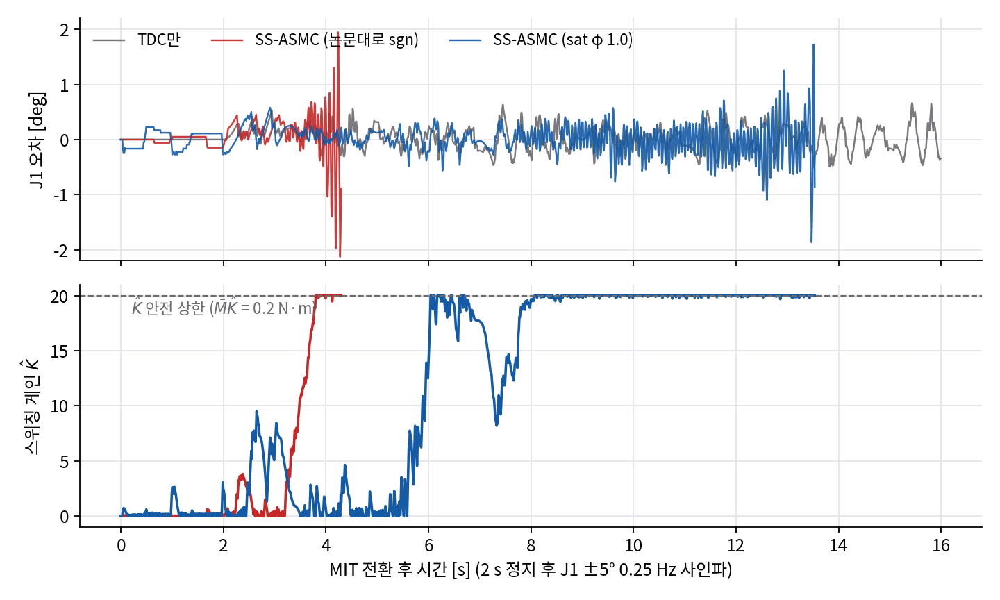

# E5 — SS-ASMC 실기 첫 적용

2026-10-20 16시 · 베이스 고정 · 비전 없음 · `tools/mit_probe.py --tdc --asmc` · 펌웨어 S-V1.7-3, 100 Hz

**요약.** Baek & Kwon 2020(Appl. Sci. 10, 2909)의 SS-ASMC(식 12–15)를 J1 한 관절에 그대로 적용했다. 사인파 시작 직후 1–3 s는
TDC만과 같거나 조금 나았지만(오차 rms 0.10–0.14°), 이후 **스위칭 게인 K̂이 상한까지 올라가 채터링이 커지며 발산**했다
(논문대로 sgn: 4.3 s, 경계층 sat φ 1.0: 13.5 s). 원인은 적응 법칙이 "외란 때문에 커진 s"와 "자기 채터링 때문에 커진 s"를
구분하지 못하는 것 — 100 Hz 지연 루프에서는 스위칭이 s를 줄이지 못하고 키워 K̂ 증가와 채터링이 서로를 키운다.
배경: [E4](MIT_E4_LOG.md) 3단계(고정 스위칭 채터링).

## 1. 구현 (논문 대응)

| 논문 | 내용 | 구현 |
|---|---|---|
| (6) | s = ė + Ks·e | 그대로 (E4까지 코드는 Kg — Ks = Kg = 20이라 결과 영향 없음, 정정) |
| (9) | TDC: τ = τ(t−L) − M̄q̈(t−L) + M̄(q̈_d + (Ks+Kg)ė + Ks·Kg·e) | E4와 동일 |
| (12) | + M̄·K̂·sgn(s) | 그대로, `--sw-phi > 0`이면 sat(s/φ) (논문에 없음) |
| (13) parent | K̂̇ = δ·η̂·\|s\|·χ (K̂ > 0, s ≠ 0), 아니면 δ·η̂·\|s\|, χ = sgn(\|s\| − ε̄) | 그대로, 오일러 적분, K̂ ≥ 0 |
| (14) child | η̂̇: 상한이면 −γ\|s\|, 하한이면 +γ\|s\|, 사이면 −γ\|s\|^a·χ, \|K̂̇\| = μ̄이면 0 | 그대로, K̂̇는 ±μ̄로 포화 |
| — | K̂ 안전 상한 20 (M̄K̂ = 0.2 N·m) | 논문에 없음, 실기 안전용 |

파라미터: 논문 시뮬레이션(2링크, δ 7·22, γ 5×10⁴, μ̄ 10⁴, K̂ 수천 → 스위칭 수십 N·m)은 우리 마찰(약 0.2 N·m) 규모에 맞지 않아
δ 1, ε̄ 0.15 rad/s(TDC만일 때 s의 보통 크기), γ 2×10⁴, a 1.5, η̂ ∈ [100, 2000](하한에서 시작), μ̄ 200, K̂ 0에서 시작.
가짜 팔(정지 0.25·운동 0.15 N·m 마찰 추가, `--fake-friction`)에서는 오차 0.066 → 0.056°, K̂ 평균 0.6으로 정상 — 단 가짜 팔에는 루프 지연이 없다.

## 2. 실기 결과 (J1, M̄ 0.01, 2 s 정지 후 ±5° 0.25 Hz 사인파)

| 시각 | 조건 | 결과 |
|---|---|---|
| 15:20 | TDC만 (E4 기준) | 16 s 완주, 사인 구간 오차 rms 0.22°, 속도 오차 rms 0.13 rad/s |
| 15:27 | 고정 스위칭 K 20, φ 1.0 (E4) | 완주, 오차 0.21°, 속도 오차 0.23 rad/s, 15–16 Hz 떨림 |
| 16:09 | SS-ASMC, 논문대로 sgn | 2–3 s 오차 0.13–0.14°(TDC만과 같음) → 3 s부터 K̂ 증가, 3.8 s 상한 → ±0.2 N·m 채터링 발산, 4.3 s 중단 |
| 16:13 | SS-ASMC, sat φ 1.0 | 3–5 s 오차 rms **0.097°**(TDC만 0.13–0.21°) → 6 s K̂ 상한, 7–8 s 잠깐 내려왔다 8 s부터 상한 고정 → 15 Hz 떨림이 커져 13.5 s 중단 |

## 3. 해석

- **적응이 채터링을 키운다:** 스위칭 → 1–2주기 늦은 반응 → 진동 → |s| 증가 → (13)이 |s| > ε̄로 보고 K̂ 증가 → 더 큰 스위칭.
  논문의 child 법칙(14)은 s가 ε̄ 안에 머물 때 K̂을 빨리 줄이도록 설계됐는데, 채터링이 s를 ε̄ 밖으로 밀어내 이 장치가 작동하지 않는다.
- **sat는 지연시킬 뿐:** 경계층(φ 1.0)은 처음 몇 초를 개선했지만(오차 0.097°) 같은 되먹임으로 결국 상한에 갔다.
- **논문과의 차이:** 시뮬레이션은 L이 충분히 작아(논문은 100 Hz 이상 권장) 스위칭이 s를 바로 줄인다. 우리는 100 Hz + CAN 지연 +
  토크 8비트에, TDE의 τ(t−L)에 직전 스위칭 토크가 그대로 들어가 스위칭이 누적되는 효과도 있다.
- 결론: **논문 식 그대로는 이 하드웨어에서 불안정.** 더 가려면 논문 수정이 필요 — 예) 적응에 쓰는 s를 저역 통과해 채터링 성분 제외,
  K̂ 증가 조건에 채터링 판별 추가, TDE의 τ(t−L)에서 스위칭 항 분리. 연구 기여점(논문 방향)과 맞물려 박사님과 상의.

## 4. 원조 2016 TIE 법칙 (`--asmc16`)

Baek, Jin, Han, IEEE TIE 63(6), 2016 식 (11): |s| ≥ ε면 k̇ = φ|s|/α, |s| < ε면 **k̇ = −φα/|s|** (s가 0에 가까울수록 더 빨리 감소),
k̂ ≤ 0.0001이면 k̇ = φ|s|/α(논문 실험 처리). 2020 SS-ASMC(13)는 감소가 δη̂|s|라 s가 작을수록 느려져 채터링 중 K̂이 쌓였다 —
같은 저자가 2016 → 2020에서 바꾼 이 부분이 우리 루프에서 결정적. 2016 실험 조건(실제 2축 팔, 4 ms 샘플링, 모터 4.5 N·m, M̄ 0.07·0.12,
Ks·β 20)이 2020 시뮬레이션보다 우리와 가깝다. 파라미터: φ 200, α 1, K̂ ≤ 20, sgn.

16:09 로그의 s를 2016 법칙에 넣어 본 개루프 재생(ε 0.3): 3–3.5 s K̂ 평균 0.20(2020 실제 3.50), 3.5–4.3 s 5.16(17.85).

| 조건 (J1 사인파, 4 s 이후) | 길이 | 위치 rms / 최대 [°] | 각속도 rms [rad/s] | 각가속도 rms [rad/s²] | 15 Hz 진폭 | K̂ 평균 |
|---|---|---|---|---|---|---|
| TDC만 (15:20) | 16 s | 0.220 / 0.663 | 0.130 | 9.39 | 0.048 | — |
| 고정 스위칭 φ 1.0 (15:27) | 16 s | 0.208 / 0.713 | 0.234 | 18.8 | 0.138 | 20 고정 |
| SS-ASMC sat φ 1.0 (16:13) | 13.5 s 발산 | 0.289 / 1.87 | 0.380 | 29.2 | 0.177 | 15.5 |
| **ASMC-2016 sgn, ε 0.3 (16:44)** | **16 s** | **0.218 / 0.634** | **0.126** | **9.16** | **0.040** | **0.16** |
| ASMC-2016 sgn, ε 0.15 (16:47) | 16 s | 0.208 / 0.721 | 0.126 | 9.09 | 0.041 | 0.36 (K̂ > 1인 시간 13%) |

2016 법칙은 sgn으로도 끝까지 안정 — K̂ 누적 문제 해결. 다만 K̂이 평소 0 근처라 TDC만과 차이가 2–15%로 실행 간 편차 수준.
ε 0.15로 낮춰 스위칭을 더 켜도(K̂ > 1 시간 3% → 13%) 안정, 지표는 여전히 TDC만과 같은 수준.
**무부하·느린 사인파에서는 TDC만으로 충분하고 스위칭 이득이 드러나지 않는다** → 박사님 기준대로 부하·빠른 동작 조건에서 비교해야 한다.

## 5. 속도 조건 비교와 하이브리드 구조 (16:52–17:08)

박사님 기준(무부하 저속만으로는 의미 없음, 각속도·각가속도로 평가)에 따라 J1 사인파를 느림(±5°, 0.25 Hz)과 빠름(±10°, 0.5 Hz,
최고 0.55 rad/s·1.7 rad/s²)으로 비교. 빠른 조건은 안전 판정을 |q̇ − q̇_ref|로(`--speed-err`). 각속도 오차 = q̇ − d(q_ref)/dt,
각가속도 오차 = 그 차분. 고정 PD = 6축 펌웨어 MIT PD(Kp 10, Kd 0.8 — **PiPER SDK 예제값, 튜닝 안 함**).
**하이브리드**(`--hybrid`): 시험 관절도 펌웨어 PD를 유지하고 우리 루프는 τ_ff = [τ_ff + PD 추정](t−L) − M̄q̈(t−L) + M̄q̈_d만 더함.

| 제어기 | 속도 | 위치 rms / 최대 [°] | 각속도 rms [rad/s] | 각가속도 rms [rad/s²] | 15 Hz 진폭 |
|---|---|---|---|---|---|
| 고정 PD | 느림 | 0.213 / 0.460 | 0.033 | 2.19 | 0.005 |
| TDC | 느림 | 0.220 / 0.663 | 0.130 | 9.73 | 0.048 |
| TDC + ASMC-2016 | 느림 | 0.208 / 0.721 | 0.126 | 9.19 | 0.039 |
| **하이브리드** | 느림 | **0.056 / 0.200** | **0.034** | **2.49** | **0.005** |
| 고정 PD | 빠름 | 0.430 / 0.832 | 0.058 | 3.19 | 0.009 |
| TDC | 빠름 | 0.253 / 0.960 | 0.206 | 15.95 | 0.138 |
| TDC + ASMC-2016 | 빠름 | 0.240 / 0.741 | 0.251 | 19.84 | 0.180 |
| **하이브리드** | 빠름 | **0.113 / 0.257** | **0.040** | **2.46** | **0.008** |

- 고정 PD: 매끈하지만 빨라지면 위치 오차 두 배, 추종 지연 약 19 ms(오차를 목표 속도에 회귀한 기울기).
- TDC 계열: 빨라져도 위치 오차 유지(TDE의 장점) — 대신 우리 100 Hz·8비트 루프 때문에 15 Hz 떨림, 미분 지표 4–5배.
- **하이브리드: 위치 오차 고정 PD의 약 1/4(느림·빠름 모두), 떨림은 고정 PD 수준, 추종 지연 약 0 ms.**
  드라이버 안의 빠르고 정밀한 PD가 감쇠·미세 강성을, 우리 TDE가 속도·마찰 변화 보상을 맡는 분담이 두 한계를 함께 피한다.
- 한계: 조건당 1회, 무부하, J1만, 고정 PD 게인 미튜닝, 펌웨어 PD 내부 배율 1 가정.

## 6. 하이브리드 + ASMC, 고정 PD 튜닝 시도 (17:18–17:23)

| 조건 | 위치 rms / 최대 [°] | 각속도 rms | 각가속도 rms | 비고 |
|---|---|---|---|---|
| 하이브리드 + ASMC-2016 (ε 0.08), 빠름 | 0.111 / 0.287 | 0.037 | 2.49 | K̂ 평균 0.05 — 스위칭 거의 안 켜짐 |
| 고정 PD J1 Kp 30 / Kd 1.0, 느림 | 0.128 / 0.326 | 0.041 | 2.78 | 육안으로 뚝뚝 끊김(정지마찰) |
| 고정 PD J1 Kp 60 / Kd 1.5, 느림 | — | — | — | 0.09 s부터 발진(±1.9 rad/s), 0.2 s 중단 — 위험 |

- 고정 PD는 게인을 올리면 위치 오차는 줄지만 끊김(Kp 30)·발진(Kp 60). 펌웨어 내부 게인 배율을 몰라 더 올리지 않음 → 실사용은 SDK 예제값이 최선.
- **하이브리드는 SDK 예제 게인 그대로 튜닝한 PD의 최선(0.128°)보다 2배 이상 좋고(0.056°) 끊김 없음** — PD 게인을 키우는 대신 TDE로 보정.
- 무부하에서는 하이브리드 위 스위칭이 필요 없음 → 스위칭(ASMC)의 역할은 부하 조건에서 확인.

## 7. 다음

- 부하 조건(그리퍼에 무게 아는 물체) × 속도 × {고정 PD, 하이브리드, 하이브리드 + ASMC}.
- J2·J3 하이브리드(중력 관절), 조건별 반복으로 편차 확인.
- 펌웨어 PD 내부 배율 확인(TDE의 PD 추정에 영향), WeGo 답변 반영.

## 데이터

`logs/mit/20261020_160936_sine.*`, `20261020_161317_sine.*`, `20261020_164459_sine.*`, `20261020_164734_sine.*`, `20261020_1652*–1723*_sine.*`(git 제외). `.tdc.csv`에 K̂(`K`), η̂(`eta`) 열 추가.
