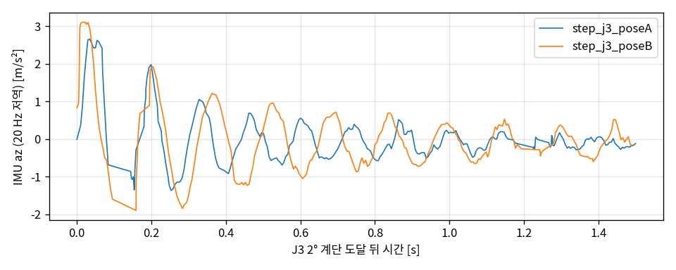
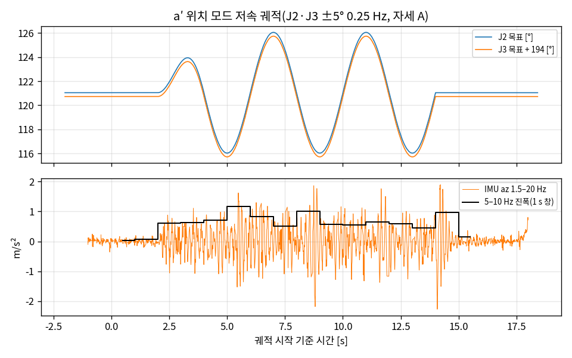

# VIB_E1 — D0 진단: 저속 떨림은 6–7 Hz 구조 모드, 15 Hz는 별개의 루프 떨림

2026-10-23 14:25–16:23 · 베이스 고정 · 무부하 · 펌웨어 S-V1.7-3, piper_sdk 0.6.2 · 도구 커밋: 이 LOG와 같은 커밋
명령: `tools/vib_probe.py --stage tap|step|slow|goto --imu --go` (툭은 사용자가 직접, 2차 툭은 `--speed-limit 1.0`), b `tools/mit_probe.py --stage hold --hold 15 --tdc --hybrid --joint 1 --mbar 0.01 --dev-limit 6 --speed-consec 10 --beep 5 --imu --go`, c `tools/mit_probe.py --stage sine --tdc --sw-k 20 --sw-phi 1.0 --joint 1 --mbar 0.01 --hold 2 --dev-limit 6 --speed-consec 10 --imu --go`, 분석 `tools/vib_d0_report.py logs/vib/20261023_1* --exclude poseA_x2 --img docs/img/p_vib_e1`

**요약.** 펌웨어 위치 모드에서 EE(손목 D455 IMU)에 **감쇠가 약한 수직 구조 모드**가 있다 — 자세 A(EE 0.37 m) 약 7 Hz, 팔을 10 cm 더 뻗은 자세 B(0.47 m) 약 6 Hz, ζ 0.02–0.08, 3–12주기.
**a′ 저속 궤적(J2·J3 ±5° 0.25 Hz)을 시작하는 순간 이 모드가 10–20배로 커져 움직이는 내내 이어지고**(5–10 Hz 진폭 0.03–0.07 → 0.5–1.2 m/s²), 크기가 속도에 비례하지 않는다(2.5°/s에서도 같은 수준).
이 모드는 **관절 엔코더(q̇)에는 보이지 않는다** — 관절 속도만 보는 피드백(TDC·SMC 포함)으로는 감지도 억제도 못 한다.
별개로 자세를 잡고만 있어도 30–50 Hz 서보 떨림(0.4–0.55 m/s² rms, 팔 비활성의 약 35배)이 계속된다 — **MIT 하이브리드 정지에서는 약 1/3**(0.12–0.19)이지만 7 Hz 모드 감쇠는 뚜렷이 나아지지 않음(조건 b).
**E4의 15 Hz 떨림은 J1 루프 떨림**으로 q̇와 IMU에 함께 나타나며(결맞음 0.70) 구조 모드와 별개(조건 c). MIT 시행 4회 중 3회에 0° 쪽 순간 튐(15 s에 0–3회).

## 1. 준비

- **IMU**: 젯슨 커널에 `CONFIG_HID_SENSOR_HUB`가 없어 pip 휠(V4L 백엔드)로는 D455 Motion Module이 안 보임 → librealsense v2.58.4를 **RSUSB 백엔드로 소스 빌드**(`~/librealsense_rsusb/py`, 빌드 폴더 `~/librealsense_src` 참조), udev 규칙 `99-realsense-libusb.rules` 설치. `imu_rec.py`만 이 빌드를 쓰고 pip 휠·손목캠 노드는 그대로.
- 설정 가속도 250 Hz·자이로 400 Hz, **실제 가속도 200 Hz**(장치 시각 중앙 간격 5.0 ms). **수신 데이터의 약 6.6%가 35–70 ms 빈틈**(약 0.17 s마다, 가속도·자이로 동시) — HID 수신 단계 손실로 추정, 아래 주파수 흩어짐의 한 원인.
- IMU 축은 카메라 좌표계(카메라가 수직에서 약 38° 기울어짐 — 정지 중력 [−0.14, −6.06, −7.76] m/s²). 축 이름보다 주파수로 모드를 구분.
- 피드백 관절·고속 모두 **200 Hz 확인**. 위치 모드 속도 10%, JointCtrl 100 Hz, 기록 200 Hz.
- 자세 A `[-0.3, 121.1, -73.2, 1.6, 52.0, 13.7]°`(traj_test line 끝, E3–E5 시작 자세), 자세 B `[0, 125, -100, 0, 50, 13.7]°`(FK로 EE 0.47 m 앞·0.18 m 높이, 그리퍼 아래 향함, `--stage goto` 5°/s로 이동).

## 2. 시행

| 시각 | 자세 | 조건 | 결과 |
|---|---|---|---|
| 14:27–14:29 | A | 툭 x·y·z (가볍게) | 정상, 최대 3.2–4.9 m/s² |
| 14:39–14:40 | A | 계단 J1·J2·J3 2° | 정상, 도달 185–327 ms |
| 14:42 | A | **a′ J1 사인파** ±5° 0.25 Hz | 정상, 추종 오차 최대 0.37° |
| 14:43 | A | **a′ J2·J3 사인파** ±5° 0.25 Hz | 정상, 추종 오차 최대 0.37° |
| 14:48 | A→B | goto 5°/s, 8.4 s | 정상 |
| 14:50–14:55 | B | 툭 x·y·z, 다시 x2·y2·z2 (세게) | 정상, 최대 2.6–6.3 m/s², 이탈 최대 0.83° |
| 14:57–14:58 | B | 계단 J1·J2·J3 2° | 정상 |
| 14:59 | B→A | goto | 정상 |
| 15:00–15:03 | A | 툭 x2(밀어 버림 — 분석 제외)·x3·y2·z2 | 정상, x3 최대 17.8 m/s², 이탈 최대 1.46° |

| 15:12 | A | **b** MIT 하이브리드 정지 + 툭(x, 늦게 침) | MIT 순간 튐 2회(1.9·11.2 s, J3·J5 0° 쪽)와 툭(8.2 s)이 겹쳐 모드 분석 불가 |
| 15:25 | A | 위고 요청 영상: MIT 펌웨어 PD 정지 30 s(손대지 않음) | 튐 4회 모두 0° 쪽(J2 −0.76°, J6 −0.66°, J6 −0.78°, J5 −2.42°) — 6절 |
| 16:19 | A | **b** 다시, 툭 z | 튐 0회, 툭 6.6 s 3.7 m/s² |
| 16:22 | A | **c** J1 TDC + 고정 스위칭 K 20 φ 1.0, ±5° 0.25 Hz | 완주, J1 오차 rms 0.22°, 튐 2회(7.1 s J3, 9.2 s J5 3.6 rad/s) |

위치 모드(vib_probe) 비상 정지 0회 — 모든 시행이 끝난 뒤 위치 모드로 자세 유지. MIT(mit_probe)는 설계대로 매 시행 끝에 비상 정지.

## 3. 판정표 (IMU az, 20 Hz 저역, 가진 뒤 1.5 s, 극대 간격 주파수)

| 시행 | 가진 | 주파수 [Hz] | ζ | 주기 수 | 첫 진폭 [m/s²] |
|---|---|---|---|---|---|
| A 툭 x | 4.9 m/s² | 6.73 | 0.080 | 3 | 2.03 |
| A 툭 z | 3.2 | 8.24 | 0.016 | 12 | 0.48 |
| A 툭 x3 | 17.8 | 6.56 | 0.072 | 4 | 5.12 |
| A 툭 y2 | 8.2 | 6.37 | 0.033 | 7 | 0.83 |
| A 계단 J1 올림/내림 | | 8.38 / 7.34 | 0.013 / 0.018 | 11 / 8 | 0.45 / 0.68 |
| A 계단 J2 내림 | | 6.50 | 0.117 | 3 | 2.95 |
| A 계단 J3 올림/내림 | | 7.07 / 7.31 | 0.067 / 0.059 | 5 / 5 | 2.66 / 1.86 |
| B 툭 x / x2 | 3.6 / 6.3 | 5.25 / 6.23 | 0.083 / 0.033 | 3 / 7 | 0.91 / 1.39 |
| B 툭 y / y2 | 3.4 / 2.6 | 6.32 / 5.71 | 0.017 / 0.019 | 9 / 8 | 0.72 / 0.60 |
| B 툭 z / z2 | 4.7 / 4.7 | 5.74 / 5.76 | 0.081 / 0.077 | 3 / 4 | 2.77 / 2.58 |
| B 계단 J1 올림/내림 | | 5.62 / 6.20 | 0.025 / 0.030 | 8 / 3 | 0.89 / 0.88 |
| B 계단 J2 올림/내림 | | 6.29 / 6.07 | 0.032 / 0.024 | 8 / 9 | 3.19 / 2.05 |
| B 계단 J3 올림/내림 | | 6.12 / 5.81 | 0.049 / 0.076 | 6 / 4 | 3.11 / 4.98 |

(A 툭 y·z2, A 계단 J2 올림은 극대 3개 미만이라 제외.) 1.5 s FFT 피크(0.67 Hz 칸)로는 계단 뒤 A 7.3–7.5 Hz, B 6.0–6.3 Hz로 더 좁게 모인다.

- **자세 A 약 7 Hz(6.4–8.4), 자세 B 약 6 Hz(5.3–6.3)** — 뻗으면 내려감(관성 증가와 맞음). B에서 진폭이 더 크고(계단 뒤 최대 0.8 m/s², FFT 진폭) 감쇠도 약함.
- 같은 자세에서 툭과 명령(계단)이 같은 모드를 흔든다. 자세 A는 약한 가진 8.2–8.4 Hz, 강한 가진 6.5–7.1 Hz — 진폭 의존(백래시 같은 연화) **가능성**, B에는 이 경향 없음, 시행 수 적음.
- 부수 모드: **수평 9.4–9.6 Hz**(B 툭 y2에서 ζ 0.015, 15주기, 진폭은 0.08로 작음), **2.7–3.6 Hz**(옆으로 친 툭·J1 계단에서만, J1 위치 서보 응답으로 추정).
- q̇에는 이 모드들이 일관되게 나타나지 않음(J5 q̇의 한 샘플 튐 ±0.15 rad/s가 지배). IMU–q̇ 위상·지연은 q̇가 모드를 보지 못해 **의미 있는 값이 안 나옴**.

## 4. a′ — 저속 궤적의 떨림

IMU z 5–10 Hz 진폭(1 s 창, J2·J3 동시, 자세 A):

| 구간[s] | 0–2 | 2–3 | 3–4 | 4–14 | 14–15 | 15–16 |
|---|---|---|---|---|---|---|
| 목표 속도 [°/s] | 0 | 2.5 | 3.3 | 5.0 | 0 | 0 |
| 진폭 [m/s²] | 0.03–0.07 | **0.61** | **0.63** | **0.46–1.17** | 0.96 (멈춘 뒤 울림) | 0.16 |

대역 rms [m/s²]:

| | az 2–20 Hz | ay 2–20 Hz | az 30–50 Hz | ay 30–50 Hz |
|---|---|---|---|---|
| J2·J3 정지(앞) | 0.085 | 0.054 | 0.208 | 0.285 |
| **J2·J3 궤적** | **0.759** | **0.309** | 0.467 | 0.553 |
| J2·J3 정지(뒤) | 0.135 | 0.059 | 0.186 | 0.244 |
| J1 궤적 | 0.104 | 0.072 | 0.243 | 0.318 |

- 수직 모드를 흔드는 J2·J3 궤적에서만 2–20 Hz가 9배(피크 6.4–6.9 Hz). **속도 2.5°/s에서 이미 최대 속도 때와 같은 크기** — 궤적 자체(0.25 Hz 매끈한 사인)의 가감속이 아니라 움직이는 동안 들어오는 외란(마찰 stick-slip·서보)이 계속 모드를 때리는 모양. J2 q̇에도 같은 구간 5.7 Hz 리플.
- 30–50 Hz 서보 떨림도 움직이는 동안 약 2배.
- J1(수평) 궤적은 수직 모드를 거의 안 흔듦.

## 5. 정지 중 서보 떨림

| 상태 | IMU 가속도 rms (축별, 1.5 Hz 고역) | 주 피크 |
|---|---|---|
| 팔 비활성 | 0.011–0.015 m/s² | — |
| 위치 모드 자세 유지, A | 0.39–0.53 | 37–46 Hz, 일부 97 Hz |
| 위치 모드 자세 유지, B | 0.28–0.60 | 비슷 |

## 6. 조건 b — MIT 하이브리드 정지 (16:19, 툭 z)

| 자세 A | 위치 모드 | MIT 하이브리드 |
|---|---|---|
| 정지 떨림 (축별 rms, 1.5 Hz 고역) | 0.39–0.53 m/s² | **0.12–0.19** (15:12 시행 튐 없는 구간도 같은 수준) |
| 툭 뒤 모드 (IMU, 20 Hz 저역) | 7–8 Hz, ζ 0.02–0.08, 3–12주기 | 6.7–6.9 Hz, ζ 0.07–0.11, 3–4주기 (az는 극대 1개) |
| 0.3 m/s² 아래로 복귀 (비슷한 세기의 툭) | 520–780 ms | 670 ms |
| 툭 뒤 관절 이탈 | J5 최대 1.46°(강한 툭) | J2 최대 1.33° |

- 30–50 Hz 서보 떨림은 MIT 하이브리드가 약 1/3 — E5 "하이브리드는 고정 PD 수준으로 매끈"을 IMU로 확인.
- 7 Hz 모드 감쇠는 시행 1회로는 차이가 불분명(복귀 시간 비슷). 펌웨어 PD도 우리 TDE도 관절 쪽만 보므로 예상과 맞음.

## 7. 조건 c — E4 떨림 설정 재현 (16:22)

| IMU (튐 없는 4.2–6.8 s, 10.5–15.8 s) | 위치 모드 정지 | 조건 c |
|---|---|---|
| 13–18 Hz | 0.02–0.06 m/s² | **ax 0.57–0.74** |
| 5–10 Hz | 0.02–0.04 | ax 0.40–0.51, az 0.14–0.22 |
| 30–50 Hz | 0.11–0.22 | 0.63–1.02 |

- J1 속도 오차 피크 **15.0 Hz**(E4 재현). 같은 구간 IMU ax와 15 Hz 부근 결맞음 **0.70** → 관절 루프에서 생긴 떨림이 EE까지 전달.
- 수직 구조 모드(az 5–10 Hz)는 a′ J2·J3(0.76)보다 훨씬 작음 — 15 Hz 루프 떨림과 6–7 Hz 구조 모드는 **별개**. 위치 모드·하이브리드에서는 15 Hz 없음.
- ax 3 Hz 피크(J1 수평 회전 응답, a·B 툭 y에서 본 2.7–3.6 Hz와 같은 대역).

## 8. MIT 순간 튐과 위고 회신

- 오늘 MIT 시행 4회 중 3회에서 0° 쪽 튐: 15:12(15 s에 2회 + 툭), 15:25(30 s에 4회), 16:19(0회), 16:22(16 s에 2회). 관절은 J2·J3·J5·J6, 크기 0.7–2.4°.
- 위고(10-21 답변) 요청대로 15:25 시행 영상(휴대폰 60 fps, 영상 0 s = 15:25:04.97, 튐 2건으로 맞춤) + 터미널·시계 화면 녹화 + CSV·CAN 원본을 10-23 회신. 첨부 코드(S-V1.7-3 토크 계수 적용 방식) 재요청. 펌웨어 V1.8.3(토크 계수 수정·MIT 개선, V1 하드웨어는 전원 투입 전 영점 필수)은 위고 분석 뒤 결정으로 보류.

## 판단 필요 (데스크톱)

1. **D0 판정 — 구조 모드인가: 예.** 툭·계단·저속 궤적 모두 같은 6–7 Hz 모드, 자세에 따라 이동. 단 **a′에서 이 모드를 흔드는 건 궤적 모양이 아니라 움직이는 동안의 외란**이다.
2. 논문 A/B에 대한 젯슨 의견:
   - **A(input shaping)**: 궤적이 이미 매끈해서(0.25 Hz) 궤적 쪽 가진은 작다 → a′ 떨림에는 효과가 작을 것. 계단·빠른 동작·베이스 cmd_vel 가감속처럼 **명령이 모드를 직접 흔드는 경우**에만 의미. 모드가 자세에 따라 6–7 Hz로 바뀌니 고정 shaper는 어긋남.
   - **B(외란 관측·능동 감쇠)**: a′ 구조(움직이는 동안의 외란 → 구조 모드)에 맞음. 단 **모드가 q̇에 안 보이므로 TDE(q̇ 기반)로는 못 잡고, IMU를 써야 한다** — 8절 "B + IMU" 방향의 직접 근거. 홀바디 때 베이스 외란도 같은 IMU로 관측 가능.
3. IMU를 피드백에 쓰려면 **6.6% 빈틈(35–70 ms)과 실제 200 Hz**가 문제 — 모드 주기 약 150 ms에 비해 빈틈이 크다. 원인 조사(USB·HID 폴링) 필요 여부.
4. 진폭 의존(약한 가진 8 Hz, 강한 가진 6.5 Hz) 가능성을 더 볼지.
5. **토크 층 선택**: MIT 하이브리드가 서보 떨림 1/3이라 진동억제 블록의 기반으로 유리하지만, 순간 튐(15 s에 0–3회, 최대 2.4°)이 외란 실험(D3)을 오염시킨다. 위고 답·펌웨어 업그레이드 전까지 D3를 위치 모드 위에서 할지, MIT 위에서 튐 구간을 걸러 낼지.

## 다음

- D0 완료 → 8절 논문 확정·구현 지시 대기. 그동안 D1(mit_probe 제어기 분리, 동작 변경 없음) 진행 가능.
- IMU 빈틈(6.6%) 원인 확인 — IMU를 피드백에 쓸 경우 선행 과제.
- 위고 답변 오면 이 LOG에 추가.
