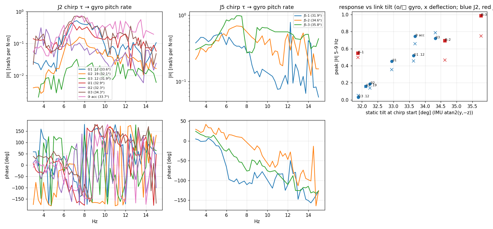

# VIB_E3 — 실기 처프 식별(J2·J5)·M̄별 툭·장착 roll: 6–7 Hz 모드 응답이 회마다 켜졌다 꺼짐, 링크 정지 기울기가 가름

2026-10-26 09:37–11:07 · 베이스 고정 · 자세 A `[-0.3, 121.1, -73.2, 1.6, 52.0, 13.7]°` · 펌웨어 S-V1.7-3, piper_sdk 0.6.2 · 기준 커밋 a7b9655, 도구는 이 LOG와 같은 커밋
명령(실기는 사용자가 실행): VIB_E2 6-1절 그대로 — `mit_probe.py --stage hold --hold 24 --chirp-joint 2|5 --chirp-amp 0.12 [--tdc --hybrid --joint 2 --mbar 0.01 --dist-mode torque|accel] --dev-limit 6 --speed-consec 10 --imu --go`, 툭 `--stage hold --hold 15 --tdc --hybrid --joint 2 --mbar 0.002|0.005|0.01 --beep 5`, roll `vib_probe.py --stage goto --target … --vmax 5 --tail 5 --imu`
분석: `source install/setup.bash; python3 tools/vib_chirp_frf.py logs/mit/20261026_{093715,094301,094839,095741,100022,100218,100624,100952,101141,101338}_hold.csv --out docs/img/p_vib_e3_chirp.png`

**요약.** 실제로 보낸 τ를 입력으로 한 처프 식별에서 6–7 Hz 피치 모드는 **6.75–7.5 Hz**에 있고 엔코더에는 거의 안 보인다(J2 처프 시 자이로의 1/5–1/13). 그런데 J2 응답 크기가 **회마다 켜졌다 꺼진다** — 피크 |H| 0.03–0.75 rad/s/N·m, 같은 진폭·같은 경로에서도 15배 차이. CAN 프레임 해독으로 명령은 매번 똑같이 나간 것을 확인했고, 운전점(τ_ff·관절 오차)·서보 떨림과는 상관없었다. 대신 **처프 시작 때 IMU로 본 링크 정지 기울기**(엔코더는 같은데 회마다 31.9–35.8°)와 순위상관 **J2 0.96(7회)·J5 1.00(3회)** — 링크가 백래시·처짐 안 어디에 걸려 있느냐가 모드 응답을 정한다. J5 처프는 3회 모두 응답이 살아 있고(0.55–0.99) J5 엔코더도 처프를 따라 움직여(J2의 10–50배), J2보다 이 모드에 잘 듣는다.

## 1. 시행

| 시각 | 조건 | 결과 |
|---|---|---|
| 09:37 | J2 ① τ_ff 직접 ±0.12 | 정상, 이탈 최대 J5 2.9°, 튐 10 · 피크 7.25 Hz **0.52** ∠−75°, 기울기 33.6° |
| 09:43 | J2 ① ±0.19 | 정상, 이탈 J5 2.75°, 튐 9 · 피크 7.5 Hz **0.16**, 32.1° |
| 09:48 | J2 ① ±0.12 | 정상, 이탈 J6 1.39°, 튐 6 · 응답 없음(**0.03**, 잡음 수준), 31.9° |
| 09:57 | J2 ② 하이브리드 TDE M̄ 0.01 + 처프 torque | 정상, 이탈 J3 1.62°, 튐 4 · 6.75 Hz **0.45** ∠−90°, 32.9° |
| 10:00 | J2 ② 같은 조건 | 정상, 이탈 J3 1.67°, 튐 4 · **0.19**(6.5 Hz), 32.3° |
| 10:02 | J2 ② 같은 조건 | 정상, 이탈 J5 2.54°, 튐 1 · 7.25 Hz **0.72** ∠−42°, 34.3° |
| 10:06 | J2 ③ 하이브리드 + 처프 accel ±0.02 | 정상, 이탈 J3 1.93°, 튐 5 · 7.75 Hz 0.75 ∠−120°(실제 τ가 한 칸보다 작아 크기는 참고만), 33.7° |
| 10:09 | J5 τ_ff 직접 ±0.12 | 정상, 이탈 J5 2.58°, 튐 8 · 5.5 Hz **0.55**(넓음), 31.9° |
| 10:11 | J5 같은 조건 | 정상, 이탈 J5 2.57°, 튐 13 · 7.0 Hz **0.69** ∠+11°, 34.6° |
| 10:13 | J5 같은 조건 | 정상, 이탈 J5 3.32°, 튐 16 · 7.25 Hz **0.99** ∠−53°, 35.8° (사용자: "더 떨렸고 후반부는 안정" — 공진 통과 10–12 s) |
| 10:17 | J2 하이브리드 M̄ 0.002 + 툭 | 정상, 튐 0 · 툭 5.4 m/s² |
| 10:19 | M̄ 0.005 + 툭 | 정상, 튐 3 · **툭과 J2 튐 동시**(사용자: 위로 튄 순간에 침) |
| 10:21 | M̄ 0.01 + 툭 | 정상, 튐 3(툭 1.6 s 뒤 J3·J5, 3.2 s 뒤 J6) · 툭 5.0 m/s², 사용자 체감 "더 단단" |
| 11:03–11:07 | 위치 모드 goto J4 ±30°·J6 ±30°, 각 끝 5 s 정지 | 정상 |

모든 MIT 시행은 끝에 비상 정지(천천히 내려앉음) → 사용자 복구(clear_arm_fault → traj_test). 피크 |H|는 자이로 base 피치 각속도 / 실제 τ, 5–9 Hz, rad/s per N·m.

## 2. 처프 식별

**도구** `tools/vib_chirp_frf.py`(새로 만듦): 입력 = CSV `tff<J>`(보낸 τ), 처프 순간 주파수를 따라가는 lock-in(창 max(4주기, 0.3 s)) → 0.25 Hz 칸. 처음 쓴 Welch/STFT H1은 둘 다 틀렸다 — ① 순간 튐이 6–7 Hz 모드를 때려 **튐 뒤 0.5–1 s 자유진동**이 남고, 이게 처프와 위상이 안 맞아 H1을 깎음(튐 ±0.1 s만 빼던 첫 판에서 ①2가 3배 작게 나옴) ② STFT 칸 1.6 Hz는 공진에 비해 거칠다. 지금은 튐 −0.1…+1 s 창을 빼고, 엔코더 튐은 보간으로 메운다.

**보낸 τ 확인**: ① 경로 `tff2 − 평균 = chirp`(차이 std 3e-5). candump 0x15B 프레임을 해독해(τ 8비트, ±8 N·m) 처프 구간 τ std가 tff2와 같음(0.084/0.134/0.082), 약 97 Hz, 0.063 N·m 칸 5–7개 오감 — **명령은 매번 같았다**.

**경로별 실제 τ/처프** (VIB_E2 6-1 가짜 팔 예측과 비교):

| 경로 | 3 Hz | 5 Hz | 7 Hz | 10 Hz | 15 Hz | 가짜 팔 예측 |
|---|---|---|---|---|---|---|
| ① τ_ff 직접 | 1.00 | 1.00 | 1.00 | 1.00 | 1.00 | 1 |
| ② TDE + torque | 0.95–1.12 | 0.98–1.00 | 0.99–1.17 | 0.98–1.03 | 1.00–1.03 | 저주파 1/4, 중간 3.3배 |
| ③ TDE + accel | 4.9 (2 Hz 8.0) | 3.0 | 2.5 | 1.6 | 1.0 | 최대 7배 |

- ② 실기는 거의 1배 — 가짜 팔 배율은 실기에 안 맞는다(가짜 팔은 강체·지연 없음). ③은 저주파일수록 커지는 "가속도 명령" 성질이 확인됨(2 Hz 8배), τ 위상도 −60–−85° 늦다.

**응답** (피크 근처, rad/s per N·m):
- 모드 **6.75–7.5 Hz**(J5-1만 5.5 Hz 넓은 봉우리). 살아 있는 회의 피크 위상은 J2 −42–−90°(③ −120°), J5 +11–−53° — 회마다 50° 넘게 흩어짐.
- J2 처프에서 엔코더 피치 응답은 자이로의 1/5–1/13(공진 근처). J5 처프에서는 J5 엔코더가 처프를 따라 움직임(qd5 |H| 0.2–0.58, J2 처프의 qd2 0.005–0.07보다 10–50배).
- 공진 밖(3–5 Hz, 10–15 Hz)은 J2 ①에서 잡음 수준, ②·J5에서는 0.05–0.6으로 살아 있음.

**켜짐/꺼짐과 정지 기울기**: 처프 시작 1.5 s의 IMU 정지 가속도 atan2(y, −z)(카메라 좌표 피치)는 엔코더 각도가 같은데(±0.1°) 회마다 31.9–35.8°. 피크 |H|와 순위상관 J2 0.96(7회), J5 1.00(3회) — 32.3° 이하 3회는 0.03–0.19, 32.9° 이상 4회는 0.45–0.75. 확인한 비(非)원인: 보낸 τ(같음), 진폭(①1·①3 같은 0.12인데 15배), TDE 유무(②도 1/3 꺼짐), τ_ff·관절 오차·전류 평균, 30–50 Hz 서보 떨림(가장 큰 ②3이 떨림 가장 작음). 엔코더 응답도 같이 꺼지므로 IMU 문제 아님.
- 해석(추정): 같은 엔코더 각도에서 링크가 2–4° 다르게 처져 있다 = 감속기 백래시·관절 컴플라이언스 안의 위치가 복구마다 다르다. 덜 처진 쪽(기울기 작음)에서는 기어가 정지 마찰로 물려 ±0.12–0.19 N·m가 모드까지 안 전해지는 것으로 보임. 방향(어느 관절·어느 쪽 이빨)은 이 데이터로는 모름.

## 3. M̄별 J2 하이브리드 툭

| M̄ | 툭 | 툭 전 5–9 Hz rms (acc_z m/s² / gyro_y rad/s) | 툭 뒤 (acc_z, 4–12 Hz) |
|---|---|---|---|
| 0.002 | 6.18 s, 5.4 m/s² | 0.24 / 0.023 | 7.3 Hz, ζ 0.13, 4주기 |
| 0.005 | 6.22 s, 22.8 m/s² — J2 튐과 겹침 | 0.13 / 0.012 | 6.7 Hz, ζ 0.07, 5주기 |
| 0.01 | 6.59 s, 5.0 m/s² | 0.21 / 0.020 | 6.7 Hz, 8주기 거의 안 줄어듦(맞춤 실패) |

- **판정 불가.** 툭이 약해(5 m/s², E1 b 3.7과 같은 수준) 첫 진폭이 평소 떨림의 6–9배뿐이고, 1회씩이다. 정지 떨림도 M̄에 대해 일관된 경향 없음(0.13–0.24) — 적어도 "M̄을 줄이면 TDE가 모드를 크게 들뜨게 한다"는 증거는 없음. 사용자 체감(0.01이 단단)은 데이터로 아직 구분 안 됨.
- 툭 검출(가속도 최대)이 MIT 튐(최대 40 m/s²)에 끌려가 툭 시각을 사용자 신호 뒤 첫 피크로 손으로 잡았다.

## 4. 장착 roll 재맞춤

- 6절 지시 "J1·J4를 돌린 자세"에서 **J1은 수직축이라 돌려도 IMU에서 본 중력 방향이 안 바뀜** → J4·J6(손목 roll 축) ±30°로 바꿈(검증: 정정).
- 4자세 + 오늘 자세 A 2회로 (pitch, roll) 최소제곱: 29.07°, −89.21°, 잔차 1.7–3.0°. 지금 상수(30.75°, −88.25°)는 같은 데이터에서 0.3–4.7°. 바이어스까지 넣으면 pitch −4°로 발산(과적합).
- **원인: 자세 A 정지 중력 자체가 회마다 3° 다름**(2절 정지 기울기, 같은 엔코더 각도) — 정지 중력 맞춤의 정밀도가 링크 처짐에 막힘. 10-23 맞춤(최대 0.36°)은 그날의 한 처짐 상태에 맞춘 것. **상수는 바꾸지 않음.** D2-1 추정기는 회전 1–2° 오차에 둔감(피치 성분 cos 1–2° ≈ 0.9995)하므로 당장 막히는 것은 없음.

## 검증 (8절·6절 지시 확인)

- "accel 모드는 가속도 명령이라 실제 토크가 커진다"(8절 10/24) — **확인**, 실기 2 Hz 8배·7 Hz 2.5배.
- "torque 모드는 TDE가 반응해 순수 0.12가 아님(가짜 팔 1/4·3.3배)"(E2 6-1, 젯슨) — **실기에선 거의 순수**(0.95–1.17배). 가짜 팔 결론 철회.
- "J5는 토크 분해능 때문에 외부 토크 대상에서 제외"(E3–E4) — ±0.12(2칸)로도 J5 응답이 J2보다 크고 재현성 좋음. 다만 J5 처프 때 순간 튐이 늘어남(8 → 13 → 16회, 대부분 J5).
- "장착 roll을 J1·J4 자세로" — J1은 무효, J4·J6로 함. 정밀도는 링크 처짐에 막힘.

## 판단 필요 (데스크톱)

1. **τ_vib 관절**: J2(계획)는 이 모드에 대한 영향이 링크 처짐 상태에 따라 0.03–0.75로 켜졌다 꺼짐 → 고정 이득 τ_vib 효과도 그만큼 들쭉날쭉할 수 있음. J5는 0.55–0.99로 일관되고 더 큼, 대신 순간 튐 증가. D2-2를 J5로(또는 J2+J5) 바꿀지.
2. **처짐 상태를 실험 조건으로 다룰지**: 복구(clear_arm_fault → traj_test)마다 링크 기울기가 31.9–35.8°로 달라짐. D3 비교에서 조건마다 3회 할 때 이 편차가 비교군 차이보다 클 수 있음. 시행 시작 때 IMU 기울기를 기록해 공변량으로 쓰거나, 시작 전에 한 방향으로 미리 누르는 절차(예: 작은 goto로 한쪽 이빨에 붙이기)를 둘지.
3. **dist_mode**: torque는 실제 τ ≈ 명령(1배), accel은 저주파에서 커지고 위상이 60–85° 늦음 → torque 쪽이 τ_vib 경로로 단순. 동의하면 D2-2는 torque.
4. **τ_vib 부호·위상**: 살아 있는 회의 피크 위상이 회마다 50° 넘게 흩어져(J2 −42–−90°, J5 +11–−53°) 속도 되먹임의 안정 여유를 하나로 못 박기 어려움 → PPF(위상 덜 민감) 쪽 근거. 처짐 상태를 고정한 뒤 다시 잴지.
5. **M̄별 툭**: 판정 불가(약한 툭·1회). 10–20 m/s²로 세게, 값마다 2–3회 다시 할지, 우선순위를 내릴지.

## 다음

- 판단 1–2 답을 받으면 D2-2 코드(`dist_comp`에 τ_vib, `imu_stream`+`link_est` 실시간 연결) — 관절은 답대로.
- 오프라인: 처짐 상태를 시행 시작 때 자동 기록(mit_probe 정지 구간 IMU 기울기 출력), 기울기 기준으로 처프 결과 재정리. E1·E2 기존 시행도 기울기를 소급 계산해 "켜짐/꺼짐"이 그때도 있었는지.

## 5. 8절 10/26 지시 반영 (오프라인, 10-26 오후)

**변형 속도 FRF** (`vib_chirp_frf.py`에 `defl = gyro − enc` 추가, 피크 5–9 Hz, rad/s per N·m):

| 시행 | 기울기 | 자이로 피크 | 변형 피크 | 7 Hz 자이로 → 변형 |
|---|---|---|---|---|
| J2 ①1 | 33.6° | 0.52 ∠−75° | 0.46 ∠−72° (7.25 Hz) | 0.49 → 0.45 |
| J2 ①2 | 32.1° | 0.16 | 0.16 | 0.11 → 0.11 |
| J2 ①3 | 31.9° | 0.03 | 0.05 | 0.03 → 0.02 |
| J2 ②1 | 32.9° | 0.45 ∠−90° | 0.36 ∠−130° (6.5 Hz) | 0.36 → 0.35 |
| J2 ②2 | 32.3° | 0.19 | 0.14 | 0.09 → 0.11 |
| J2 ②3 | 34.3° | 0.72 ∠−42° | 0.79 ∠−127° (7.75 Hz), 7 Hz는 0.60 ∠−37° | 0.71 → 0.60 |
| J5-1 | 31.9° | 0.55 ∠−24° (5.5 Hz) | 0.50 ∠−116° (6.25 Hz) | 0.34 → 0.37 |
| J5-2 | 34.6° | 0.69 ∠+11° | 0.47 ∠+67° | 0.69 → 0.47 |
| J5-3 | 35.8° | 0.99 ∠−53° | 0.75 ∠−52° | 0.98 → 0.58 |

- 검증 "J5 |H|에 강체 회전 몫이 섞임" — **확인.** J5는 강체 몫을 빼면 공진 근처에서 25–40% 줄어듦(켜진 회 0.69 → 0.47, 0.99 → 0.75). J2는 거의 그대로(엔코더 몫이 작음). 변형 기준으로 켜진 회끼리 J2 0.46–0.79 vs J5 0.47–0.75로 **같은 수준** — 데스크톱 판단대로 "J5가 센 게 아니라 덜 꺼지는 것". J5-1(31.9°)은 변형으로도 0.50이라 J2의 같은 기울기(0.03–0.16)보다 덜 꺼짐은 유지.
- 기울기–피크 순위상관: J2 자이로 0.96 · 변형 0.96(7회), J5 자이로 1.00 · 변형 0.50(3회).
- **위상 여유는 변형 기준으로 J5가 나빠짐**: J5 변형 피크 위상 −116°·+67°·−52° → 0°/180° 축에서 64°·67°·52° 벗어남 → 여유 **23–38°**(자이로 기준 37–79°). J2 변형 −72°·−130°·−37–−127° → 여유 대략 18–53°. 회 간 흩어짐은 J2·J5 모두 50° 이상 — 처짐 고정 뒤 다시 잴 것(8절 4번 기준).
- 위상의 23 ms 지연 확인: E3 분석은 전부 IMU 장치 시각 + 최소 오프셋(`vib_d2_estimator.load_aligned`, DEV_TIME 기본 True)이고 τ는 CSV 송신 시각 — **빠져 있음**. 실시간 루프 지연은 D2-2에서 따로 잼.

**기울기 자동 기록**: `mit_probe --imu`가 끝에 정지 확인·MIT 시작 1.5 s·MIT 끝 1.5 s 기울기를, `vib_probe --imu --go`가 끝 1.5 s 기울기를 출력(`imu_frame.static_tilt`). E3 기록에 돌려 보면 MIT 시작 → 끝 변화는 −0.5–0°(24 s 동안 대체로 유지), 정지 확인(위치 모드) → MIT 시작은 −0.1–+1.4°.

**E1·E2 소급 (자세 A 시작 1.5 s)**: 10-23 위치 모드 vib_probe 12회(툭·계단·저속, 비상 정지 없이 연달아) **35.2–36.1°**로 좁게 모임 — 모두 "켜진" 쪽. 같은 날 MIT 5회(매번 비상 정지 → 복구) 32.3–35.4°로 흩어짐. → **비상 정지·복구가 처짐 상태를 흔든다**는 해석과 맞음. D2-1 추정기 검증(E1 위치 모드 기록)과 10-23 장착 맞춤은 켜진 상태 데이터.

## 6. 처짐 고정 절차 + J2 처프 3회 (10-26 11:22–11:37, 8절 10/26 2번·1번)

**진입 방향 시험** (위치 모드, 자세 A에 J2 ±3°에서 2°/s로 진입, 끝 1.5 s 기울기): J2 +3° 진입 35.95·35.95·35.93°, −3° 진입 35.97·35.98·35.97° — **방향 무관, 0.05° 안**. 위치 모드에서 처짐 상태는 안정적이고, 흔드는 것은 비상 정지·복구(5절 소급과 같은 결론). 두 방향 다 "좁고 ≥ 33°" 기준 만족 → (a) J2 +3° 진입 사용.
- 한계: 이번 6회는 이미 켜진 상태(약 36°)에서 시작했다. "복구 직후 낮은 상태 → 붙이기로 36°로 복귀"는 직접 보지 못함(복구 직후 기울기는 기록 안 함). 다만 아래 처프 3회는 비상 정지 → 복구 → 붙이기 뒤 35.0–35.8°로 모두 켜진 쪽.

**J2 처프 3회** (붙이기 → `mit_probe --tdc --hybrid --joint 2 --mbar 0.01 --chirp-joint 2 --chirp-amp 0.12 --dist-mode torque`, 경로는 D2-2 τ_vib 경로):

| 시행 | 기울기 붙이기 후 / MIT 시작 / 끝 | 튐 | 변형 피크 | 실제 τ/처프 |
|---|---|---|---|---|
| F1 11:29 | 35.95 / 36.03 / 35.98° | 13회 | 8.0 Hz **0.64** ∠−59° | 0.96–1.08 |
| F2 11:32 | 35.02 / 35.03 / 35.36° | 9회 | 7.25 Hz 0.28 ∠−16° (7.5–10 Hz는 튐 제외로 빈칸) | 1.00–1.03 |
| F3 11:35 | 35.81 / 36.09 / 35.45° | 7회 | 8.0 Hz **0.42** ∠−27° | 0.97–1.07 |

변형 |H|·위상, 공통 주파수 (rad/s per N·m):

| f [Hz] | F1 | F3 | E3 ②3 (34.3°) | E3 ②1 (32.9°) |
|---|---|---|---|---|
| 7.5 | 0.46 ∠−38° | 0.41 ∠−34° | 0.65 ∠−36° | 0.32 ∠−147° |
| 7.75 | 0.53 ∠−35° | 0.37 ∠−59° | 0.79 ∠−127° | 0.28 ∠−171° |
| 8.0 | 0.64 ∠−59° | 0.42 ∠−27° | 0.71 ∠−77° | 0.28 ∠−172° |
| 8.25 | 0.53 ∠−98° | 0.40 ∠−95° | 0.53 ∠−101° | 0.30 ∠+172° |
| 8.5 | 0.63 ∠−95° | 0.36 ∠−83° | 0.43 ∠−149° | 0.25 ∠+154° |

- **켜짐/꺼짐 해소**: 붙이기 뒤 3회 모두 응답 살아 있음 — 피크 0.28–0.64(2.3배), E3 J2 7회 0.03–0.75(25배)보다 훨씬 좁음. F2는 튐 제외로 공진 대역이 비어 피크를 과소평가했을 가능성.
- **모드가 8.0 Hz로 올라감**: 36° 상태 피크 8.0 Hz(F1·F3) vs E3 33–34° 상태 7.25–7.75 Hz — 처짐 상태가 유효 강성도 바꿈. D2-2 PPF를 쓰면 ω_f는 자세 A·36° 상태 8 Hz 기준.
- **위상 흩어짐 (8절 4번 기준)**: F1–F3 차이 7.5 Hz 4°, 7.75 Hz 24°, 8.0 Hz 32°, 8.25 Hz 3°, 8.5 Hz 12° — 평균 약 15°, 최대 32°. 기준 "20° 안 → 속도 감쇠 먼저 / 50° 이상 → PPF 먼저"의 **중간**.
- **처짐이 다르면 위상이 뒤집힌다**: E3 ②1(32.9°)은 같은 대역 위상 −147–+154°로 36° 상태(−34–−98°)와 약 110° 차이. 속도 감쇠 부호가 상태에 따라 반대가 될 수 있다 → D2-2·D3는 붙이기 절차 + 시작 기울기 확인(≥ 35°)을 전제로 해야 함.
- 피크 위상 −27–−59°: 속도 되먹임 τ_vib = −k·(변형 속도)의 위상 여유 31–63°(0° 축 기준). 실시간 루프의 IMU 수신·제어 주기 지연이 여기서 더 깎임(D2-2에서 측정).

### 검증 (8절 10/26)
- "J5 |H|에 강체 회전 몫" — 확인(5절).
- "위상 여유 J2 0–48°, J5 37–79° → J5 유리" — 자이로 기준 계산은 맞으나 변형 기준으로는 J5 23–38°(5절). 처짐 고정 뒤 J2 31–63°.
- "붙이기 절차로 기울기를 좁게 ≥ 33°에" — 확인(위치 모드 6회 0.05° 안, 처프 3회 35.0–36.1°). 진입 방향은 무관.
- "처짐 고정 뒤 J2가 일관되면 J2 유지" — 3회 모두 켜짐, 크기 2.3배 범위 → **J2 일관**으로 판단(근거 3회).

### 판단 필요 (추가)
6. **D2-2 관절 = J2**로 진행해도 되는지(위 근거로 8절 결정 순서상 J2). J5 처프(처짐 고정)는 안 함.
7. **감쇠 법칙**: 위상 흩어짐 평균 15°·최대 32°로 기준 중간. 제안 — 피크 근처(7.5–8.25 Hz) 흩어짐이 4–32°이고 처짐 상태를 고정하면 부호가 일정하므로 **속도 감쇠(τ_vib = −k·변형 속도, 작은 k)를 먼저**, PPF(ω_f 8 Hz)는 바로 다음 비교군. 반대 의견 있으면 순서만 바꾸면 됨(코드는 둘 다 `--vib-law`로).
8. 순간 튐이 처프 시행에서 늘었다(7–13회/24 s, E3 J2 처프 1–10회). 튐 ±1 s 제외로 F2처럼 공진 대역이 비면 D3 지표(툭 뒤 감쇠)도 같은 문제 — 툭 직후 1 s 안 튐이 난 회는 다시 하기로 규칙화할지.
